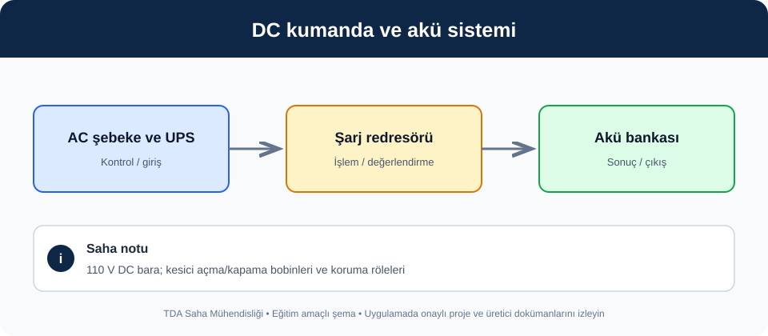

# 📍 Gün 04 — Sekonder Sistemler: DC Kumanda, Akü ve Şarj Redktörleri

## 🎯 Günün Hedefleri

-   [x] Şalt sahası sekonder sistemlerinin mimarisini kavramak.
-   [x] DC kumanda barası (110V/220V DC) ve akü-şarj sistemini anlamak.
-   [x] Kesici bobinlerinin (Trip/Close) DC besleme yapısını öğrenmek.
-   [x] Akü bankası öz deşarj testi ve redktör ripple kontrolü yapmak.

---

## 📚 Özet Çalışma Notları

### 1. Sekonder Sistem Nedir?

Primer sistem güç taşır; sekonder sistem ise bunu **kontrol eder, korur, ölçer ve izler**. TDA mühendisinin asıl oyun alanı sekonder sistemdir.

-   **DC Kumanda:** Koruma röleleri ve kesicilerin bobinleri **AC değil DC** ile beslenir — şebekede enerji kesintisi olsa bile açma/kapama emri çalışmalıdır.
-   **Akü Bankası:** Şebeke çöktüğünde en az **8 saat** (bazı projelerde 24 saat) yedekleme yapacak boyutlandırılır.
-   **Şarj Redktörü:** AC şebekeyi DC'ye çevirir, aküyü şarj eder ve yükü besler.

### 2. Tipik DC Gerilim Seviyeleri

| Gerilim | Kullanım Alanı                                                |
| :------ | :------------------------------------------------------------ |
| 24 V DC | PLC, SCADA haberleşme, elektronik kartlar                     |
| 48 V DC | Haberleşme sistemleri, telekom teknik odaları                 |
| 110 V DC | OG/YG şalt sahalarında klasik kumanda standardı              |
| 220 V DC | Büyük YG trafo merkezlerinde yüksek güçlü trip bobinleri     |

### 3. Saha Testleri ve Kontroller

-   **DC Bara İzolasyon Testi:** Bara-toprak izolasyonu Megger ile kontrol edilir.
-   **Ripple Kontrolü:** Redktör çıkışındaki dalgalanma **< %1** olmalıdır (yüksek ripple akü ömrünü kısaltır).
-   **Akü Deşarj Testi (Capacity Test):** Nominal akımda belirli sürede kapasite kaybı ölçülür (%80 altı kabul edilmez).
-   **Trip/Close Bobin Akımı:** Bobin direnci ve çekme akımı etiket değerleriyle karşılaştırılır.

---

## 🔗 Detaylı Notlar

Tüm mimari detaylar, devre şemaları ve test prosedürleri için:
👉 **[4. Gün Detaylı Teknik Notları (detail.md)](./detail.md)**
