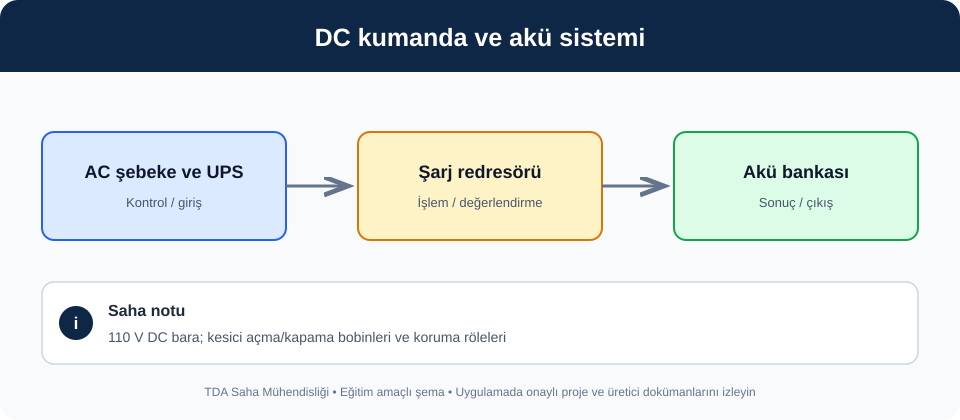

# 📖 Gün 04 — Sekonder Sistemler: DC Kumanda, Akü ve Şarj Redktörleri (Teknik Detaylar)

Bu doküman, 4. Gün çalışması kapsamında incelenen **şalt sahası sekonder mimarisi**, **DC kumanda baraları**, **akü/redktör sistemleri** ve **bobin devreleri** konularının teknik detaylarını içerir.

---

## 1. Sekonder Sistem Mimarisi

Şalt sahasında enerjinin taşınmasını sağlayan kesici, ayırıcı, bara gibi ekipmanlar **primer sistem**i oluşturur. Bu sistemleri izleyen, kontrol eden ve koruyan tüm devreler ise **sekonder sistem**dir.

### 1.1. Sekonder Sistemin Ana Grupları

1. **Ölçü Devreleri:** CT ve VT sekonderleri → gösterge, sayaç, koruma röleleri.
2. **Kumanda Devreleri:** Kesici açma/kapama, ayırıcı motor tahrikleri, interlock devreleri.
3. **Koruma Devreleri:** IED'lerden kesici trip bobinlerine giden trip devreleri.
4. **İşaret/Alarm Devreleri:** Devrede/Açık lambaları, sf6 düşük gaz, trafo sıcaklık ikazları.
5. **Haberleşme Devreleri:** SCADA, IEC 61850, RTU bağlantıları.

### 1.2. Neden DC Kumanda?

-   **Enerji Bağımsızlığı:** Şebeke arızasında AC gerilim çöker; ancak koruma rölesinin kesiciyi açması **zorunludur**. Bu yüzden trip devreleri DC ile beslenir.
-   **Arızada Güvenlik:** AC kaynağı yoksa bile akü bankası bobinleri besler.
-   **Parazit Direnci:** DC devreler endüktif parazitlerden daha az etkilenir.

---

## 2. DC Kumanda Barası ve Topraklama İzolasyonu

### 2.1. IT Topraklama Yapısı

DC kumanda sistemlerinde pozitif (+) ve negatif (-) baralar **toprağa bağlanmaz** (IT sistemi). Bir kutup toprağa değse bile devre çalışmaya devam eder; ancak **izolasyon izleme rölesi (Isolwatch)** alarm verir.

> ⚠️ **Kritik Kural:** İlk toprak teması alarm verir; **ikinci toprak teması** (diğer kutupta) kısa devre veya istenmeyen trip yaratabilir. İlk alarmda devre izole edilmelidir.

### 2.2. İzolasyon Arızası Arama Metodu

1. İzolasyon rölesi hangi kutupta kaçağın olduğunu gösterir (+ veya -).
2. DC bara üzerindeki sigortalar tek tek açılır (bölüm bölüm izolasyon).
3. Kaçağın olduğu devre bulunana kadar bölüm bölüm izole edilir.
4. Kaçağın olduğu fider içinde bobin, kontak veya kablo test edilir.

---

## 3. Akü ve Şarj Redktörü Sistemi

### 3.1. Akü Tipleri

| Tip                              | Ömrü (Yıl) | Bakım       | Kullanım                     |
| :------------------------------- | :--------- | :---------- | :--------------------------- |
| **Kurşun-Asit (Vented)**         | 10-15      | Su ekleme   | Eski tesisler, büyük sahalar |
| **VRLA (Bakımsız, AGM/Gel)**     | 5-10       | Sadece ölçüm | Modern kompakt sahalar       |
| **Ni-Cd**                        | 15-20      | Düşük       | Yüksek sıcaklık ortamları    |

### 3.2. Şarj Redktörü Parametreleri

-   **Float Voltajı:** Aküyü tam şarj tutan sabit gerilim (kurşun-asit için hücre başına ~2.25 V → 110V sistemde ~90 hücre × 2.25 = ~203 V değil, 110V sistemde 51-52 hücre × 2.25 ≈ 115 V).
-   **Boost Voltajı:** Hızlı şarj modu (hücre başına ~2.40 V), sadece bakım modunda kullanılır.
-   **Ripple:** Redktör çıkışındaki AC bileşen **< %1 RMS** olmalıdır; yüksek ripple akü iç ısınması ve ömür kısalmasına yol açar.

### 3.3. Akü Kapasite Testi (Discharge Test)

$$\text{Kapasite (\%)} = \frac{\text{Ölçülen Deşarj Süresi}}{\text{Nominal Süre}} \times 100$$

-   Test: Nominal akımda (örneğin C10/10 = 10 saatlik akımda) deşarj edilir.
-   **Kabul Kriteri:** Kapasite **≥ %80** olmalıdır; altındaki aküler değiştirilir.

---

## 4. Kesici Kumanda Devreleri

### 4.1. Trip Bobini (Açma Bobini - 52TC)

-   Koruma rölesi kontak kapanınca bobin enerjilenir ve kesici mekanizmasını serbest bırakır.
-   Bobin direnci tipik olarak **20-200 Ω** arasındadır; DC baradan ~1-5 A çeker.

### 4.2. Close Bobini (Kapama Bobini - 52CC)

-   Kapama işlemi daha fazla mekanik enerji gerektirdiği için bobin akımı trip'e göre daha yüksektir.
-   Spring-charged motor yayları doldurduktan sonra kapama izni verilir.

### 4.3. Anti-Pumping Devresi (52Y)

Kesici "kapalı" pozisyonda trip bilgisi hâlâ aktifken, operatör "close" butonuna basılı tutarsa kesici **kapama-açma-kapama** döngüsüne girer (pumping). Anti-pump rölesi bunu engeller: tek kapama denenir, trip varsa yeniden kapama yapılmaz.

---

## 5. Sekonder Testleri - Özet Tablo

| Test                          | Cihaz           | Kabul Kriteri                  |
| :---------------------------- | :-------------- | :----------------------------- |
| DC Bara İzolasyon             | Megger 500V DC  | > 10 MΩ                        |
| Ripple Analizi                | Osiloskop/DMM   | < %1 RMS                       |
| Akü Kapasite Testi            | Deşarj bataryası| ≥ %80 kapasite                 |
| Bobin Direnci                 | Mikroohmmetre   | Etiket değerine ±%10 uyum      |
| Kumanda Fonksiyon Testi       | Manuel tetikleme| Trip/Close hareketini fiziksel doğrulama |

---

## 🔗 İlgili Kaynaklar

-   _IEC 62040 — UPS ve Redktör Sistemleri_
-   _IEC 60896 — Akü Test Standartları_
-   _IEEE 1188 — VRLA Akü Bakım Rehberi_
