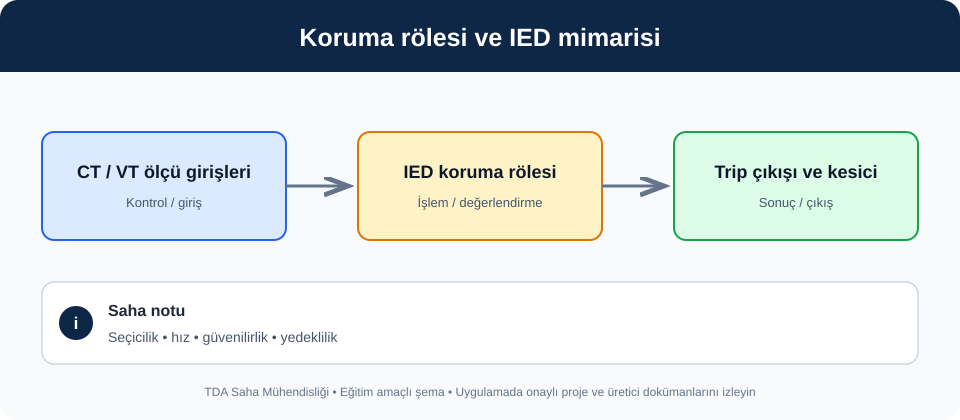

# 📍 Gün 05 — Koruma Röleleri Temelleri (IED) ve Zon Mantığı

## 🎯 Günün Hedefleri

-   [x] Koruma rölesinin (IED) iç mimarisini ve fonksiyon bloklarını kavramak.
-   [x] Koruma felsefesinin 4 temel ilkesini (seçicilik, hız, güvenilirlik, yedeklilik) öğrenmek.
-   [x] Zon (bölge) koruma mantığını ve kademe kaskadını analiz etmek.
-   [x] Numerik röle ile elektromekanik röle arasındaki farkları sıralamak.

---

## 📚 Özet Çalışma Notları

### 1. Koruma Rölesi Nedir?

Koruma rölesi, CT/VT'ten gelen bilgiyi işleyerek **arıza tespitinde kesiciye açma (trip) komutu veren** cihazdır. Modern tiplerine **IED (Intelligent Electronic Device)** denir.

-   **Eski Nesil:** Elektromekanik (indüksiyon diskli) — sadece tek fonksiyon.
-   **Statik/Analog:** Elektronik kartlar ile daha hassas.
-   **Numerik IED:** Mikroişlemcili; 20-40 koruma fonksiyonu, olay kaydı ( disturbance record ), haberleşme (IEC 61850) aynı cihazda.

### 2. Korumanın 4 Temel İlkesi

| İlke                     | Açıklama                                                            |
| :----------------------- | :------------------------------------------------------------------ |
| **Seçicilik (Selectivity)** | Sadece arızalı bölgeyi ayır; sağlıklı bölge çalışmaya devam etsin. |
| **Hız (Speed)**          | Arıza ne kadar hızlı temizlenirse ekipman hasarı o kadar az olur.   |
| **Güvenilirlik**         | Ne **güvenilmez trip** (yanlış açma) yapmalı ne de **arıza kaçırmalı**. |
| **Yedeklilik (Backup)**  | Bir röle arızalanırsa ikincil koruma devreye girmeli.               |

### 3. Zon (Bölge) Koruma Mantığı

Her koruma rölesi belirli bir **zon** ile sınırlıdır:

-   **Zon 1:** Fider — aşırı akım, mesafe Zone-1
-   **Zon 2:** Trafo — diferansiyel (87T), Buchholz
-   **Zon 3:** Bara — bara diferansiyeli (87B)
-   **Zon 4:** Jeneratör — jeneratör diferansiyeli (87G)

Ana ilke: **İç arızada aç, dış arızada bekla.**

---

## 🔗 Detaylı Notlar

IED iç yapısı, fonksiyon kodları (ANSI), CT/VT bağlantı mantığı için:
👉 **[5. Gün Detaylı Teknik Notları (detail.md)](./detail.md)**
