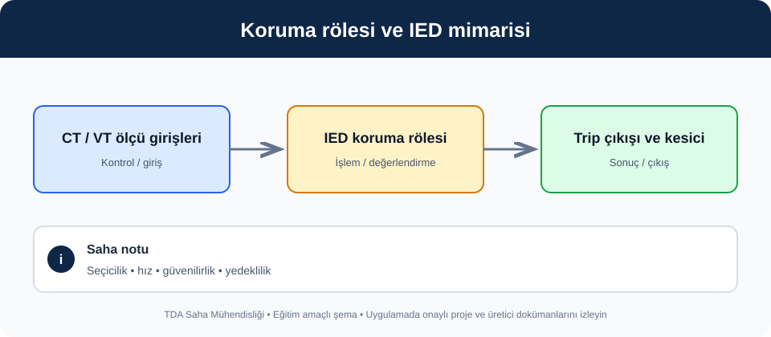

# 📖 Gün 05 — Koruma Röleleri (IED) Mimarisi ve Koruma Felsefesi (Teknik Detaylar)

Bu doküman, 5. Gün çalışması kapsamında incelenen **numerik koruma rölelerinin iç mimarisi**, **ANSI fonksiyon kodları**, **zon koruma mantığı** ve **kademe kaskadı** detaylarını içerir.

---

## 1. Numerik Koruma Rölesi (IED) İç Mimarisi

Numerik röle, giriş analog sinyallerini örnekleme algoritmasıyla (sampling) işleyip koruma kararları veren bilgisayardır.

### 1.1. Sinyal Yolu

```
CT/VT → Giriş Trafo/İzolasyon → Anti-Aliasing Filtre → A/D Çevirici
      → DSP İşlemci (koruma algoritmaları) → Trip Output Kontakları
                                          → IEC 61850 GOOSE
                                          → Olay Kaydı (Disturbance Record)
```

-   **Örnekleme Hızı:** Tipik olarak her periyotta 16-64 sample (1 kHz-3.2 kHz).
-   **Metastability:** 2-3 farklı algoritma aynı arızayı farklı yöntemle doğrularsa güvenilir trip kararı verilir.

### 1.2. Giriş/Çıkış Kartları

-   **Analog Giriş:** CT ve VT sekonderlerinden 1A/5A veya 100/110V.
-   **Dijital Giriş (DI):** Extern trip bilgisi, interlock durumları, kontak pozisyonları.
-   **Dijital Çıkış (DO):** Trip kontakları, alarm kontakları, SCADA bilgileri.
-   **Programlanabilir Mantık (PLC - Programmable Logic):** Kullanıcının kendi interlock mantığını kurmasını sağlar.

---

## 2. ANSI C37.2 Fonksiyon Kodları (En Yaygınlar)

| Kod  | Fonksiyon                              | Tipik Kullanım              |
| :--- | :------------------------------------- | :-------------------------- |
| 21   | Mesafe (Distance)                      | Hat koruma                  |
| 25   | Senkronizasyon Check                   | Jeneratör/hat bağlama       |
| 27   | Düşük Gerilim (Under Voltage)          | Motor ve şebeke koruma      |
| 46   | Negatif Sıra Akım (Unbalance)          | Motor/alternator asimetri   |
| 49   | Termal Overload                        | Trafo/motor sargı ısınma    |
| 50   | Ani Aşırı Akım (Instantaneous OC)      | Kısa devre koruma           |
| 51   | Zaman Gecikmeli Aşırı Akım (IDMT)      | Yük ve arıza koruma         |
| 59   | Yüksek Gerilim (Over Voltage)          | Şebeke koruma               |
| 63   | Basınç (Buchholz, Suraya)              | Trafo mekanik koruma        |
| 67   | Yönlü Aşırı Akım (Directional OC)      | Paralel fider/halka şebeke  |
| 79   | Otomatik Tekrar Devreye Alma (AR)      | Havai hat fiderleri         |
| 81   | Frekans (U/O + ROCOF)                  | Şebeke çökme koruma         |
| 87   | Diferansiyel (87T/87B/87G/87L)         | Ekipman içi arıza koruma    |

---

## 3. Zon Koruma ve Kademe Kaskadı

### 3.1. Ana Kural

Koruma sistemleri **"kademeli piramit"** şeklinde tasarlanır:

```
[Şebeke] ← [Bara] ← [Trafo] ← [Fider] ← [Yük]
   Z4        Z3        Z2        Z1
```

Her iç zon, dış zondan **daha hızlı** ve **daha hassas** ayarlanır. Arıza iç zonlarda anında temizlenmeli, dış zonlara taşmadan kesilmelidir.

### 3.2. Zon Ayar Mantığı Örnek (Mesafe Koruma)

-   **Zone 1:** Hattın **%80-90'ı**, ani açma (0 ms) — hata kesinlikle bu bölgededir.
-   **Zone 2:** Hattın **%120'si** (komşu hattın ucuna taşar), ~400 ms gecikme.
-   **Zone 3:** Hattın **%150+**'si (yedek koruma), ~1 s gecikme.

Bu yapı ile her noktada **birincil** + **yedek** koruma bulunur.

---

## 4. Yedeklilik Stratejileri

### 4.1. Local Backup

-   Aynı rölede **iki farklı algoritma** (örneğin mesafe + aşırı akım).
-   **Breaker Fail (50BF):** Kesici açmazsa komşu kesicileri açar.

### 4.2. Remote Backup

-   Komşu trafo merkezindeki röle arızalı bölgeye daha yavaş müdahale eder.
-   Şebeke genelinde yedekleme sağlar fakat geniş alanı kesintiye uğratır.

### 4.3. Dual Redundant IED

Kritik tesislerde (santral, büyük iletim TR) **2 adet farklı marka IED** paralel kurulur:
-   **Main-1 (Koruma-1):** A marka, A algoritma seti
-   **Main-2 (Koruma-2):** B marka, B algoritma seti

Farklı markaların kullanılmasının sebebi: **ortak yazılım hatası** (common mode failure) riskini kırmak.

---

## 5. Eleme Mantığı: Dependability vs Security

-   **Dependability (Bağlılık):** Gerçek arıza kaçmaz → Trip edebilme yeteneği.
-   **Security (Güvenlik):** Gerçek olmayan arızada trip etmeme → Yanlış açmayı önleme.

Bu iki özellik **denge** içinde ayarlanır. Trafo korumasında güvenlik (yanlış açmamak) daha önceliklidir (trafolar pahalı ve arızaları yıkıcıdır); hat korumasında hız ön plandadır.

---

## 6. Röle Ayar Hesabı Örnek (51 Fonksiyonu)

-   **Nominal Akım:** $I_n = 400\text{ A}$
-   **CT Oranı:** 400/1 A
-   **Pick-up:** $I_s = 1.2 \times 400 = 480\text{ A}$ (yük akımının %20 üstü)
-   **TMS (Time Multiplier Setting):** 0.15
-   **Karakteristik:** IEC Standart Inverse ($k = 0.14$, $\alpha = 0.02$)

$$t = \frac{k \times TMS}{\left(\frac{I}{I_s}\right)^\alpha - 1}$$

-   **Senaryo:** $I = 2400\text{ A}$ (6 × $I_s$) durumunda açma süresi:

$$t = \frac{0.14 \times 0.15}{6^{0.02} - 1} \approx 1.3\text{ s}$$

---



## 🔗 İlgili Kaynaklar

-   _IEC 60255 — Koruma Röleleri Standartları_
-   _ANSI/IEEE C37.2 — Fonksiyon Kodu Tanımları_
-   _G. Ziegler, "Numerical Distance Protection"_
