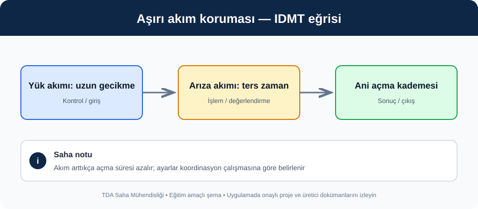

# 📍 Gün 06 — Aşırı Akım ve Toprak Koruma (50/51, 50N/51N)

## 🎯 Günün Hedefleri

-   [x] Aşırı akım korumasının faz (50/51) ve toprak (50N/51N) tiplerini ayırt etmek.
-   [x] IDMT (Inverse Definite Minimum Time) eğri karakteristiklerini kavramak.
-   [x] IEC standart eğri parametrelerini (k, α) ve TMS hesabını öğrenmek.
-   [x] Yönülü aşırı akım (67) ihtiyacını halka şebeke örneğinde analiz etmek.

---

## 📚 Özet Çalışma Notları

### 1. Aşırı Akım Korumasının 4 Alt Fonksiyonu

| Fonksiyon | ANSI | Tanım                                        | Kullanım                |
| :-------- | :--- | :------------------------------------------- | :---------------------- |
| Ani Faz   | 50   | Yüksek akımda gecikmesiz açma                | Kısa devre koruma       |
| Zamanlı Faz | 51 | IDMT eğrisi ile açma                         | Yük/aşırı yük koruma    |
| Ani Toprak | 50N | Toprak arızasında gecikmesiz açma            | Faz-toprak kısa devre   |
| Zamanlı Toprak | 51N | IDMT eğrisi ile toprak açması            | Düşük akımlı toprak arızası |

> ⚡ **Neden Ayrı Toprak Koruma?** Faz-toprak arızasında akım, üç fazlı kısa devreye göre çok daha düşüktür; faz koruması bu akımı görmeyebilir. Toprak koruması **3 CT akımının vektörel toplamı** (kalan akım $I_0 = I_a + I_b + I_c$) ile çalışır ve çok daha hassas ayarlanabilir.

### 2. IEC 60255 Standart IDMT Eğrileri

$$t = \frac{k \times TMS}{\left(\frac{I}{I_s}\right)^\alpha - 1}$$

| Eğri Tipi           | k     | α     | Kullanım                          |
| :------------------ | :---- | :---- | :-------------------------------- |
| Standard Inverse    | 0.140 | 0.02  | Genel amaçlı fider koruma         |
| Very Inverse        | 13.5  | 1.0   | Trafo ve toprak koruma            |
| Extremely Inverse   | 80    | 2.0   | Sigorta koordinasyonu, seri sigorta |
| Long Term Inverse   | 120   | 1.0   | Yedek koruma (uzun gecikme)       |

### 3. Ayar Mantığı

-   **Pick-up ($I_s$):** Yük akımının 1.1-1.3 katı; toprak korumasında tipik %20-40 $I_n$.
-   **TMS:** Üst kademe ile koordinasyon gecikmesini ayarlar; alt kademe en az **0.3 s** gradyanla üstüne ayarlanır.
-   **Ani (50):** Trafo ikincil kısa devre akımının üzerine ayarlanır; trafo inrush'ını atlatacak şekilde gecikme eklenebilir.

---

## 🔗 Detaylı Notlar

Eğri hesap örnekleri, koordinasyon çalışması ve yönülü koruma (67) detayları için:
👉 **[6. Gün Detaylı Teknik Notları (detail.md)](./detail.md)**
