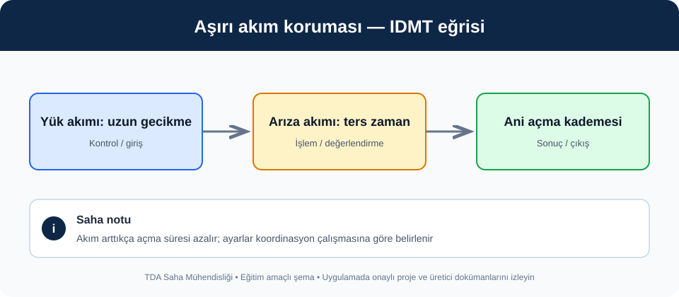

# 📖 Gün 06 — Aşırı Akım ve Toprak Koruması: IDMT Eğrileri ve Koordinasyon (Teknik Detaylar)

Bu doküman, 6. Gün çalışması kapsamında incelenen **aşırı akım fonksiyonları**, **IDMT eğri matematiği**, **kademeli koordinasyon** ve **yönülü koruma** detaylarını içerir.

---

## 1. Toprak (Earth Fault) Korumasının Fiziksel Temeli

### 1.1. Kalan Akım (Residual Current) Kavramı

Üç fazın CT sekonderleri birbirine paralel bağlanır. Dengeli yükte faz akımlarının vektörel toplamı **sıfırdır**:

$$\bar{I}_0 = \bar{I}_a + \bar{I}_b + \bar{I}_c \approx 0$$

Faz-toprak arızasında arıza akımı nötr üzerinden döner ve bu denge bozulur; $I_0$ sıfırdan ayrışır. Röle bu **kalan akımı** ölçer.

-   **Faz koruması** CT başına ayrı ayrı bakar → toprak arızasında düşük akım görmez.
-   **Toprak koruması** $I_0$ ile bakar → çok düşük akımlarda bile hassas açma yapabilir.

### 1.2. Toprak Ayar Değerleri

-   **Kompakt şalt / kablolu şebeke:** $I_{s0} = \%20-40 \times I_n$ (tipik 100-400 A birincil)
-   **Havai hat şebekesi:** Daha yüksek (geçici toprak temasları için)
-   **RB (Rezistif Nötr) sistemlerinde:** Nötr rezistansı üzerinden hesap: $I_f = \frac{U_{faz}}{R_n}$

---

## 2. IDMT Eğri Matematiği

### 2.1. IEC 60255-151 Genel Formülü

$$t = \frac{k \times TMS}{\left(\dfrac{I}{I_s}\right)^\alpha - 1} + \text{breaker time}$$

-   $k$: Eğri sabiti (eğri tipine göre)
-   $\alpha$: Eğri üssü (eğrinin dikliğini belirler)
-   $TMS$: Zaman ölçek çarpanı (0.05 - 1.5 tipik)
-   $\frac{I}{I_s}$: Kat katlama (multiple). Bu değer 1'in altında ise röle açmaz.

### 2.2. Örnek Hesap (Standard Inverse)

Verilen: $I_s = 480\text{ A}$, $TMS = 0.15$, eğri $k=0.14$, $\alpha=0.02$

| Akım (A) | Kat Katlama ($M = I/I_s$) | Açma Süresi (s)    |
| :------- | :------------------------ | :----------------- |
| 720      | 1.5                       | ~5.0               |
| 1440     | 3.0                       | ~1.8               |
| 2400     | 5.0                       | ~1.3               |
| 4800     | 10.0                      | ~0.9               |

> ⚠️ **Kritik Not:** Ekstrem İnverse eğriler yüksek katlamada çok hızlı düşer; sigorta ile koordinasyon gerektiren noktalarda tercih edilir.

### 2.3. Definite Time (DT) Alternatifi

Bazı durumlarda IDMT yerine **sabit gecikmeli** (Definite Time) koruma kullanılır: Akım pick-up'ı geçtiği anda sabit süre çalışır.

-   **Avantaj:** Koordinasyon hesabı daha basit.
-   **Kullanım:** ZS sistemlerinde, jeneratör nötr korumasında.

---

## 3. Kademeli Koordinasyon (Grading)

Şebeke birden fazla koruma noktası içerir. Amaç: **Arızanın olduğu en yakın kesici açılsın, üsttekiler yedek beklesin.**

### 3.1. Grading Gradyanı

$$\Delta t = t_{üst} - t_{alt} \geq 0.3\text{ s}$$

Bu 0.3 s şunları kapsar:
-   Kesici açma süresi (~60-100 ms)
-   Röle hata toleransı (~%5 → ~50 ms)
-   CT hata payı ve aşım (overshoot) (~50 ms)
-   Güvenlik payı (~100 ms)

### 3.2. Örnek Şebeke Koordinasyonu

```
[Bara TR] ── [Fider Kesici] ── [Dağıtım TR] ── [AG Kesici] ── [Yük]
   51: 1.4 s      51: 0.9 s         51: 0.4 s         51: 0.1 s
```

Arıza AG kesicinin altındaysa AG kesici **0.1 s**'te açar; fider kesicisi 0.8 s sonra yedek olarak açar (AG kesici başarısız olursa).

---

## 4. Yönülü Aşırı Akım (67)

### 4.1. Ne Zaman Gerekli?

Halka şebeke (ring main) veya çift beslemeli sistemlerde akım **iki yönden** gelebilir. Basit 51 koruma arızanın yönünü bilemez ve **sağlıklı bölgeyi açabilir**.

### 4.2. Çalışma Mantığı

-   Koruma, **faz açısı** karşılaştırması yapar: $I$ akımı ile $V$ gerilimi arasındaki açı.
-   **Yön karakteristiği (MTA - Maximum Torque Angle):** Tipik ±45° veya ±90° karakteristik bölge.
-   Akım **ileri (forward)** yönde ise röle izin verir, **geri (reverse)** yönde ise kilitlenir.

### 4.3. Toprak Yönülü (67N)

-   Yön referansı: $V_0$ (sıfır sıra gerilimi) veya $I_0$ karşılaştırması.
-   Kablolu şebekelerde toprak arıza yönü tespiti için kritiktir.

---

## 5. Hot/Cold Load Pickup (Sıcak/Soğuk Yük Alma)

Uzun bir kesinti sonrası kondansatör motorlar, klimalar aynı anda kalkış çektiğinde yük akımı nominalin 2-4 katına çıkabilir. Ayarlar buna toleranslı olmalıdır:

-   Pick-up yükün **1.2-1.5 katı** yapılır veya
-   Röle "cold load pickup" mantığı ile ilk 10-15 dakika yüksek ayarlı modda bekler.

---

## 6. Ayar Dosyası ve Devreye Alma

-   Ayarlar projenin **short-circuit raporu** (load flow + short circuit analizi, örneğin ETAP/DIgSILENT) ile belirlenir.
-   Ayar dosyası IED'ye yüklenmeden önce **4-göz prensibi** ile kontrol edilir (hesaplayan + kontrol eden farklı kişiler).
-   Devreye almada ayarın aktif olduğunu doğrulamak için sekonder enjeksiyon ile bir noktadan test edilir.

---



## 🔗 İlgili Kaynaklar

-   _IEC 60255-151 — Aşırı Akım Koruma Fonksiyonları_
-   _IEEE C37.112 — Inverse-Time Characteristic_
-   _Network Protection & Automation Guide (Alstom/GE)_
