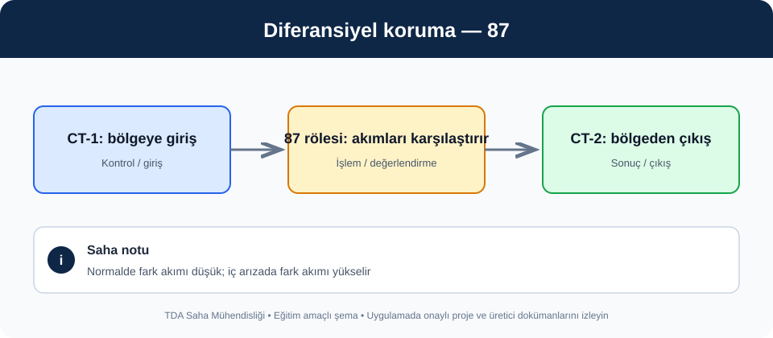

# 📍 Gün 07 — Diferansiyel Koruma (87) ve Kirchhoff İlkesi

## 🎯 Günün Hedefleri

-   [x] Kirchhoff akım yasası üzerine kurulan diferansiyel koruma mantığını kavramak.
-   [x] Yüzde (biased/percentage) diferansiyel karakteristiğini anlamak.
-   [x] Trafo diferansiyelinde vektör grup düzeltmesi ve inrush inhibisyonunu öğrenmek.
-   [x] CT bağlantı hatalarının diferansiyel korumaya etkisini analiz etmek.

---

## 📚 Özet Çalışma Notları

### 1. Temel İlke

Koruma bölgesine **giren ve çıkan akımların vektörel toplamı** normal işletmede sıfırdır. Bölge içinde arıza olursa denge bozulur:

-   **Normal / Dış Arıza:** $|\bar{I}_1 - \bar{I}_2| \approx 0$ → röle kilitli.
-   **İç Arıza:** $|\bar{I}_1 - \bar{I}_2| = I_{arıza}$ → röle trip eder.

> ⚡ **Avantajı:** Mutlak seçicilik — diferansiyel bölgesi içindeki her arıza ani olarak (15-30 ms) temizlenir; bölge dışı hiçbir olay onu etkileyemez.

### 2. Yüzdeli Diferansiyel (Percentage Bias)

CT hataları yüksek geçiş akımlarında fark akımı yaratır. Bunu önlemek için karakteristik **eğimli (bias)** yapılır:

| Bölge         | Karakteristik                                                    |
| :------------ | :--------------------------------------------------------------- |
| Düşük akım    | Sabit eşik ($I_{s0}$ — genelde %20 $I_n$)                        |
| Bias bölgesi  | Eğim %20-40 — CT hatasına orantılı fark kabul edilir             |
| Yüksek akım   | Yüksek eğim (bias-2) — doyma ve ışıklandırmaya karşı            |

### 3. Trafo Diferansiyeli (87T) — Ek Zorluklar

-   **Vektör grup düzeltmesi:** Dyn11 trafoda primer/sekonder 30° kaymıştır; röle bunu yazılımsal düzeltir.
-   **Çevrim oranı düzeltmesi:** CT oranları trafo çevrim oranını tam karşılamaz; $I_{nom}$ baz değeri ile normalize edilir.
-   **Inrush inhibisyonu:** Enerjileme anındaki 6-12× çekme akımı iç arıza gibi görünür. Röle **2. harmonik** oranını ölçerek (%15 üstü) inrush olarak algılar ve trip inhibe eder.
-   **Overexcitation inhibisyonu:** 5. harmonik yüksekliği aşırı mıknatıslanmayı gösterir.

---

## 🔗 Detaylı Notlar

Bias karakteristiği, stabilite/hassasiyet analizi ve CT bağlantı hataları için:
👉 **[7. Gün Detaylı Teknik Notları (detail.md)](./detail.md)**
