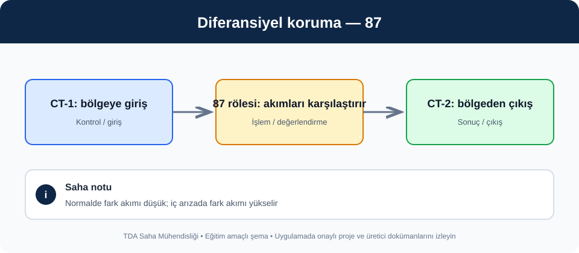

# 📖 Gün 07 — Diferansiyel Koruma: Bias Karakteristiği ve Uygulama Detayları (Teknik Detaylar)

Bu doküman, 7. Gün çalışması kapsamında incelenen **87 diferansiyel korumanın matematiği**, **bias karakteristiği**, **87T trafo uygulamaları** ve **saha hataları** konularını içerir.

---

## 1. Basit Diferansiyel Korumadan Yüzdeliye

### 1.1. Basit (Unbiased) Diferansiyel — Problemi

$$|\bar{I}_1 - \bar{I}_2| > I_s \Rightarrow \text{Trip}$$

Basit yapıda eşik sabittir. Fakat dış arıza durumunda:
-   CT'ler yüksek akımda **doymaya** başlar.
-   İki CT'nin hatası farklı olur.
-   **Spurious (sahte) fark akımı** oluşur ve röle yanlış trip eder.

### 1.2. Yüzdeli (Biased) Diferansiyel — Çözüm

$$|\bar{I}_1 - \bar{I}_2| > k \cdot \frac{|\bar{I}_1| + |\bar{I}_2|}{2}$$

Geçiş akımı büyüdükçe tolerans da büyür. Tipik **çift eğimli** karakteristik:

```
Fark akımı (Id)
   │           /
   │          /  ← Yüksek eğim (Bias-2, %50-80) — CT doyma bölgesi
   │    ____/
   │   /    ← Düşük eğim (Bias-1, %20-40)
   │  /
   │ /___ Is0 (sabit eşik %20 In)
   └──────────────────────────→ Restraint akımı (Ir)
```

**Tipik Ayarlar (Trafo):**
-   $I_{s0} = 0.2 \times I_{nom}$
-   Bias-1 eğimi = %30 (dikey alan %0-2.0 × $I_{nom}$ arası)
-   Bias-2 eğimi = %80 (yüksek akım bölgesi)
-   Ani yüksek set (UNC - Unrestrained) = 8-12 × $I_{nom}$ (ağır iç arıza için bias'ı atlar)

---

## 2. Trafo Diferansiyeli (87T) — Yazılımsal Düzeltmeler

Trafo, diferansiyel koruma için özel dikkat gerektirir. Primer ve sekonder tarafındaki akımlar:

1.  **Farklı genlikte** (çevrim oranı kadar)
2.  **Farklı fazda** (vektör grup kadar, örn. Dyn11'de 30°/±330°)
3.  **Farklı CT oranlarında** ölçülür.

### 2.1. Faz Düzeltmesi

**Dyn11** trafoda sekonder primerden **-330°** (yani +30° geri) kaymıştır. Röle bunu iki şekilde düzeltir:

-   **Klasik yöntem:** Primer tarafında Y-D yazılımsal dönüşümü ile farkı sıfırlar.
-   **Modern yöntem (vektör grubu bilgisi ile):** Röleye `Dyn11` girilir; röle faz vektörlerini otomatik döndürür.

### 2.2. Genlik Düzeltmesi

Her iki taraf için **nominal güç üzerinden** baz akım hesaplanır:

$$I_{baz,primer} = \frac{S_{nom}}{\sqrt{3} \times U_{primer}}, \quad I_{baz,sekonder} = \frac{S_{nom}}{\sqrt{3} \times U_{sekonder}}$$

Ölçülen akımlar baz akımına oranlanarak **per-unit** değerlerle karşılaştırılır.

### 2.3. CT Yıldız Noktası Bağlantısı

-   Trafo **YNd** ise primer CT'leri yıldız, sekonder CT'leri de yıldız bağlanır ve röle yazılımsal Delta dönüşümü yapar.
-   Bağlantı yanlış yapılırsa (örn. delta-bağlı CT primerde) röle **dış arızada trip eder** — saha en sık hatası budur.

---

## 3. Inrush (Çekme Akımı) Fenomeni ve İhibisyon

### 3.1. Neden İnış Yaratır?

Trafo çekirdeği **histerezis** nedeniyle residual flux (kalıcı mıknatıslanma) taşır. Gerilim sıfır geçişinde enerjilenirse çekirdek **2× nominali aşan** manyetik akıma zorlanır ve **doyma** başlar. Bunun sonucu:

-   Tek yönlü yüksek akım pikleri (8-12 × $I_{nom}$ ilk pik)
-   Zamanla azalan (0.1 - 1 s) decay
-   **Yüksek 2. harmonik** bileşen

### 3.2. İhibisyon Yöntemleri

| Yöntem                          | İlke                                                  |
| :------------------------------ | :---------------------------------------------------- |
| **2. Harmonik İnhibit**         | $I_2/I_1 > \%12-15 \Rightarrow$ trip inhibe edilir   |
| **Dalga şekli analizi**         | Pikler arası boşluk (gap detection) analizi           |
| **Ani fark (gap-crossing)**     | Differential'i yüksek ama semetrik olmayan dalga tanıma |

> ⚠️ **Denge:** İnhibisyon hassas ayarlanmalıdır; **iç arıza** esnasında da CVT/CT geçişinde 2. harmonik görülebilir ve röle gecikebilir. Modern röleler "inrush + iç arıza birlikte" durumunu **harmonik OR/AND mantığı** ile çözer.

---

## 4. Diğer Diferansiyel Uygulamalar

| Fonksiyon | Uygulama                          | Not                                            |
| :-------- | :-------------------------------- | :--------------------------------------------- |
| 87G       | Jeneratör stator diferansiyeli    | CT'ler nötr ve çıkış ucunda                    |
| 87B       | Bara diferansiyeli                | Tüm bağlantılı CT'ler toplanır                 |
| 87L       | Hat diferansiyeli                 | İki uçtan fiber haberleşme gerektirir          |
| 87M       | Motor diferansiyeli               | büyük motorlarda, 6 uçlu sargılarda            |
| REF (87N) | Sınırlı toprak diferansiyeli      | Trafo yıldız noktası civarı yüksek hassasiyet  |

### 4.1. REF (Restricted Earth Fault) — Kritik Detay

Yıldız bağlı sargının toprak arızaları, sargının **nötre yakın** kısmında düşük akım üretir. REF koruması **yalnızca nötr CT'si ile yıldız noktası CT'si arasındaki bölgeye** bakar ve **%5-10 $I_{nom}$** gibi çok hassas ayar yapabilir.

---

## 5. Saha Testleri ve Hata Arama

### 5.1. Devreye Alma Testleri

1.  **CT devre süreklilik ve izolasyon** kontrolü.
2.  **CT polarite testi** — yanlışsa stabilite bozulur.
3.  **Primer Enjeksiyon (Primary Injection):** Primer tarafa test akımı verilip iki tarafın CT sekonderlerinde doğru akım yönü ve oranı doğrulanır.
4.  **Stabilite Testi (Through Fault):** Dışarıdan akım verilir, rölenin trip etmemesi beklenir.
5.  **Hassasiyet Testi (Internal Fault Simülasyon):** Röle girişlerinden fark akımı verilir, trip süresi ölçülür.

### 5.2. Saha Arıza Tablosu

| Belirti                                    | Muhtemel Sebep                                |
| :----------------------------------------- | :-------------------------------------------- |
| Dış arızada sürekli trip                   | CT polarite hatası veya bağlantı grubu hatası |
| Enerjilemede trip                          | Inrush inhibit ayarı düşük veya harmonik filtre kapalı |
| Yükte küçük fark akımı alarmı              | CT oran yazılımı veya vektör grubu parametresi hatalı |
| İç arızada gecikmeli trip                  | Bias eğimi çok dik veya $I_{s0}$ çok yüksek   |

---



## 🔗 İlgili Kaynaklar

-   _IEC 60255-1x — Diferansiyel Koruma_
-   _IEEE C37.91 — Trafo Koruma Rehberi_
-   _Alstom NPAG — Chapter 15: Transformer and Transformer-Feeder Protection_
