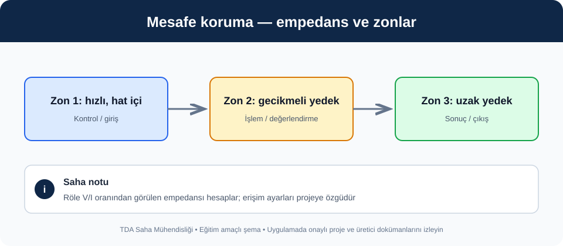

# 📍 Gün 08 — Mesafe Koruması (21) ve Hat Koruma

## 🎯 Günün Hedefleri

-   [x] Mesafe korumasının impedance ölçüm mantığını kavramak.
-   [x] Zone 1-2-3 ayar mantığını ve gecikme kaskadını öğrenmek.
-   [x] Dörtgen (quadrilateral) ve Mho karakteristiklerini ayırt etmek.
-   [x] Power swing ve loss of excitation durumlarında röle davranışını analiz etmek.

---

## 📚 Özet Çalışma Notları

### 1. Temel İlke: Impedans Ölçümü

Mesafe rölesi, CT ve VT'ten gelen akım ve gerilimi oranlayarak **görülen impedansı** hesaplar:

$$Z_{görülen} = \frac{V}{I}$$

-   **Normal işletme:** Yük impedansı **büyük** → röle dışarıda.
-   **Arıza:** Impedans düşer → $Z_{görülen}$ röle karakteristik bölgesine girerse trip.

Arızanın **mesafesi**, impedance ile doğru orantılıdır: $d = \dfrac{Z_{görülen}}{Z_{km}}$.

### 2. Zon Ayar Mantığı

| Zon      | Erişim                         | Gecikme   | Amaç                    |
| :------- | :----------------------------- | :-------- | :---------------------- |
| Zone 1   | Hattın %80-90'ı                | Ani (~0ms)| Kesin iç arıza          |
| Zone 2   | Hattın %120'si + komşu ortası  | ~400 ms   | Uç arıza için yedek     |
| Zone 3   | Hattın %150+'si (ters yönlü)   | ~1000 ms  | Uzaktan yedek koruma    |

> ⚡ **Neden Zone 1 %100 değil?** Hattın tam ucundaki arıza impedance olarak komşu hattın başındaki arıza ile ayırt edilemez. Overreach yapmamak için bilerek %80-90 ile sınırlanır; kalan kısım Zone 2'nin hızına bırakılır.

### 3. Karakteristik Şekilleri

-   **Mho:** Direksiyonel daire; kısa hatlarda ve arka güç akışında tercih edilir.
-   **Quadrilateral (Dörtgen):** Dörtgen bölge; toprak arızalarında direnç bileşenini daha iyi kapsar, uzun hatlarda tercih edilir.

---

## 🔗 Detaylı Notlar

Zon hesap örnekleri, power swing blocking (78) ve teleprotection şemaları için:
👉 **[8. Gün Detaylı Teknik Notları (detail.md)](./detail.md)**
