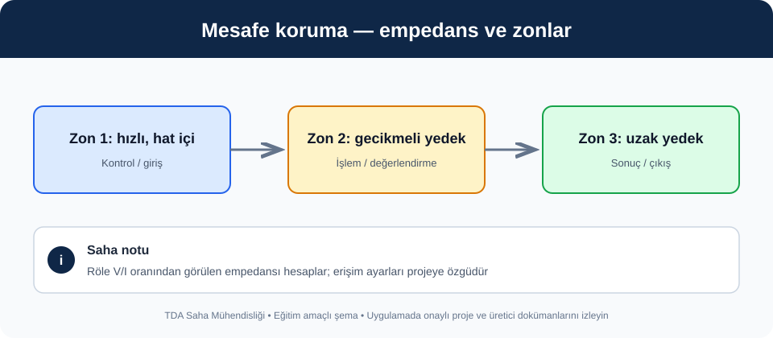

# 📖 Gün 08 — Mesafe Koruması: Impedans Ölçümü, Zonlar ve Uygulama (Teknik Detaylar)

Bu doküman, 8. Gün çalışması kapsamında incelenen **mesafe koruma matematiği**, **karakteristik şekilleri**, **teleprotection şemaları** ve **power swing** konularını içerir.

---

## 1. Impedans Ölçüm Fiziği

### 1.1. Faz Seçici Ölçüm

Arıza tipine göre farklı faz çiftleri doğru impedance verir:

| Arıza Tipi          | Kullanılan Sinyal              |
| :------------------ | :----------------------------- |
| 3 fazlı (LLL)       | $V_{faz}/I_{faz}$             |
| Faz-faz (LL)        | $V_{LL}/I_{LL}$ (faz farkı)   |
| Faz-toprak (LG)     | $(V_{faz}) / (I_{faz} + k \cdot I_0)$ |

$k$ katsayısı **toprak dönüş yolu impedansını** (earth return compensasyon) hesaba katar.

### 1.2. Hat Parametreleri

Ayarlar, hattın **pozitif ve sıfır sıra impedansları** ile hesaplanır:

-   $Z_1$ (pozitif sıra): Ω/km tipik $0.12 + j0.38$Ω/km
-   $Z_0/Z_1$ oranı: 2-3.5 arasında değişir (toprak dönüş konfigürasyonuna göre)

$$Z_1 = (r_1 + j\omega l_1) \times L_{hat}$$

---

## 2. Karakteristik Şekilleri Detaylı

### 2.1. Mho (Dairesel)

-   Daire, orijinden başlar ve hat impedance açısında yönlüdür.
-   **Self-polarized Mho:** Yükte zone-3 genişlemesi (load encroachment) riski.
-   **Cross-polarized Mho:** Sıfır sıra gerilimi ile referans; daha geniş toprak arıza erişimi.

### 2.2. Quadrilateral (Dörtgen)

-   $R$ (direnç) ve $X$ (reaktans) bileşenleri **ayrı ayrı** ayarlanır.
-   **Avantaj:** Toprak arızasında ark direncini ($R_{arc}$) daha iyi kapsar.
-   Ark direnci: $R_{arc} \approx \dfrac{1000 \times L_{arc}}{I_{arıza}}$ (metre başına ~kV mertebesi)

### 2.3. Yük Encroachment (Yük Bölgesine Girme)

Yükte impedance küçük olabilir ($V/I = Z_{yük}$ düşükse). Zone-3 karakteristiği yük bölgesini kapsarsa **yanlış trip** olur. Çözüm:
-   Yük bölgesi kesmesi (load encroachment characteristic)
-   Zone-3 açısını daraltmak veya yönü ters çevirmek.

---

## 3. Zone Hesap Örneği

**Hat:** 154 kV, 80 km, $Z_1 = 0.34$ Ω/km → toplam $Z = 27.2$ Ω

| Zon     | Erişim                | Ayar Impedansı | Gecikme |
| :------ | :-------------------- | :------------- | :------ |
| Zone 1  | %85 → 68 km           | 23.1 Ω         | 0 ms    |
| Zone 2  | %120 → 96 km          | 32.6 Ω         | 400 ms  |
| Zone 3  | %180 → 144 km (ters)  | 49.0 Ω         | 1000 ms |

**PT/CT oranı düzeltmesi:** Röle ölçümü sekonder üzerinden yapılır; ayarlar birincil Ω üzerinden hesaplanıp sekondere çevrilir:

$$Z_{sekonder} = Z_{primer} \times \frac{CT_{oran}}{VT_{oran}}$$

---

## 4. Teleprotection (Haberleşmeli) Şemalar

Hattın tamamının ani temizlenmesi için iki uçtaki röleler haberleşir:

| Şema          | Kanal Davranışı                          | Güvenlik           |
| :------------ | :--------------------------------------- | :----------------- |
| **Permissive Underreach (PUTT)** | Uçta Zone-1 gören röle karşı uca "izin" gönderir | Orta hız, iyi seçicilik |
| **Permissive Overreach (POTT)**  | Zone-2 erişimi + karşı onay → ani trip  | Yaygın, hızlı      |
| **Blocking**  | Dış arıza gören röle "blok" gönderir     | Hızlı ama kanal hatasına açık |
| **Direct Trip** | Zone-2 doğrudan karşı ucu açar          | En hızlı, en az güvenli |

**Fiber optik** hatlarda günümüzde en yaygın: **POTT + 87L (hat diferansiyeli)** birlikte.

---

## 5. Power Swing (Güç Salınımı) ve Out-of-Step

### 5.1. Sorun

Sistem paralel çalışmada jeneratörler arasında açı salınımı olduğunda, görülen impedance karakteristik içinde **yavaşça dolaşır**. Zone-3, bunu **arızayla karıştırabilir**.

### 5.2. Power Swing Blocking (78)

-   Impedans karakteristiğe **yavaş** girerse (örn. >50 ms Zone-3 → Zone-2 geçiş süresi) power swing olarak algılanır ve trip **bloklanır**.
-   Impedans **hızlı** girerse (ani düşüş) gerçek arıza kabul edilir.

### 5.3. Out-of-Step Tripping (OST)

Açı 180°'yi geçerse (pole slipping) sistem ayrılmalıdır; OST rölesi belirli bir ayrılma noktasında kontrollü trip yapar.

---

## 6. Saha Testleri

1.  **Sekonder enjeksiyon:** Zone 1/2/3 trip süresi ve impedance değerlerini doğrula.
2.  **Faz-per-de-faz test:** 3 fazlı, LL ve LG arıza simülasyonları.
3.  **End-to-end test:** İki uçtan eş zamanlı çift uçlu test (OTT - End-to-End) ile haberleşme şemaları doğrulanır (GPS zaman referansı ile).
4.  **Schemacheck:** CT/VT bağlantı yönleri ve相位 ilişkileri saha şemasıyla doğrulanır.

---

## 🔗 İlgili Kaynaklar

-   _IEC 60255-181 — Distance Protection_
-   _IEEE C37.113 — Guide for Protective Relay Applications to Transmission Lines_
-   _G. Ziegler, "Numerical Distance Protection"_
