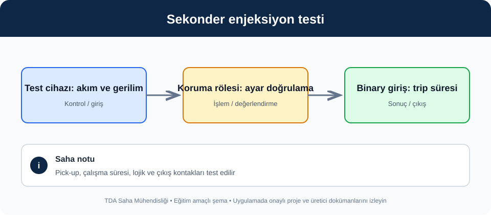

# 📍 Gün 09 — Sekonder Enjeksiyon Testleri ve IED Doğrulama

## 🎯 Günün Hedefleri

-   [x] Sekonder enjeksiyon test cihazının (Omicron, ISA) fonksiyonlarını kavramak.
-   [x] Röle ayarlarının (setting) saha testiyle doğrulanmasını öğrenmek.
-   [x] Trip süresi ölçümü ve output kontak testlerini yapmak.
-   [x] Raster (karakteristik nokta) testi ile IDMT eğrisini doğrulamak.

---

## 📚 Özet Çalışma Notları

### 1. Test Cihazı ve Bağlantı

-   **Test cihazı:** 3 fazlı akım/gerilim üreteci + binary giriş/çıkış kanalları (Omicron CMC, ISA DRTS, Doble).
-   **Bağlantı:** CT/VT terminal bloklarından röleye giden kablolar sökülür, test cihazı doğrudan röle girişlerine bağlanır.
-   **Kritik:** Test bitince CT devreleri **kısa devre geri alınmalıdır** — açık CT sekonderi tehlikeli yüksek gerilim üretir.

### 2. Test Adımları

| Adım | Test                              | Doğrulama                                 |
| :--- | :-------------------------------- | :---------------------------------------- |
| 1    | Ayar dosyası kontrolü             | Setting vs proje ayar listesi             |
| 2    | Pick-up (start) değer testi       | $I_s$ değerinin ±%5 tolerans içinde olması |
| 3    | Trip süresi testi                 | Röle çıkış kontakına kadar ms ölçümü      |
| 4    | Raster (karakteristik) test       | IDMT eğrisinin 5-10 noktada doğrulanması  |
| 5    | Output kontak testleri            | Trip/alarm kontaklarının kapandığını fiziksel görme |
| 6    | Binary input testleri             | DI kanallarının doğru algıladığını kontrol |
| 7    | LED ve alarm fonksiyon testi      | İkaz lambaları ve SCADA işaretleri        |

### 3. Kabuk (Shell) vs Ayar Ayrımı

Numerik rölelerde **Communication (shell) ayarları** ile **koruma (protection) ayarları** ayrıdır. Testte ikisinin ayrı ayrı doğrulanması gerekir.

---

## 🔗 Detaylı Notlar

Raster test prosedürü, tolerans tabloları ve Omicron test planı örnekleri için:
👉 **[9. Gün Detaylı Teknik Notları (detail.md)](./detail.md)**
