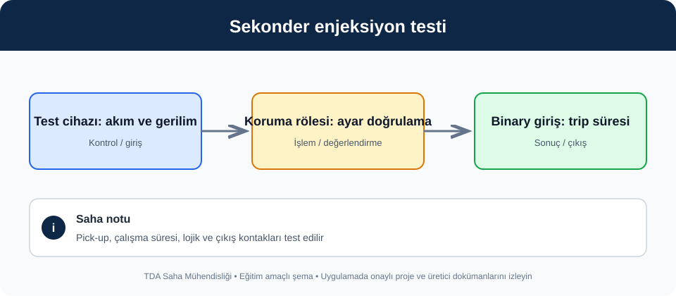

# 📖 Gün 09 — Sekonder Enjeksiyon Testleri: Prosedür ve Doğrulama (Teknik Detaylar)

Bu doküman, 9. Gün çalışması kapsamında incelenen **sekonder enjeksiyon test metodolojisi**, **raster testi**, **tolerans kriterleri** ve **tipik hatalar** konularını içerir.

---

## 1. Test Cihazı Kabiliyetleri

Modern sekonder enjeksiyon cihazları (Omicron CMC 356, ISA DRTS, Doble F6150):

-   **Akım çıkışı:** Faz başına 0-30 A (geçici 300 A'ya kadar), 3 fazlı sıralı ve faz-faz modları.
-   **Gerilim çıkışı:** 0-300 V faz, 3 fazlı + sıfır sıra ($V_0$) üretimi.
-   **Binary I/O:** Röle triplerini ölçmek için 16+ binary giriş; trip kontakları için binary çıkış.
-   **Transponder:** IEC 61850 GOOSE / SV testi, RSC232, Modbus gibi haberleşme testleri.
-   **Karakteristik test:** Otomatik raster (point-by-point) veya karakteristik sınır tarama (search).

---

## 2. Test Prosedürü Adım Adım

### 2.1. Hazırlık

1.  Ayar dosyası (setting file) proje revizyonu ile karşılaştırılır.
2.  Röle CT/VT terminal bağlantıları (schematic) kontrol edilir.
3.  Test devresi bağlanır; CT devreleri test cihazına bağlanırken CT terminal kısa devre vidaları (shorting links) doğru kullanılmalıdır.
4.  Röle durumuna dikkat: **Service** → **Test** moduna geçilir (normal işletmeye etkisiz hale getirilir).

### 2.2. Pick-up Testi

-   Akım $I_s$ değerinin %60'ından başlayıp yavaşça artırılır.
-   Röle "Start" göstergesinin verdiği değer kaydedilir.
-   **Kabul:** Ölçülen pick-up, ayar değerin **±%5** toleransı içinde.

### 2.3. Trip Süresi Testi

-   Röleye $I_s$'in 2×, 5×, 10× katı akım verilir.
-   Test cihazı binary girişle röle trip kontak kapandığı anı milisaniyelik hassasiyetle ölçer.
-   **Kabul:** IEC formülle hesaplanan teorik değer ±%5 (veya ±50 ms) içinde.

### 2.4. Raster (Karakteristik) Testi

IDMT eğrisi üzerinde 5-10 nokta seçilir (M=2, 3, 5, 10, 20) ve her noktada trip süresi ölçülür:

| Kat Katlama (M) | Teorik Süre (s) | Ölçülen (s) | Sapma (%) |
| :-------------- | :-------------- | :---------- | :-------- |
| 2.0             | 4.47            | 4.51        | +0.9      |
| 5.0             | 1.42            | 1.39        | -2.1      |
| 10.0            | 0.86            | 0.87        | +1.2      |

**Kabul:** Her noktada **±%5** tolerans.

### 2.5. Yönülü Koruma (67) Testi

-   Akım ve gerilim birlikte verilir, faz açısı değiştirilir.
-   Rölenin **ileri/geri yön karakteristik sınırı** tarama testi ile doğrulanır.

### 2.6. Diferansiyel (87) Testi

-   **Stabilite:** İki tarafa eşit fazlı akım verilir, trip olmaması beklenir.
-   **Hassasiyet:** Fark akımı oluşturulur, trip değeri $I_{s0}$'a uyumu doğrulanır.
-   **Bias testi:** Fark akımı ile restraint akımı birlikte değiştirilir, karakteristik sınır çizilir.

---

## 3. Output Kontak ve Binary I/O Testleri

### 3.1. Output Kontaklar

-   Röle trip komutunu tetikler; kontakların fiziksel kapandığı **multimetre veya cihazın binary girişi** ile doğrulanır.
-   Kontak tipi kontrolü: NO/NC, transient veya latched.

### 3.2. Binary Inputlar (DI)

-   Test cihazı sahte kontak sinyali üretir (örn. kesici yardımcı kontak simülasyonu).
-   Röle DI algılaması ve mantığı (interlock, blocking) doğrulanır.

### 3.3. SCADA Sinyalleri

-   Alarm işaretleri, trip komutları, ölçümler SCADA/Gateway üzerinden doğrulanır.
-   Zaman damgası (SOE) hassasiyeti kontrol edilir (< 1 ms tipik).

---

## 4. Test Kabuğu (Test Mode / Test Schema)

Numerik rölelerde **Test Mode**:

-   Trip çıkışları **izinli veya izinsiz** yapılabilir.
-   SCADA sinyallerine "test" etiketi eklenir; alarm sistemi yanlış uyarı üretmez.
-   Test bitince **service mode**'a geri dönülür ve doğrulanır.

> ⚠️ **Kritik:** Test modunda unutulan röle saha arıza anında **trip etmez**. Test bitiş kontrol listesi zorunludur.

---

## 5. Tipik Saha Hataları

| Hata                                        | Sonuç                                        |
| :------------------------------------------ | :------------------------------------------- |
| CT kısa devre vidaları test sonrası açılmaz | CT sekonderi açık devre → tehlikeli gerilim  |
| Test modundan çıkılmaz                      | Arıza anında trip etmez                      |
| Ayar dosyası versiyon uyumsuz               | Yanlış ayarlar sahada aktif kalır            |
| Binary giriş polaritesi ters                | Interlock mantığı ters çalışır               |
| Trip kontak hedefi (trip matrix) yanlış    | Kesici yerine başka fider açılır             |

---

## 6. Test Raporu İçeriği

Her röle için test dossier'da bulunması gerekenler:

1.  Test cihazı ve kalibrasyon sertifikası
2.  Ayar dosyası ve versiyonu (hash ile)
3.  Pick-up / trip süresi ölçüm sonuçları
4.  Raster test tablosu
5.  Kontak test sonuçları
6.  Test personeli ve tarih
7.  Devreye alma onay imzası

---

## 🔗 İlgili Kaynaklar

-   _IEC 60255-8 — Koruma Röleleri Test Standartları_
-   _IEEE C37.103 — Differential and Polarized Relay Testing_
-   _Omicron CMC Test Universe Kullanım Kılavuzu_
