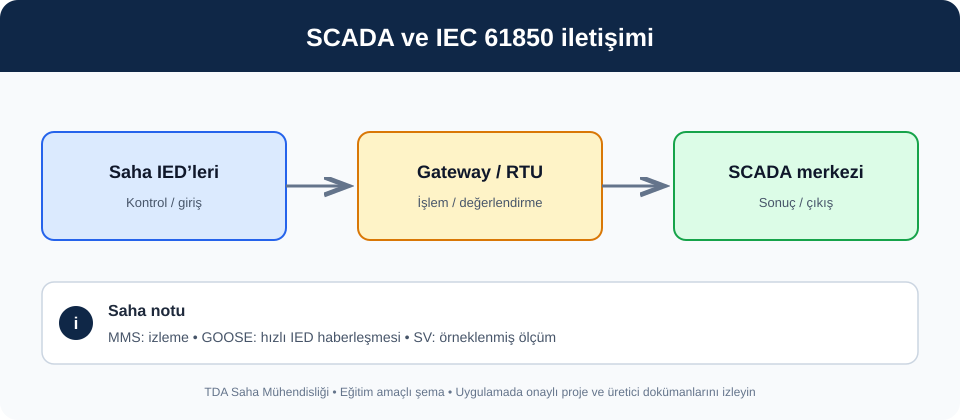

# 📍 Gün 10 — SCADA ve IEC 61850 Haberleşme Sistemleri

## 🎯 Günün Hedefleri

-   [x] SCADA mimarisini (RTU, Gateway, Master Station) kavramak.
-   [x] IEC 61850 protokol katmanlarını (MMS, GOOSE, SV) ayırt etmek.
-   [x] IEC 60870-5-104 ile 61850 farklarını ve kullanım alanlarını öğrenmek.
-   [x] Saha testlerinde point-to-point sinyal doğrulama yapmak.

---

## 📚 Özet Çalışma Notları

### 1. SCADA Mimarisi

```
[Saha IED] ↔ [Gateway/RTU] ↔ [İletişim Hattı] ↔ [Master Station / MMC]
```

-   **IED:** Koruma + ölçüm + kontrol (sahada)
-   **Gateway/RTU:** Protokol çevirici, veri toplama noktası
-   **Master Station:** Merkezi izleme/kontrol yazılımı (SCADA/EMS)

### 2. Protokol Katmanları

| Protokol       | Katman                 | Kullanım                       |
| :------------- | :--------------------- | :----------------------------- |
| **IEC 61850 MMS** | TCP/IP based, nesne yönelimli | IED ↔ Gateway, SCADA |
| **IEC 61850 GOOSE** | Ethernet multicast, peer-peer | Hızlı kilitlenme, interlock (< 4 ms) |
| **IEC 61850 SV** | Sampled Values        | Process bus, CT/VT dijital     |
| **IEC 60870-5-104** | TCP/IP, klasik SCADA | Kuzey Amerika dışı geniş kullanım |
| **DNP3**        | TCP/IP, ekonomik       | Kuzey Amerika standardı        |
| **Modbus**      | Basit seri/TCP         | Endüstriyel cihazlar           |

### 3. GOOSE — Devrim Niteliğinde Bir Özellik

-   **Fast Peer-Peer:** İki IED arasında bakır kablo yerine Ethernet üzerinden < **4 ms** ile sinyal.
-   **Publisher/Subscriber:** Her cihaz yayın yapar, ilgililer abone olur.
-   **Sanal Kablolama:** Fiziksel kablolama yerine SCL dosyası ile yapılandırma.
-   **Priority Tagging (802.1Q):** Ağ trafiğinde önceliklendirme.

### 4. Point Test Mantığı

SCADA devreye almada her sinyal tek tek doğrulanır:
-   **DI (Digital Input):** Kesici açık/kapalı, alarm kontaktı
-   **DO (Digital Output):** Trip/Close komutları, select-before-operate mantığı
-   **AI (Analog Input):** Akım, gerilim, güç ölçümleri
-   **AO (Analog Output):** Setpoint verme

---



## 🔗 Detaylı Notlar

SCL dosya yapısı, GOOSE konfigürasyonu ve test prosedürleri için:
👉 **[10. Gün Detaylı Teknik Notları (detail.md)](./detail.md)**
