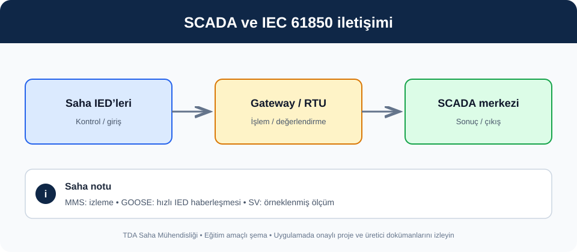

# 📖 Gün 10 — SCADA ve IEC 61850: Protokoller ve Devreye Alma Testleri (Teknik Detaylar)

Bu doküman, 10. Gün çalışması kapsamında incelenen **IEC 61850 mimarisi**, **SCL dosya yapısı**, **GOOSE konfigürasyonu** ve **SCADA devreye alma testleri** konularını içerir.

---

## 1. IEC 61850 Mimarisinin Katmanları

### 1.1. Standart Yapı

| Bölüm      | İçerik                                                     |
| :--------- | :--------------------------------------------------------- |
| Part 6     | Configuration language (SCL - Substation Configuration Language) |
| Part 7-4   | Compatible Logical Node (LN) tipleri (MMXU, PTOC, CSWI...)  |
| Part 7-2   | ACSI (Abstract Communication Service Interface)             |
| Part 8-1   | MMS + GOOSE mapping (SAS - Substation Automation)           |
| Part 9-2   | Sampled Values (Process Bus)                                |
| Part 10    | Conformance Testing                                         |

### 1.2. Logical Node (LN) Yapısı

Cihaz fonksiyonları nesne yönelimli olarak gruplanır:

| LN Tipi | Fonksiyon                                 |
| :------ | :---------------------------------------- |
| XCBR    | Circuit Breaker (kesici)                  |
| XDIS    | Disconnector (ayırıcı)                    |
| MMXU    | Measurement Unit (ölçüm)                  |
| PTOC    | Time Overcurrent (zamanlı aşırı akım)     |
| PDIF    | Differential                              |
| PDST    | Distance Protection                       |
| CSWI    | Switch Control Interface                  |
| GGIO    | Generic I/O                               |

Örnek: `Q0SB1XCBR1.Pos` → Bay Q0, SB1 panosu, kesici 1, pozisyon.

---

## 2. SCL Dosya Yapısı

SCL, XML tabanlı tanım dosyasıdır. 4 tip dosya içerir:

-   **ICD (IED Capability Description):** Cihazın kabiliyet tanımı (üretici).
-   **CID (Configured IED Description):** Projeye konfigüre edilmiş cihaz tanımı.
-   **SCD (Substation Configuration Description):** Tüm sahada tüm cihazların haberleşme tanımı.
-   **IID (Instantiated IED Description):** Cihaz içindeki gerçek konfigürasyon.

> ⚡ **Workflow:** Üretici ICD → Sistem entegratörü SCD hazırlar → Her cihaza CID yüklenir. **CID SCD ile uyumlu olmalı** — version uyumsuzluğu GOOSE/SV haberleşmesini bozar.

---

## 3. GOOSE Konfigürasyonu ve Test

### 3.1. Yayın Mantığı

-   **Publisher (yayınlayan):** Bulunduğu durumları (kesici pozisyonu, trip bilgisi) multicast yayınlar.
-   **Subscriber (abone):** Bu yayınları dinler, mantığını çalıştırır.
-   **sqNum/seqNum:** Devamlılık kontrolü; sıra bozulursa "kayıp GOOSE" alarmı.

### 3.2. Yayın Hızı

-   **Normal durum:** İlk yayın sonrası **1 s**, **2 s**, **4 s**, **8 s**, **60 s** aralıklarla tekrar (heartbeat).
-   **Değişiklik:** Anında yeni yayın (event-driven) ve 4 ms içinde birkaç tekrar.

### 3.3. GOOSE Testi

1.  **Abonelik doğrulama:** Gateway'de GOOSE trafiğini Wireshark ile yakala.
2.  **Veri içeriği kontrolü:** MAC adres, APPID, datset içeriği doğru mu?
3.  **Test etkenliği:** Bir IED'den GOOSE tetikle, subscriber'da sinyal değişimini doğrula.
4.  **Failover test:** Publisher'ı kapat, subscriber'da "GOOSE timeout" alarmını kontrol et.

---

## 4. IEC 60870-5-104 Detayları

### 4.1. Temel Özellikler

-   **TCP Port 2404** üzerinden master-slave haberleşme.
-   **APDU yapısı:** I-format (bilgi), S-format (supervisory), U-format (control).
-   **Point adresleri:** IOA (Information Object Address) her sinyale eşsiz adres.

### 4.2. Tipik ASDU Tipleri

| ASDU | İçerik                            | Örnek                          |
| :--- | :-------------------------------- | :----------------------------- |
| M_SP_NA_1 | Single point                 | Kesici pozisyon                |
| M_DP_NA_1 | Double point                 | Ayırıcı açık/kapalı/arızalı   |
| M_ME_NC_1 | Floating point measurement   | Aktif güç, akım               |
| C_SC_NA_1 | Single command               | Trip/Close                    |
| C_DC_NA_1 | Double command               | Select-before-operate         |

### 4.3. Select-Before-Operate (SBO)

-   Komut iki aşamalı gönderilir: önce **select**, sonra **execute**.
-   Select onayı cihazdan gelmeden execute gönderilemez — yanlış komuta karşı emniyet.

---

## 5. Zaman Senkronizasyonu

Saha olaylarının doğru sıralanması için tüm IED'ler **aynı saati** kullanmalıdır:

-   **IRIG-B:** Klasik, kablolı, yüksek hassasiyet.
-   **NTP:** Ağ üzerinden milisaniye hassasiyetinde.
-   **PTP (IEEE 1588):** Mikrosaniye hassasiyeti, process bus için gerekli.

> ⚡ **Kritik Test:** Tüm IED'lerde saat sapması < **±1 ms** olmalıdır. SOE (Sequence of Event) kayıtları doğru analiz için bunu gerektirir.

---

## 6. SCADA Devreye Alma Kontrol Listesi

1.  **Point-to-Point Test:** Her DI, DO, AI, AO sinyali tek tek sahada tetiklenerek MMC ekranında görülmeli.
2.  **Komut Testleri:** Trip/Close SCADA'dan verilir, kesicinin tepkisi izlenir.
3.  **Alarm Testleri:** Örn. SF6 düşük, trafo sıcaklık — alarm tetiklenip SCADA'ya iletilmeli.
4.  **Zaman Damgası Testi:** Sahada bir olay üretilir, MMC'de SOE kaydı ile zaman uyumu kontrol edilir.
5.  **Failover Testi:** Gateway veya ağ hattı kesilir, SCADA'nın alarm davranışı izlenir.
6.  **Hazardous Test:** Komuta karşılık kesici yanıt vermezse (timeout) SCADA hata mesajı üretmelidir.

---

## 🔗 İlgili Kaynaklar

-   _IEC 61850 — Communication Networks and Systems_
-   _IEC 60870-5-104 — Telecontrol Protocol_
-   _IEC 61850-10 — Conformance Testing_
