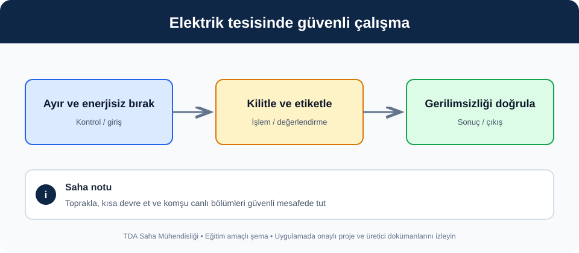

# 📍 Gün 11 — Saha Emniyeti: 5 Altın Kural, LOTO ve Manevra Fişi

## 🎯 Günün Hedefleri

-   [x] Enerjisiz çalışmanın 5 altın kuralını ezbere öğrenmek.
-   [x] LOTO (Lock Out - Tag Out) uygulamasını saha senaryosunda kullanmak.
-   [x] Manevra fişi (switching order) hazırlama mantığını kavramak.
-   [x] Risk değerlendirmesi (JSA) ve PPE seçimini doğru yapmak.

---

## 📚 Özet Çalışma Notları

### 1. Enerjisiz Çalışmanın 5 Altın Kuralı (EN 50110)

1.  **Enerjisiz bırak** — Çalışılacak bölümü besleyen tüm kaynaklar kesilir.
2.  **Yeniden enerjilenmeye karşı koru** — Kesiciler kilitlenir, etiketlenir.
3.  **Gerilimsizliği doğrula** — Gerilim kontrol pensi/Catu ile ölç.
4.  **Toprakla ve kısa devre et** — Toprak bıçağı veya portatif topraklama seti.
5.  **Komşu canlı parçalardan koru / işaretle** — Bariyer, tabela, uyarı.

> ⚡ **Kritik Sıra:** 1-2-3 **tamamlanmadan** 4 yapılamaz. Topraklama yapılmadan hiçbir çalışma başlamaz.

### 2. LOTO Uygulaması

-   **Lock (Kilit):** Kesici/şalter mekanik kilidi kilitlenir.
-   **Tag (Etiket):** "Çalışma var - Kimse açmasın" etiketi — isim, tarih, telefon.
-   **Kişisel Kilit:** Her çalışan kendi kilidini takar; son çıkan kendi kilidini açar.

### 3. Manevra Fişi (Switching Order)

Adım adım, numaralı operasyon listesidir. Her adım:
-   **Ekipman adı + tanıtıcı kodu** (örn. F1-DS1 Hat Ayırıcısı)
-   **Yapılacak işlem** (Aç / Kapat / Kontrol Et)
-   **Tebrik noktaları:** Cihaz pozisyon kontrolü ("Açık pozisyonda kaldığını kontrol et")

### 4. Kişisel Koruyucu Donanım (PPE / KKD)

| Risk                 | KKD                                        |
| :------------------- | :----------------------------------------- |
| Elektrik ark         | Arc-flash kıyafet (kal/cm² sınıfına göre)  |
| Yüksek gerilim teması | İzole eldiven + deri koruyucu             |
| Sıcak/parça sıçraması| Gözlük, kask, yüz siperi                   |
| Yüksekten düşme      | Emniyet kemeri, çift bağlantılı halat      |

---

## 🔗 Detaylı Notlar

Arc-flash sınıfı hesabı, izolasyon çizelgesi ve emniyet senaryoları için:
👉 **[11. Gün Detaylı Teknik Notları (detail.md)](./detail.md)**
