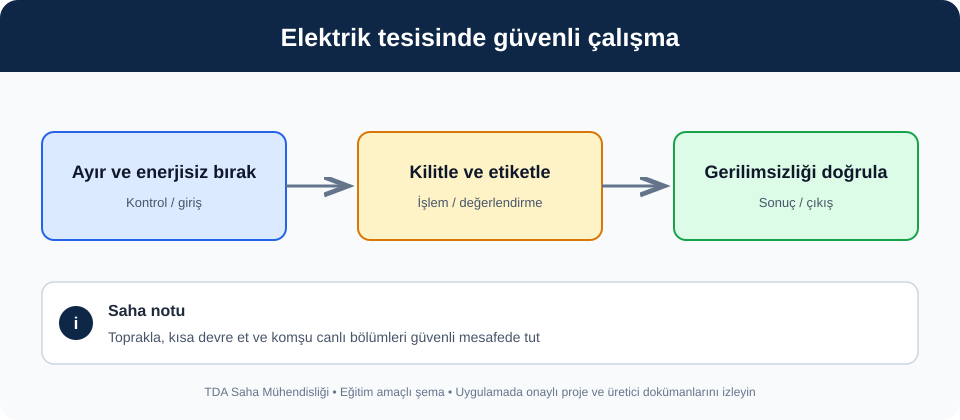

# 📖 Gün 11 — Saha Emniyeti: Enerjisiz Çalışma, LOTO ve Arc Flash (Teknik Detaylar)

Bu doküman, 11. Gün çalışması kapsamında incelenen **enerjisiz çalışma prosedürleri**, **risk değerlendirmesi**, **arc flash koruması** ve **senaryolar** konularını içerir.

---

## 1. Elektrik Güvenliğinin Temel Kavramları

### 1.1. İnsan Üzerinde Etkiler

| Akım (AC 50Hz) | Etki                                              |
| :------------- | :------------------------------------------------ |
| 0.5 - 1 mA     | Algı eşiği                                        |
| 10 mA          | Kas kasılması, bırakamama (let-go)                |
| 30 mA          | Solunum zorluğu, ventilasyon yetersizliği         |
| 50 mA+         | Ventriküler fibrilasyon başlangıcı                |
| 1-5 A          | Kalp durması, yanık                               |

**Ölümcül eşik:** Tipik olarak **30-50 mA AC** — bu yüzden RCCB/ELCB'ler 30 mA tripte tasarlanmıştır.

### 1.2. Gerilim Sınıfları ve Yaklaşma Mesafeleri

| Gerilim          | Min. Yaklaşma (kılıfsız)      |
| :--------------- | :---------------------------- |
| < 1 kV           | 0.5 m                          |
| 1 - 36 kV        | 0.6 - 0.8 m                    |
| 36 - 145 kV      | 1.5 - 1.8 m                    |
| 145 - 420 kV     | 2.5 - 3.5 m                    |

---

## 2. Enerjisiz Çalışma Prosedürü — Detaylı

### 2.1. Adım 1: Enerjisiz Bırakma

-   Besleyen **tüm kaynaklar** kapatılır: hat tarafı + bara tarafı + jeneratör/UPS yedeği.
-   Çift beslemeli sistemlerde **her iki taraf** kesilir (ters besleme riski).
-   Kapasitif yükler (kablo, kondansatör) gerilimi tutabilir.

### 2.2. Adım 2: Yeniden Enerjilenmeye Karşı Koruma

-   Kesici/aşırı yük anahtarının kontrol devresi sigortaları çekilir.
-   Mekanik kilit + kişisel kilit + "çalışma var" etiketi.
-   Uzak besleme noktalarında da etiketleme (diğer merkez bilgilendirilir).

### 2.3. Adım 3: Gerilimsizliği Doğrulama

-   **Gerilim kontrol pensi (VD - Voltage Detector)** kullanılır; kendi kendini test edebilir (self-test) tip olması zorunludur.
-   Kompakt hücrelerde **kapak猫 kapCatu (Capacitive Voltage Indicator)** gösterge panelinden bakılır.
-   VD önce **canlı devrede test edilir** (aşılanma olmadan çalıştığı kanıtlanır), sonra çalışma noktasında ölçüm yapılır.
-   Üç faz ayrı ayrı kontrol edilir.

### 2.4. Adım 4: Topraklama

-   Portatif topraklama seti: önce **toprak ucuna** bağlanır, sonra faz iletkenlerine (akım sıfırken).
-   Sıra ters yapılırsa (önce faza) ve hatta gerilim kalmışsa personel ölür.
-   **Kapasitif kalıntı yükler** (uzun kablolar) toprak bıçağı ile boşaltılır.

### 2.5. Adım 5: Bariyerleme ve İşaretleme

-   Komşu canlı panellere **izolasyon bariyeri** veya izole perdeler.
-   "DUR - 36 kV ÇALIŞMA ALANI DEĞİL" etiketleri.
-   Çalışma alanı fiziksel olarak sınırlandırılır.

---

## 3. LOTO — Kilit ve Etiket Sistemi

### 3.1. Grup Kilitleme (Group Lockout)

Birden fazla personel aynı ekipmanda çalışacaksa:

-   **Group Lock Box:** Ana anahtar kutuya kilitlenir; her çalışan kendi kilidini kutuya takar.
-   Son çıkan kendi kilidini açar, kutu boşalınca sistem enerjilendirilebilir.

### 3.2. Etiket Bilgileri

-   Çalışan adı + telefon
-   Departman / firma
-   Çalışma izni (PTW) numarası
-   Başlangıç ve bitiş tarih-saat

---

## 4. Risk Değerlendirmesi (JSA - Job Safety Analysis)

Her iş başında **5N1K** mantığıyla:

| Soru                | Örnek                                        |
| :------------------ | :------------------------------------------- |
| Ne yapılacak?       | CT sekonder değişimi                         |
| Riskler neler?      | Yüksek gerilim, düşme, alet düşmesi         |
| Kontrol önlemleri?  | Enerjisiz, LOTO, bariyer                    |
| Kalan risk?         | Komşu fider enerjili — 1.5 m yaklaşma yasağı |
| Acil durum planı?   | İlk yardım, elektrik çarpması müdahalesi     |

> ⚡ **Temel Kural:** Risk kabul edilemez düzeyde ise iş **durdurulur**; acele asla güvenliği geçmez.

---

## 5. Arc Flash (Ark Patlaması) Koruması

### 5.1. Ark Enerjisi Hesabı

IEEE 1584 hesabı ile **incident energy** (kal/cm²) hesaplanır; buna göre kıyafet sınıfı belirlenir:

| ATPV Sınıf | kal/cm²  | Tipik Gerilim Düzeyi    |
| :--------- | :------- | :---------------------- |
| Cat 1      | 4        | 240 V panolar           |
| Cat 2      | 8        | 600 V panolar           |
| Cat 3      | 25       | OG panoları (yüksek akım) |
| Cat 4      | 40       | YG, ana dağıtım         |

### 5.2. Ark Riskini Azaltan Yöntemler

-   **Remote racking:** Kesici çekici uzaktan hareket ettirme (personel uzakta).
-   **Arc-resistant switchgear (IEC 62271-200):** Ark gazını yönlendiren panolar.
-   **Arc flash detection (AFD):** Işık + akım algılayan röle — trip süresini 2-3 ms'e indirir.
-   **Maintenance mode:** Ayarları geçici düşürerek trip süresini kısaltır.

---

## 6. Tipik Kazaları ve Dersler

| Senaryo                                        | Kök Sebep                                  |
| :--------------------------------------------- | :----------------------------------------- |
| Yük altında ayırıcı açma → ark patlaması       | Interlock bypass edilmiş                   |
| Topraklanmış hatta enerji verme → kısa devre   | Manevra fişi sırası takip edilmemiş        |
| CT açık devresi → ölümcül gerilim              | Test sonrası shorting link açılmamış       |
| Komşu fider teması → çarpılma                  | Yaklaşma mesafesi ihlali, bariyer yok      |

---

## 🔗 İlgili Kaynaklar

-   _EN 50110 — Elektrik Tesisatlarında İşletme_
-   _OSHA 1910.147 — Lockout/Tagout Standardı_
-   _IEEE 1584 — Arc Flash Hazard Calculation_
-   _NFPA 70E — Elektrik Güvenliği_
