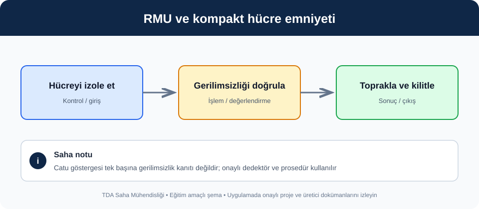

# 📖 Gün 12 — Kompakt Şalt (RMU/SF6): Mimari, Emniyet ve Testler (Teknik Detaylar)

Bu doküman, 12. Gün çalışması kapsamında incelenen **RMU mimarisi**, **SF6 gaz sistemleri**, **Catu kullanımı** ve **kompakt hücre devreye alma prosedürleri** konularını içerir.

---

## 1. RMU Tipleri ve Yapıları

### 1.1. Manevra Odacıkları

| Odacık       | Ekipman                                       | Amaç                    |
| :----------- | :-------------------------------------------- | :---------------------- |
| Ring-Switch  | Yük anahtarı (LBS) + toprak bıçağı            | Halka yönlendirme       |
| Tee-off      | LBS + sigorta (HN) veya kesici (VCB)          | Trafo koruma            |
| Metering     | CT/VT paneli                                  | Sayac noktası           |

### 1.2. Manevra Yeteneği

-   **Yük anahtarı (LBS):** Nominal yükü keser; **kısa devre akımını kesmez**.
-   **Sigorta (HN - HV Fuse):** Kısa devre koruması; sigorta atarsa **trip bar** ile diğer fazları da açar (3 faz birlikte).
-   **Kesicili RMU:** Koruma rölesi ile birlikte hem yük hem kısa devre kesme kabiliyeti.

### 1.3. SF6 Gaz Yönetimi

-   Hücre içi gaz basıncı tipik **1.3 - 1.5 bar** (20°C'de, gauge).
-   **Düşük basınç alarmı:** Manevra yeteneği azalır — hücre çalıştırılmamalı.
-   Gaz sızıntısı kontrolü: SF6 dedektörü veya kızılötesi kamera.
-   **Yasak:** SF6 hücre içine kablo bağlama/sökme işlemlerinde basınç düşürme için açılan valf — yetkisiz kullanımı yasaktır.

---

## 2. Catu (KVG) Detaylı Kullanım

### 2.1. Çalışma Prensibi

Kablo iletkeni ile ekran katmanı arasındaki **kapasitif bölüşüm** ile ölçüm:

$$V_{gösterge} = V_{hat} \times \frac{C_{ekran}}{C_{ekran} + C_{izolasyon}}$$

Gösterge devresine **yüksek impedanslı LED'ler** bağlıdır; canlı fazda LED yanar.

### 2.2. Test Prosedürü

1.  **Test / Simulate** düğmesine basılır — tüm LED'ler yanmalı (gösterge çalışıyor kanıtlanır).
2.  Hücre üstü gösterge panelinden her fazın LED durumu okunur.
3.  **Karanlık faz** varsa (tek LED sönük) — faz kesintisi veya sigorta atması ihtimali.
4.  **Canlı faz varsa kapak açılmaz** — fiziksel kilit buna izin vermez.

> ⚠️ **Kritik:** Catu **ölçüm aleti değil**, gösterge cihazıdır. Kesin gerilimsizlik kontrolü için **VD (voltage detector)** ile dış kablodan ölçüm gerekir.

### 2.3. Fault Passage Indicator (FPI)

RMU'larda arıza geçiş göstergesi: Hattan geçen kısa devre akımını algılar ve halka şebekede **arıza bölgesini** gösterir. SCADA'ya iletilir.

---

## 3. Devreye Alma Kontrol Listesi

### 3.1. Kurulum Kontrolleri

-   [ ] Temel düz ve ankraj cıvataları doğru (üretici toleransı)
-   [ ] SF6 basınç göstergesi nominal (1.3-1.5 bar)
-   [ ] Hücre içi nem absorbsörü (silika jel) mavi
-   [ ] Kablo bağlantı torkları üretici değerinde
-   [ ] Topraklama barası tesisatına bağlı (Ra ölçümü yapıldı)

### 3.2. Elektriksel Testler

| Test                       | Cihaz          | Kriter                          |
| :------------------------- | :------------- | :------------------------------ |
| Kablo IR testi             | Megger 5 kV    | > 1000 MΩ (her faz-gövde)       |
| Kablo VLF testi            | VLF 0.1 Hz     | 2 × U₀, 30-60 dk, çökme yok     |
| Trafo IR testi             | Megger 5 kV    | PI > 2                          |
| Topraklama direnci         | Earth tester   | Ra < 2 Ω (tipik)                |
| Çevrim oranı (trafo)       | TTR cihazı     | ±%0.5 etiket değeri             |

### 3.3. Fonksiyon Testleri

-   [ ] LBS açma/kapama mekanik çalışması
-   [ ] Toprak bıçağı interlock testi
-   [ ] Sigorta tripper bar mekanizması
-   [ ] Catu gösterge testi
-   [ ] FPI testi (test akımı üretici ile)
-   [ ] SCADA sinyalleri (varsa)

---

## 4. Kablolu Hücrelerde Manevra Sıralaması

### 4.1. RMU Devreye Alma (İlk Enerjileme)

1.  Hücre gövde topraklaması kontrol edilir.
2.  SF6 basınç değeri kontrol edilir.
3.  Kablo VLF testi tamamlanmış olmalı.
4.  **Ring switch** kapalı konumda (halka bağlantısı).
5.  Üstten besleme tarafı kesici kapatılır — hücre enerjilenir.
6.  Catu ile canlılık kontrolü.
7.  Trafo tee-off sigortaları takılır, LBS kapatılır.
8.  Trafo ikincilinde gerilim kontrolü.

### 4.2. Kablo Eklemesi (Yeni Kablo Devreye Alımı)

1.  Yeni kablo enerjiden izole edilir.
2.  **VLF testi** yapılır (2 × U₀ — 30 dk).
3.  **IR testi** (5 kV DC).
4.  RMU tarafında kablo bağlanır, kablo bölme kapağı kapatılır.
5.  Toprak bıçağı **açılır**, LBS **kapama** izni verilir.
6.  Kesici kapatılır — kablo enerjilenir.

---

## 5. Tipik Hata ve Bakım Senaryoları

| Senaryo                          | Çözüm                                              |
| :------------------------------- | :------------------------------------------------- |
| SF6 basınç düşük alarmı          | Gaz kaçağı tespiti, yetkili servis müdahalesi      |
| Sigorta attı (trafo tee-off)     | Trafo tarafı arıza araştır; sigorta değişimi öncesi toprakla |
| Kapak kilidi sıkıştı             | Kuvvet uygulama — mekanizma kontrolü                |
| Catu LED yanmıyor (canlı hatta)  | Gösterge arızalı — VD ile bağımsız kontrol yap     |

---

## 🔗 İlgili Kaynaklar

-   _IEC 62271-200 — AC Metal-Enclosed Switchgear_
-   _IEC 62271-203 — Gas-Insulated Metal-Enclosed Switchgear (GIS)_
-   _IEC 60466 — HV Insulated Switchgear_
