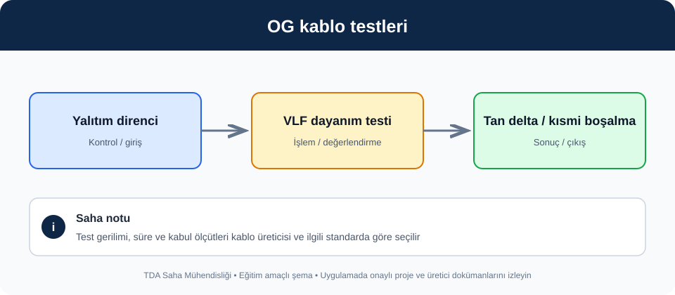

# 📍 Gün 13 — OG Kabloları: VLF, Tan Delta ve Ekran Testleri

## 🎯 Günün Hedefleri

-   [x] OG kablo yapısını (iletken, XLPE, ekran, dış kılıf) kavramak.
-   [x] VLF (0.1 Hz) testinin DC hipot testine göre avantajını anlamak.
-   [x] Tan Delta ölçümü ile kablo sağlığı değerlendirmesi yapmak.
-   [x] Ekran (sheath) testi ve su ağacı (water tree) analizi öğrenmek.

---

## 📚 Özet Çalışma Notları

### 1. OG Kablo Anatomisi

Katmanlı yapı:

1.  **İletken:** Bakır veya alüminyum, sıkıştırılmış dairesel.
2.  **İç yarı iletken:** Elektrik alan dağılımını düzeltir.
3.  **İzolasyon (XLPE):** Çapraz bağlı polietilen — ana yalıtım katmanı.
4.  **Dış yarı iletken (ekran altı):** Alan kontrolü.
5.  **Metal ekran (screen):** Bakır tel/bant — toprak yolu, hata akımı taşıyıcı.
6.  **Dış kılıf (sheath):** PVC veya HDPE — mekanik koruma.

### 2. Test Yöntemleri

| Test              | Amaç                                        | Kriter                        |
| :---------------- | :------------------------------------------ | :---------------------------- |
| **IR (Megger)**   | Ekran-iletken izolasyonu                    | > 1 GΩ (her faz)              |
| **Sheath Testi**  | Dış kılıf bütünlüğü                         | 10 kV DC, > 100 MΩ            |
| **VLF**           | İzolasyon mukavemet testi                   | 2 × U₀, 30-60 dk              |
| **Tan Delta**     | İzolasyon kaybı (nem/su ağacı)              | Tipik < 1×10⁻³ (yeni kablo)   |
| **PD Testi**      | Kısmi boşalma (boşluk, eklem hataları)      | pC değerleri üretici kriteri  |

### 3. Neden DC Hipot Değil, VLF?

-   Eski PE/PVC kablolarda DC test iyi çalışır; fakat **XLPE kablolarda** DC testi **uzun süre izolasyonu yavaşça bozar** (space charge oluşumu).
-   **VLF (0.1 Hz):** AC test avantajı sağlar, fakat cihaz kapasitesi 500× küçük (düşük frekans nedeniyle) — sahada pratik.

---

## 🔗 Detaylı Notlar

VLF prosedürü, Tan Delta yorumlama ve hata konumu (TDR) için:
👉 **[13. Gün Detaylı Teknik Notları (detail.md)](./detail.md)**
