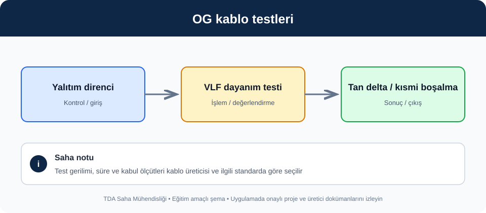

# 📖 Gün 13 — OG Kablo Testleri: VLF, Tan Delta, PD ve Hata Yer Tespiti (Teknik Detaylar)

Bu doküman, 13. Gün çalışması kapsamında incelenen **kablo test metodolojisi**, **VLF prosedürü**, **Tan Delta yorumlama** ve **hata konumu tespiti** konularını içerir.

---

## 1. Test Gerilim Seviyeleri (IEC 60502-2)

Kablo tipine göre test gerilimi:

| Kablo      | $U_0$  | VLF Test Gerilimi (2 × U₀)  | Süre       |
| :--------- | :----- | :-------------------------- | :--------- |
| 12/20 kV   | 12 kV  | 24 kV RMS                   | 30-60 dk   |
| 20/35 kV   | 20 kV  | 40 kV RMS                   | 30-60 dk   |

> ⚡ **Meydana yeni kablo vs eski kablo:** Yeni kabloya **2 × U₀**, işletmedeki kabloya bakım testi olarak **1.5 × U₀** veya daha düşük uygulanır.

---

## 2. VLF Testi — Adım Adım

### 2.1. Hazırlık

1.  Kablo enerjiden izole edilir, 5 altın kural uygulanır.
2.  Kablo her iki uçta ayrılır; **ekranlar topraklanır**.
3.  VLF cihazı ekranla (toprak) ile iletken arasında bağlanır.
4.  Diğer uçta kimse olmamalı — işaretlenir ve bariyerlenir.

### 2.2. Uygulama

1.  Gerilim kademeli olarak **2 × U₀**'a yükseltilir (1-2 dakikada).
2.  **30-60 dakika** boyunca bu gerilim tutulur.
3.  **Çökme (breakdown) olmaması** kabul kriteridir.
4.  Test bitince gerilim yavaşça sıfırlanır, kablo **topraklanarak boşaltılır** (en az 5 dk).

### 2.3. Sonuç Değerlendirme

-   **Geçti:** Test süresi tamamlandı, çökme yok → kablo devreye alınabilir.
-   **Çöktü:** Arıza konumu tespiti gerekir (TDR/ark yöntemi), onarım sonrası yeniden test.

---

## 3. Tan Delta (Dielectric Loss) Testi

### 3.1. İlke

İdeal izolasyonda akım gerilimi 90° önceleyir. Gerçek izolasyonda kayıp bileşen vardır:

$$\tan \delta = \frac{I_R}{I_C}$$

-   $I_R$: Rezistif (kayıp) akım — nem, boşluk, su ağacı ile artar.
-   $I_C$: Kapasitif akım — sağlıklı izolasyonda dominant.

### 3.2. Yorumlama Tablosu (XLPE, 12/20 kV)

| tan δ (10⁻³) | Durum                       | Aksiyon                          |
| :----------- | :-------------------------- | :------------------------------- |
| < 0.5        | Mükemmel                    | Normal çalışmaya devam           |
| 0.5 - 2      | İyi                         | 1-2 yılda izle                   |
| 2 - 5        | Kritik                      | Yakın izleme, planlı değişim     |
| > 5          | Kötü                        | Acil değişim planla              |

### 3.3. Tip-Delta Eğrisi

Tan Delta farklı gerilim seviyelerinde ölçülür (0.5, 1.0, 1.5 × U₀):
-   **Düz çizgi:** Sağlıklı izolasyon.
-   **Gerilimle artan eğri:** Su ağacı / boşluk varlığı göstergesi.

---

## 4. Kısmi Boşalma (PD - Partial Discharge) Testi

### 4.1. PD Nedir?

İzolasyon içindeki **boşluklarda** (void, eklem hataları, ekran keskin ucu) yerel elektriksel boşalmalar. PD, zamanla izolasyonu erozyona uğratır ve **sonunda çökme** yaratır.

### 4.2. Ölçüm

-   **pC (picocoulomb)** birimiyle ifade edilir.
-   Tipik kabul: **< 10 pC** (yeni kablo, eklem ve uçlar için).
-   **Online PD testi:** İşletmedeki kabloda HF CT'ler ile ölçüm — kesintisiz sağlık izleme.

---

## 5. Ekran (Sheath) Testi

-   Dış kılıf bütünlüğü — kabloya su sızmasını engeller.
-   Test: Ekran ile toprak arasında **10 kV DC** uygulanır, 1 dk.
-   **Kabul:** > 100 MΩ.
-   **Kötü sonuç:** Su girişi riski → ekran testi periyodik yapılmalı (yıllık).

---

## 6. Kablo Hata Yer Tespiti (Fault Location)

### 6.1. Yöntemler

| Yöntem            | Uygulama                                  | Hassasiyet      |
| :---------------- | :---------------------------------------- | :-------------- |
| **TDR**           | Düşük dirençli arızalar                   | ±%1 hata uzunluğu |
| **Arc Reflection**| Yüksek dirençli arızalar (TDR + puler)    | ±%0.5           |
| **Thumper**       | Akustik dinleme ile kesin konum           | ~±0.5 m         |
| **Cable Radar**   | Uzun hatlarda, karışık eklem noktaları    | Gelişmiş        |

### 6.2. İşlem Sırası

1.  **TDR ile ön tarama** → yaklaşık mesafe.
2.  **Arc reflection** → kesin arıza bölgesi daraltılır.
3.  **Thumper** → arıza noktasına yüksek enerji verilir, akustik dinleme ile kazılır/konumlanır.
4.  Onarım → yeni eklem → yeniden VLF testi.

---

## 7. Tipik Kablo Arızaları ve Nedenleri

| Arıza Tipi              | Neden                                         |
| :---------------------- | :-------------------------------------------- |
| Eklem arızası           | Hatalı montaj, nem sızması, yarı iletken kesik |
| Uç (terminasyon) arızası| Yetersiz creepage, kir birikimi, su           |
| Su ağacı (water tree)   | Ekran hasarı, uzun süre su teması             |
| Aşırı ısınma            | Yük aşımı, yetersiz ısı dağılımı, döşeme     |
| Mekanik hasar           | Kazı sırasında yabancı temas                 |

---

## 🔗 İlgili Kaynaklar

-   _IEC 60502-2 — OG Kablolar ve Testleri_
-   _IEEE 400 / 400.2 — VLF Field Testing_
-   _CIGRE TB 276 — Cable Partial Discharge_
