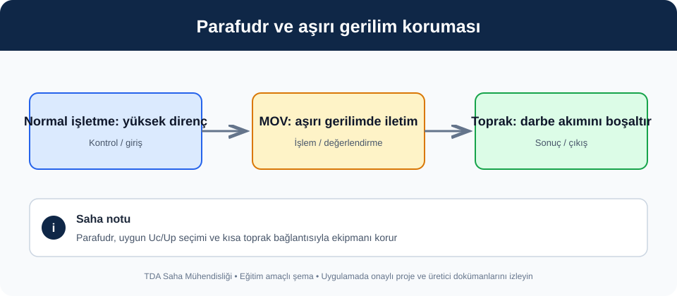

# 📍 Gün 14 — Parafudr (Surge Arrester) ve Aşırı Gerilim Koruma

## 🎯 Günün Hedefleri

-   [x] Parafudr (MOV) yapısını ve V-I karakteristiğini kavramak.
-   [x] Tip sınıflarını (Class 1/2/3) ve enerji kapasitesini ayırt etmek.
-   [x] Kaçak akım (leakage current) testi ile sağlık durumunu değerlendirmek.
-   [x] Koordinasyon (insulation coordination) mantığını anlamak.

---

## 📚 Özet Çalışma Notları

### 1. Parafudr Nedir?

Aşırı gerilim dalgalarını (yıldırım, manevra, indüksiyon) toprağa aktaran, normal işletmede **hiç akım geçirmeyen** cihaz.

-   **Modern tip:** Metal Oxide Varistor (MOV) — ZnO diskler.
-   **Çalışma:** Normal gerilimde çok yüksek direnç; kilitleme gerilimi üzerinde ani iletken olup dalgayı toprağa boşaltır; dalgadan sonra eski haline döner.

### 2. Tip Sınıfları (IEC 60099-4)

| Sınıf      | Kullanım                         | Tipik Enerji              |
| :--------- | :------------------------------- | :------------------------ |
| **Class 1 (T1)** | Bina girişi, yıldırım koruma | 10/350 µs dalga           |
| **Class 2 (T2)** | OG panoları, dağıtım        | 8/20 µs dalga             |
| **Class 3 (T3)** | Cihaz seviyesi (AG sonu)    | Kombinasyon dalga         |

> ⚡ **Kritik:** Yıldırım koruma sistemli binalarda T1 mutlaka ana girişte olmalıdır — doğrudan yıldırım akımı (10/350 µs) T2 cihazı patlatır.

### 3. Saha Testleri

| Test                    | Yöntem                                  | Kriter                             |
| :---------------------- | :-------------------------------------- | :--------------------------------- |
| İzolasyon               | Megger 5 kV                             | > 1000 MΩ                          |
| Kaçak akım (üçüncü harmonik) | Üçüncü harmonik analizi           | Referans değere göre < %20 sapma   |
| Kaçak akım (rezistif)   | Rezistif akım ölçümü                    | Üretici tipik değere yakın         |
| Referans gerilim ($U_{ref}$) | 1 mA akımda gerilim ölçümü        | Etiket değere ±%5 uyum             |

---

## 🔗 Detaylı Notlar

İzolasyon koordinasyonu hesabı ve kaçak akım trend analizi için:
👉 **[14. Gün Detaylı Teknik Notları (detail.md)](./detail.md)**
