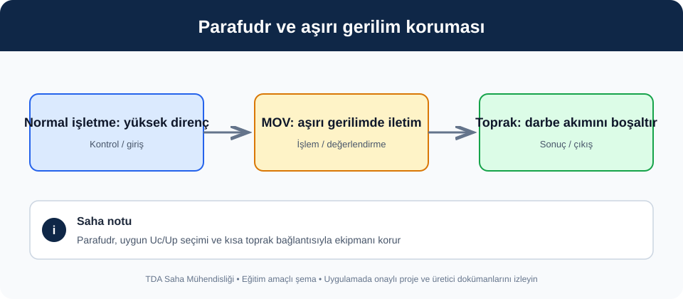

# 📖 Gün 14 — Parafudr: V-I Karakteristiği, İzolasyon Koordinasyonu ve Testler (Teknik Detaylar)

Bu doküman, 14. Gün çalışması kapsamında incelenen **MOV karakteristikleri**, **izolasyon koordinasyonu**, **kaçak akım izleme** ve **uygulama detayları** konularını içerir.

---

## 1. MOV (Metal Oxide Varistor) Fiziksel Yapısı

### 1.1. ZnO Diskler

Her disk, çinko oksit granülleri ile bismut ve diğer oksitlerin sinterlenmesiyle üretilir. Her granül sınırı bir **p-n jonksiyonu** gibi davranır:

-   Düşük gerilimde: Granül sınırları yalıtkan → çok yüksek direnç ($10^6$ - $10^9$ Ω)
-   Kilitleme gerilimi üzerinde: Jonksiyonlar kırılır → düşük direnç (sadece birkaç Ω)
-   Bu **geçiş** nanosaniyeler içinde olur.

### 1.2. V-I Karakteristik Bölgeleri

```
Akım (log)
  │                                    /
  │                                   /  ← Bölge 3: İletim (yıldırım/manevra akımı)
  │                                  /      kA mertebesi
  │                                 /
  │                                /
  │        ______________________/
  │       /                        ← Bölge 2: Kilitleme noktası (knee)
  │      /
  │     /
  │    /                          ← Bölge 1: Normal işletme (µA mertebesi)
  │   /
  └──────────────────────────────────→ Gerilim
```

### 1.3. Koruma Seviyeleri

-   **$U_p$ (Koruma Seviyesi / Residual Voltage):** Nominal deşarj akımında (8/20 µs) parafudr üzerindeki kalan gerilim.
-   **$U_c$ (Sürekli İşletme Gerilimi):** Parafudr sürekli dayanabileceği gerilim — **sistemin faz-toprak geriliminden büyük** seçilmelidir.
-   **$U_r$ (Nominal Deşarj Akımı Gerilimi):** Referans gerilim.

---

## 2. İzolasyon Koordinasyonu (Insulation Coordination)

### 2.1. Temel İlke

Korunacak ekipmanın **BIL (Basic Insulation Level)** değeri, parafudr koruma seviyesinden **yeterince yüksek** olmalıdır:

$$\text{Koruma Marjı} = \frac{BIL - U_p}{U_p} \times 100 \geq 20-25\%$$

### 2.2. Örnek Hesap

-   Sistem: 36 kV, faz-toprak $U_m/\sqrt{3} = 20.8$ kV
-   Parafudr: $U_c = 24$ kV, $U_p = 72$ kV (5 kA'da)
-   Ekipman BIL: 170 kV
-   **Marj:** $(170 - 72)/72 = \%136$ → Çok güvenli.
-   Yıldırım dalgası geldiğinde ekipman yalıtımı **asla** kırılmaz.

### 2.3. Ayak Mesafesi (Separation Distance)

Parafudr, korunacak ekipmandan uzaklaştıkça koruma etkinliği **azalır** (dalganın yansıması nedeniyle):

$$d_{max} = \frac{U_{BIL} - U_p}{2 \times S}$$

-   $S$: Dalga dikliği (kV/µs)
-   Tipik olarak parafudr, **korunacak ekipmana 5-15 m** içinde olmalıdır.

---

## 3. Kaçak Akım İzleme (Leakage Current Monitoring)

### 3.1. Neden İzlenir?

MOV diskler yaşlandıkça veya nem sızdıkça **rezistif kaçak akım** artar. Bu, parafudrun sağlık durumunun birincil göstergesidir.

### 3.2. Ölçüm Yöntemleri

| Yöntem                  | Ölçülen                           | Avantaj                         |
| :---------------------- | :-------------------------------- | :------------------------------ |
| **Toplam kaçak akım**   | Kapasitif + rezistif              | Basit, ucuz                     |
| **3. harmonik analizi** | Rezistif bileşen ile korele       | Cihaz üzerinden ölçülebilir     |
| **Rezistif akım ölçümü**| Direkt rezistif bileşen           | En doğru, ek cihaz gerektirir   |

### 3.3. Trend Analizi

-   **Yeni parafudr:** Tipik 100-300 µA rezistif akım.
-   **%20-30 artış:** İzleme sıklığını artır.
-   **%50+ artış:** Parafudr değişim planla.
-   **mA mertebesine çıkış:** Acil değişim — MOV zarar görmüş.

---

## 4. Saha Testleri — Detaylı

### 4.1. Referans Gerilim Testi ($U_{ref}$)

1.  Parafudr enerjiden izole edilir, alt ucu topraklanır.
2.  Yukarıdan kademeli AC gerilim uygulanır.
3.  1 mA akım geçtiği andaki gerilim **$U_{ref}$** olarak kaydedilir.
4.  **Kabul:** Etiket değerin ±%5 toleransı.

### 4.2. İzolasyon Direnci

-   5 kV DC ile alt-üst terminaller arasında ölçüm.
-   **Kabul:** > 1000 MΩ.
-   Düşük değer: Nem sızması veya disk çatlağı.

### 4.3. Alt Terminal (Gripper) Direnci

-   Parafudr içindeki sayaç/gripper devresi direnci kontrol edilir.
-   Tipik değer: 1-10 Ω.

---

## 5. Uygulama Detayları

### 5.1. Yerleşim Kuralları

-   **Trafo çıkışı:** Her faz için ayrı parafudr (yıldız bağlantılı).
-   **Hat girişi:** Şalt sahası dışında, hat tarafında.
-   **Kablolu-havai geçiş noktası:** Havai hat kablola geçerken mutlaka parafudr.
-   **Nötr:** Bazı sistemlerde nötr-faz parafudrı da gerekebilir.

### 5.2. Topraklama

-   Parafudr alt ucu **olabildiğince kısa** toprak bağlantısı ile ana toprak barasına bağlanır.
-   **Kritik:** Uzun toprak kablosu, deşarj anında ekstra gerilim düşümü yaratır ve koruma seviyesini bozar.
-   Bağlantı iletkeni kesiti: Min. 50 mm² bakır (tipik).

### 5.3. Enerji Kapasitesi

-   **Yıldırım enerjisi:** 8/20 µs, 10-20 kA nominal deşarj akımı.
-   **Manevra enerjisi:** Uzun dalga (250/2500 µs), tipik 300-500 A.
-   **Hat enerjisi (Line Discharge):** Uzun hat enerjisi — yüksek enerji sınıfı.

---



## 🔗 İlgili Kaynaklar

-   _IEC 60099-4 — Surge Arresters Part 4_
-   _IEEE C62.11 — Surge Arresters Standardı_
-   _IEC 60071 — Insulation Coordination_
