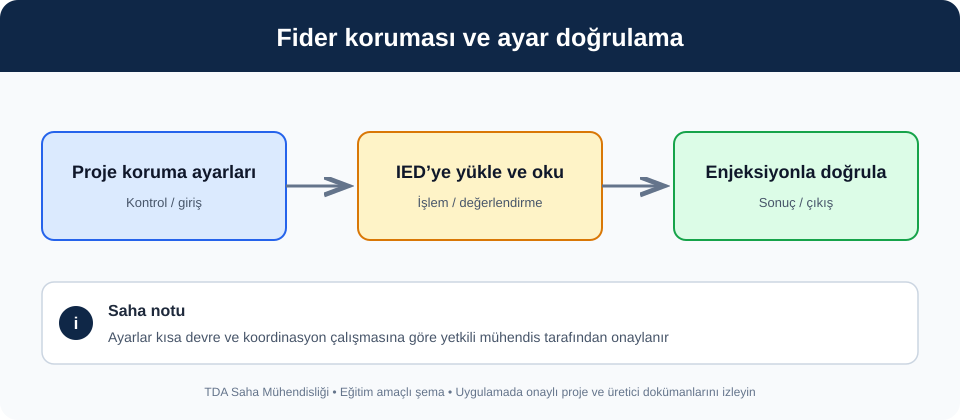

# 📍 Gün 15 — Fider Devreye Alma: Komisyonlama Akışı ve Dokümantasyon

## 🎯 Günün Hedefleri

-   [x] Fider komisyonlama sürecinin adım adım akışını kavramak.
-   [x] Ayar dosyası yükleme ve doğrulama prosedürünü uygulamak.
-   [x] Devreye alma kontrol listesi (checklist) hazırlamak.
-   [x] Test dossier yapısını ve imza akışını öğrenmek.

---

## 📚 Özet Çalışma Notları

### 1. Komisyonlama Adımları (Sıra Kritik!)

1.  **Kurulum ve görsel kontrol** — mekanik montaj, etiketler, kapaklar.
2.  **Sekonder kablo testleri** — süreklilik, izolasyon, bağlantı doğruluğu.
3.  **CT/VT testleri** — oran, polarite, burden.
4.  **IED ayar yükleme** — setting file + doğrulama (readback).
5.  **Sekonder enjeksiyon** — koruma fonksiyonlarının testi.
6.  **Interlock ve kumanda testleri** — tüm manevra senaryoları.
7.  **SCADA point testleri** — her sinyal tek tek.
8.  **Enerjileme ve faz kontrolü** — faz sırası, faz-faz gerilim.
9.  **Yük altında ölçüm doğrulama** — CT/VT yönleri, faz açıları.

### 2. Ayar Yönetimi

-   **Ayar dosyası hash'i** hesaplanır ve saklanır (yüklenen dosyanın birebir doğrulanması).
-   **4-göz prensibi:** Hesaplayan ve kontrol eden farklı kişiler.
-   **Versiyon kontrol:** Her değişiklik revizyon numarası ile kaydedilir.

### 3. Test Dossier Yapısı

```
📁 Test Dossier — Fider F1
 ├── 01_Proje Dokümanları (schematic, ayar listesi)
 ├── 02_Ekipman Sertifikaları (FAT raporları)
 ├── 03_Cihaz Kalibrasyon Sertifikaları
 ├── 04_Test Prosedürleri ve Kabul Kriterleri
 ├── 05_Ölçüm Sonuçları (ham veri)
 ├── 06_Interlock ve Kumanda Test Raporu
 ├── 07_SCADA Point Test Raporu
 ├── 08_Enerjileme Kayıtları (manevra fişi)
 └── 09_İmza ve Onay Sayfası
```

---



## 🔗 Detaylı Notlar

Her adımın detaylı kontrol listesi ve tipik hata senaryoları için:
👉 **[15. Gün Detaylı Teknik Notları (detail.md)](./detail.md)**
