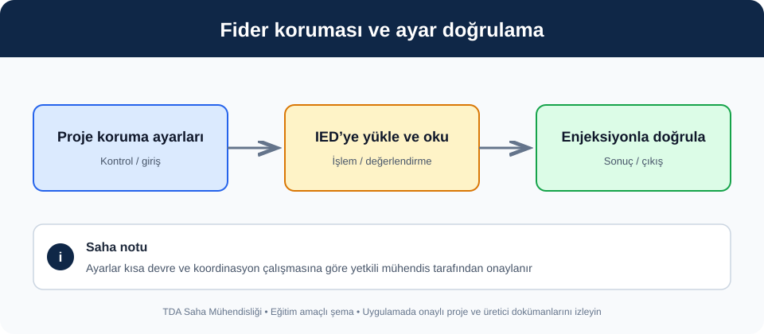

# 📖 Gün 15 — Fider Koruma Ayarları: Detaylı Prosedür ve Dokümantasyon (Teknik Detaylar)

Bu doküman, 15. Gün çalışması kapsamında incelenen **fider devreye alma prosedürü**, **her adımın kontrol listesi** ve **tipik hata senaryoları** konularını içerir.

---

## 1. Adım 1: Kurulum ve Görsel Kontrol

### Kontrol Listesi

-   [ ] Panolar temel üzerinde düz (su terazisi), ankraj cıvataları torklu.
-   [ ] Kablo kanalları düzenli, sekonder kablolar demetlenmiş.
-   [ ] Etiketleme tam: her fider, her hücre, her terminal bloğu.
-   [ ] Kapak ve perde yerinde, kilit mekanizmaları çalışıyor.
-   [ ] Topraklama barası tesisat topraklamasına bağlı.
-   [ ] Aydınlatma, priz, havalandırma çalışıyor.
-   [ ] Yangın söndürme sistemi (varsa) aktif.
-   [ ] İkaz levhaları: "Yüksek Gerilim", "Önce toprakla", kapak etiketleri.

### Tipik Hatalar

-   Sekonder kabloların primer hücreden geçmesi (ark riski).
-   Terminal bloklarında gevşek bağlantı — ısınma sonrası kopma.
-   Toprak barasında eksik bağlantı veya paslı yüzey.

---

## 2. Adım 2: Sekonder Kablo Testleri

### 2.1. Süreklilik (Continuity)

-   Her sekonder kablo çekirdeği iki uçtan ölçülür.
-   **Kabul:** < 1 Ω (tipik kablo uzunluğuna göre).

### 2.2. İzolasyon

-   Kablolar arası ve kablo-toprak: **500 V DC Megger**, > 100 MΩ.
-   CT devrelerinde dikkat: Megger **CT sekonderine** zarar vermez ama ölçüm sırasında kısa devre vidaları takılı olmalı.

### 2.3. Bağlantı Doğruluğu (Point-to-Point)

-   Schematic ile her kablo çekirdeği tek tek kontrol edilir.
-   **Renk kodu** ve **numaralandırma** schematic ile uyumlu.
-   Bu adım **en çok hata bulunan** adımdır — acele edilmemeli.

---

## 3. Adım 3: CT/VT Testleri

### 3.1. CT Testleri

| Test               | Cihaz           | Kriter                       |
| :----------------- | :-------------- | :--------------------------- |
| Oran (ratio)       | CT analyzer     | Etiket ±%1                   |
| Polarite           | CT analyzer     | Doğru yön                    |
| Sargı direnci      | Mikroohmmetre   | Fazlar arası dengeli         |
| Knee-point (Vk)    | CT analyzer     | Proje kriteri (tipik Vk ≥ 2×Vs) |
| Excitation eğrisi  | CT analyzer     | Üretici eğrisi ile uyum      |
| Burden             | CT analyzer     | Toplam yük < CT kapasitesi   |

### 3.2. VT Testleri

-   Oran ve polarite.
-   **Faz sırası (phase sequence):** A-B-C sırası doğru mu?
-   Yük (burden) ölçümü.

---

## 4. Adım 4: IED Ayar Yükleme

### 4.1. Prosedür

1.  Proje ayar dosyası (settings file) güncel revizyonu alınır.
2.  Hash (SHA-256) hesaplanır, proje dokümanındaki hash ile karşılaştırılır.
3.  Röleye yüklenir (USB, Ethernet veya port üzerinden).
4.  **Readback:** Röleden ayarlar okunur, proje dosyası ile karşılaştırılır.
5.  Uyumsuzluk yoksa imzalanır.

### 4.2. Ayar Grupları

-   **Koruma ayarları:** Pick-up, TMS, eğri tipi, zamanlar.
-   **Logic ayarları:** Trip matrix, interlock, blocking mantıkları.
-   **Haberleşme ayarları:** IEC 61850, GOOSE, IP adresleri.
-   **Görüntüleme:** Etiketler, dil, zaman senkron.

---

## 5. Adım 5: Sekonder Enjeksiyon

Gün 09'daki prosedür uygulanır. Fider için tipik testler:

-   50/51, 50N/51N pick-up ve trip süresi.
-   67 yönülü koruma (varsa).
-   79 auto-reclose (varsa).
-   27/59, 81 frekans/gerilim.
-   Trip matrix doğrulama: Hangi fonksiyon hangi kesiciyi açıyor?

---

## 6. Adım 6: Interlock ve Kumanda Testleri

### 6.1. Test Matrisi

| Senaryo                          | Beklenen Davranış              |
| :------------------------------- | :----------------------------- |
| Kesici kapalı → ayırıcı aç       | Bloke edilir                   |
| Kesici açık → ayırıcı aç         | İzin verilir                   |
| Hat ayırıcı kapalı → toprak aç   | Bloke edilir                   |
| Hat ayırıcı açık → toprak kapat  | İzin verilir                   |
| Toprak kapalı → kesici kapat     | Bloke edilir                   |

### 6.2. Kumanda Testi

-   Yerel (pano butonu) ve uzaktan (SCADA) trip/close komutları.
-   **Anti-pumping** doğrulama.
-   Spring charge motoru çalışması ve göstergesi.
-   Gas trip (SF6 düşük basınç trip) — simüle edilir.

---

## 7. Adım 7: SCADA Point Testleri

Her sinyal için tablo doldurulur:

| Point No | Tanım              | Sahada Tetiklenen       | SCADA Görüntü | Zaman Damgası |
| :------- | :----------------- | :---------------------- | :------------ | :------------ |
| 1001     | F1 Kesici Pozisyon | Manuel trip/close       | ✓             | ✓             |
| 1002     | F1 Hat Ayırıcı     | Manuel manevra          | ✓             | ✓             |
| 3001     | F1 Ia Akımı        | Test akımı              | ✓             | —             |
| 5001     | F1 SF6 Düşük       | Simülasyon              | ✓             | ✓             |

---

## 8. Adım 8: Enerjileme ve Faz Kontrolü

### 8.1. Faz Kontrolü (Phase Sequence)

-   İlk enerjilemede hat tarafı ve bara tarafı fazları karşılaştırılır.
-   **Faz-faz gerilimler:** A1-A2: 0V, A1-B2: $U_{LL}$ (doğru sıra) veya A1-A2: $U_{LL}$ (ters faz — DÜZELTİLMELİ).
-   Yanlış faz sırası kesici kapatılırsa **yıldırım gibi kısa devre** olur.

### 8.2. İlk Enerjileme Protokolü

1.  Tüm testler tamamlanmış, dossier onaylanmış olmalı.
2.  Manevra fişi hazırlanır ve şef mühendis onaylar.
3.  Saha boşaltılır, güvenlik bölgesi kurulur.
4.  Kesici kapama komutu uzaktan veya yerel verilir.
5.  Ölçümler kontrol edilir: akım, gerilim, güç yönü.

---

## 9. Adım 9: Yük Altında Doğrulama

-   **CT yönü:** Aktif güç yönü besleme yönüne uyumlu mu? (SCADA'da P değeri işaretine bakılır)
-   **Faz açıları:** Fazlar 120° arayla mı? (phasor diagram kontrolü)
-   **Toprak akımı:** Dengeli yükte $I_0 \approx 0$ olmalı.
-   **Ölçümler:** Sayaç ve SCADA değerleri karşılaştırılır.

---

## 10. Tipik Hata Senaryoları ve Dersler

| Hata                                      | Sonuç                              | Önlem                          |
| :---------------------------------------- | :--------------------------------- | :----------------------------- |
| CT polarite ters                           | Diferansiyel koruma dış arızada trip | Primer enjeksiyon ile doğrulama |
| VT faz sırası ters                          | Yönülü koruma ters çalışır          | Faz kontrolü zorunlu           |
| Trip matrix hatası                          | Yanlış kesici açılır               | Sekonder enjeksiyon + trip test |
| Ayar dosyası eski revizyon                  | Koruma yanlış ayarla çalışır       | Hash kontrol zorunlu           |
| SCADA point karışıklığı                     | Operatör yanlış kesici kapatır     | Point-to-point test zorunlu    |

---

## 🔗 İlgili Kaynaklar

-   _IEC 60364-6 — Doğrulama (Verification)_
-   _EN 50110 — Elektrik Tesisatlarında İşletme_
-   _IEC 61850-4 — System and Project Management_
