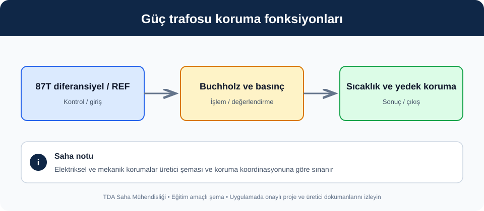

# 📍 Gün 16 — Güç Trafo Koruması: 87T, REF ve Mekanik Korumalar

## 🎯 Günün Hedefleri

-   [x] Trafo diferansiyel koruma (87T) ayarlarını ve inrush inhibisyonunu öğrenmek.
-   [x] REF (Restricted Earth Fault) korumasının hassasiyet mantığını kavramak.
-   [x] Mekanik koruma zincirini (Buchholz, PRD, WT/Oil WT) analiz etmek.
-   [x] Overflux (24) ve backup koruma fonksiyonlarını değerlendirmek.

---

## 📚 Özet Çalışma Notları

### 1. Trafo Koruma Katmanları

| Katman      | Fonksiyon    | ANSI    | Hız        |
| :---------- | :----------- | :------ | :--------- |
| Elektriksel iç | Diferansiyel | 87T    | 20-40 ms   |
| Elektriksel iç | REF          | 87N    | 30-50 ms   |
| Elektriksel dış | Overcurrent | 50/51  | IDMT       |
| Mekanik     | Buchholz     | 63      | Saniyeler  |
| Termal      | Sıcaklık     | 26/49   | Dakikalar  |

### 2. Buchholz Rölesi Detayı

-   Konum: Kazan ile genleşme deposu arasındaki boru üzerinde.
-   **İki aşamalı:**
    -   **Alarm:** Gaz birikimi → yavaş bozulma göstergesi (sargı izolasyon kısmi deşarj).
    -   **Trip:** Ani yağ akışı → büyük arıza (sargı-arası kısa devre).
-   **Gaz analizi:** Buchholz'dan alınan gazın rengi ve bileşimi (H₂, C₂H₂, CO...) arızanın tipini gösterir.

### 3. İnhush (Magnetizing Inrush) Ayarı

-   Enerjilemede 8-12 × $I_n$ çekme akımı — **87T bunu iç arıza olarak görür**.
-   Çözüm: **2. harmonik inhibit** ($I_2/I_1 > 15\%$ → trip inhibit).
-   Alternatif: **Gap detection** (dalga şekli analizi).

### 4. Saha Testleri

| Test                    | Kriter                                   |
| :---------------------- | :--------------------------------------- |
| 87T stabilite           | Dış arıza akımında trip yok              |
| 87T hassasiyet          | Fark akımı $I_{s0}$'da trip              |
| 2. harmonik inhibit     | İnüş benzeri dalga verildiğinde inhibit aktif |
| Buchholz alarm/trip     | Mekanik tetikleme ile kontak kontrolü    |
| WT/Oil WT alarm/trip    | Termometre simülasyonu                   |

---

## 🔗 Detaylı Notlar

87T bias ayarları, REF hesabı ve gaz analiz yorumlama için:
👉 **[16. Gün Detaylı Teknik Notları (detail.md)](./detail.md)**
