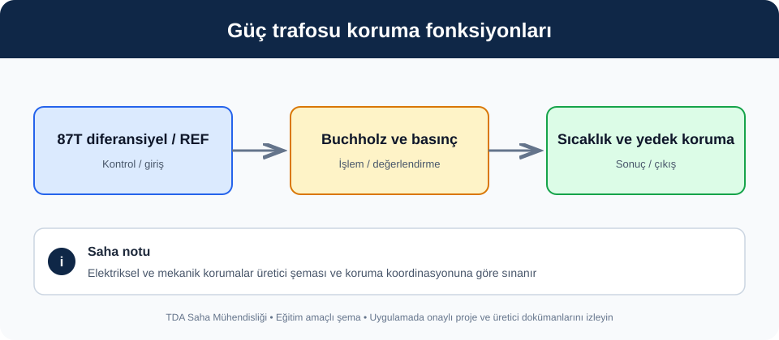

# 📖 Gün 16 — Trafo Koruması: 87T Ayarı, REF, Mekanik Koruma ve Gaz Analizi (Teknik Detaylar)

Bu doküman, 16. Gün çalışması kapsamında incelenen **trafo koruma ayarları**, **REF hesabı**, **Buchholz gaz analizi** ve **overflux koruma** konularını içerir.

---

## 1. 87T Trafo Diferansiyeli — Ayar Detayı

### 1.1. Nominal Baz Akımı

Trafo iki tarafında farklı baz akımlar hesaplanır:

$$I_{baz,YG} = \frac{S_{nom}}{\sqrt{3} \times U_{YG}}, \quad I_{baz,AG} = \frac{S_{nom}}{\sqrt{3} \times U_{AG}}$$

**Örnek:** 25 MVA, 154/31.5 kV trafo:
-   $I_{baz,YG} = 93.7$ A → CT: 150/1 → $I_{nom,röle,YG} = 0.625$
-   $I_{baz,AG} = 458$ A → CT: 600/1 → $I_{nom,röle,AG} = 0.764$

### 1.2. Tipik Ayar Değerleri

| Parametre    | Tipik Değer        | Amaç                                            |
| :----------- | :----------------- | :---------------------------------------------- |
| $I_{s0}$     | 0.20 × $I_{nom}$   | Küçük iç arızalar için hassasiyet               |
| Bias-1 eğimi | %30                | CT hata toleransı (normal akımlarda)            |
| Bias-2 eğimi | %80                | CT doyma toleransı (yüksek geçiş akımları)      |
| UNC (ani)    | 8-12 × $I_{nom}$   | Ağır iç arıza — bias bypass                    |
| $I_2/I_1$ inhibit | %15           | İnüş inhibit                                    |

### 1.3. CT Bağlantı Hatası — En Sık Hata

-   Yıldız/Delta CT bağlantısı trafo vektör grubuyla **ters olmalı**.
-   **Dyn11 trafo:** Primer CT delta, sekonder CT yıldız (veya modern rölelerde yazılımsal düzeltme).
-   **Hata sonucu:** Yükte bile sürekli fark akımı — dış arızada trip.

---

## 2. REF (Restricted Earth Fault) — Sınırlı Toprak Koruma

### 2.1. Neden Gerekli?

Trafo yıldız bağlı sargısının **nötre yakın** kısmındaki toprak arızaları düşük akım üretir. Genel toprak koruması (51N) bu akımı görmeyebilir. REF, **sadece sargı bölgesine** bakan çok hassas bir diferansiyel korumadır.

### 2.2. Devre Yapısı

-   Yıldız noktası CT'si (nötr CT) ile sargı uçlarındaki CT'lerin nötr bağlantısı bir arada değerlendirilir.
-   **Yüksek impedanslı REF:** Dört CT paralel, üzerinden yüksek impedanslı voltaj rölesi.
-   **Düşük impedanslı REF:** Modern rölelerde yazılımsal diferansiyel.

### 2.3. Hassasiyet

$$I_{s,REF} = \%5-10 \times I_{nom}$$

Bu, sargının **~%85-90** kısmını kapsar; nötre yakın son %10-15 bölge (az akım) korunamaz — bu bölge toprak noktasına yakındır ve daha az tehlikelidir.

---

## 3. Buchholz Rölesi ve Gaz Analizi

### 3.1. Gaz Birikim Mantığı

Sargı izolasyonu kısmi deşarj veya küçük ark ile bozuluyorsa, yağ ayrışır ve **gaz** oluşur. Bu gaz Buchholz üst kısmında birikir:

-   **İlk seviye:** Alarm kontak — 100-300 cm³ gaz.
-   **İkinci seviye:** Trip kontak — ani yağ akışı veya büyük gaz hacmi.

### 3.2. Gaz Rengi ve Kokusu — Saha Tanısı

| Gaz Rengi/Koku          | Muhtemel Arıza                       |
| :---------------------- | :----------------------------------- |
| Renksiz, kokusuz        | Hava sızıntısı                       |
| Beyaz/gri, yanık koku   | Kağıt/izolasyon bozulması            |
| Sarı, çizge koku        | Ahşap/kağıt izolasyon                |
| Siyah/gri, yağ koku     | Yağ arkı, sargı-arası kısa devre     |

### 3.3. Çözünmüş Gaz Analizi (DGA — Dissolved Gas Analysis)

Yağ örneklemesiyle gaz kromatografisi:

| Gaz            | Gösterge                                |
| :------------- | :-------------------------------------- |
| H₂ (Hidrojen)  | Kısmi deşarj / korona                   |
| CH₄ (Metan)    | Düşük sıcaklık ısınması                 |
| C₂H₂ (Asetilen)| **Ark** — kısa devre, yüksek enerji     |
| C₂H₄ (Etilen)  | Sıcak nokta (> 300°C)                   |
| CO (Karbon mono)| Kağıt/seramik izolasyon bozulması      |

**Rogers oranı, Duval üçgeni** gibi yöntemlerle arıza tipi sınıflandırılır.

> ⚡ **Kritik Eşikler:** Asetilen > 1 ppm veya H₂ > 100 ppm → acil DGA tekrarı ve yük azaltma değerlendirmesi.

---

## 4. Termal Korumalar

### 4.1. Yağ Sıcaklığı (Oil Temperature - OTI)

-   **Alarm:** 85°C — yük azaltılmalı.
-   **Trip:** 95°C — trafonun açılması.

### 4.2. Sargı Sıcaklığı (Winding Temperature - WTI)

-   Yağ sıcaklığı + yük akımı ile termal model: **sargı sıcaklığı simülasyonu**.
-   Alarm: 95°C, Trip: 105°C (tipik).

### 4.3. Yağ Seviyesi ve Basınç

-   **Yağ seviyesi düşük:** Alarm → sızıntı kontrolü.
-   **PRD (Pressure Relief Device):** Aşırı basınçta yağı dışarı boşaltır, patlamayı önler. Trip kontaklı olabilir.

---

## 5. Overflux (24) Koruma

### 5.1. Sorun

$V/f$ oranı tasarım değerini aşarsa çekirdek **aşırı mıknatıslanır** — yan akım akışı artar, çekirdek ısınır, izolasyon zarar görür.

$$\frac{V}{f} > \frac{V_{nom}}{f_{nom}} \times 1.1 \Rightarrow \text{Alarm/Trip}$$

### 5.2. Ne Zaman Tehlike?

-   Frekans düşerken gerilim sabit kalırsa (şebeke frekans düşüşü).
-   Jeneratör senkron dışı çalışırken hız düşük, gerilim yüksek.
-   Ayırma/anahtarlama anında geçici $V/f$ artışı.

### 5.3. Karakteristik

Zaman-gerilim eğrisi ile kademeli: hafif aşım → uzun gecikme; yüksek aşım → hızlı trip.

---

## 6. Yedek Korumalar

-   **50/51 (YG tarafı):** Trafonun YG tarafında aşırı akım — difansiyel yedeği.
-   **50N/51N:** Trafo nötr topraklama üzerinden toprak koruma.
-   **50BF:** Trafo kesicisi başarısızlığında üst kesicileri açar.

---

## 🔗 İlgili Kaynaklar

-   _IEC 60255 — Protection Relays_
-   _IEEE C37.91 — Guide for Protecting Power Transformers_
-   _IEC 60599 — Mineral Oil-Impregnated Electrical Equipment (DGA)_
-   _IEC 60076-7 — Loading Guide for Oil-Immersed Transformers_
