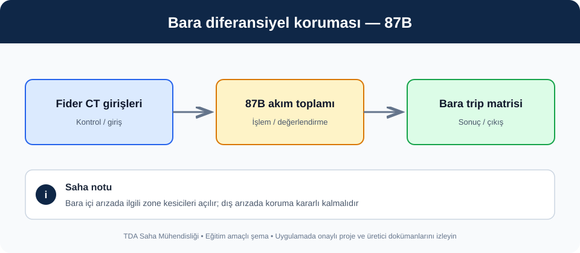

# 📍 Gün 17 — Bara Koruması: 87B Bara Diferansiyeli ve Yüksek Impedans

## 🎯 Günün Hedefleri

-   [x] Bara diferansiyel korumasının (87B) çok-CT mantığını kavramak.
-   [x] Yüksek impedanslı ve düşük impedanslı şemaları ayırt etmek.
-   [x] CT doyması ve stabilite ilişkisini analiz etmek.
-   [x] Zone seçimi ve fider trip mantığını öğrenmek.

---

## 📚 Özet Çalışma Notları

### 1. 87B Mantığı

Baraya bağlı **tüm fiderlerin CT akımları** vektörel toplanır:

-   **Normal / Dış arıza:** $\sum \bar{I}_{fiderler} \approx 0$ → stabil.
-   **Bara iç arıza:** $\sum \bar{I}_{fiderler} = I_{arıza}$ → trip, **tüm fiderler açılır**.

### 2. Şema Tipleri

| Şema              | Yapı                                        | Avantaj / Dezavantaj                    |
| :---------------- | :------------------------------------------ | :-------------------------------------- |
| **Yüksek impedans** | CT'ler paralel, üzerinden V rölesi        | CT doymasına çok toleranslı; tek zorluk: tüm CT aynı özellikler |
| **Düşük impedans** | CT'ler ayrı girişler, yazılımsal toplama   | Farklı CT'lerle çalışır; doyma toleransı düşük |
| **Hibrit**        | Kombinasyon                                 | Modern IED uygulamaları                 |

### 3. CT Doyma Problemi

Dış arıza durumunda arıza akımını taşıyan fider CT'si **doymaya** başlarsa, fark akımı oluşur — **sahte iç arıza** gibi görünür. Çözüm:

-   Yüksek impedans şema: Doyma anında röle girişindeki gerilim düşer, trip olmaz.
-   Düşük impedans şema: **Bias karakteristik** + CT doyma dedektörü (CT saturation detector).

### 4. Saha Testleri

| Test                     | Kriter                                   |
| :----------------------- | :--------------------------------------- |
| Stabilite (dış arıza)    | Maksimum geçiş akımında trip yok         |
| Hassasiyet (iç arıza)    | $I_{s0}$'da trip                         |
| CT oran/polarite         | Tüm fider CT'leri doğru                  |
| Zone seçimi              | Bus coupler/isolator pozisyonuna göre doğru zone |

---

## 🔗 Detaylı Notlar

Yüksek impedans şema hesabı, CT doyma faktörü ve zone mantığı için:
👉 **[17. Gün Detaylı Teknik Notları (detail.md)](./detail.md)**
