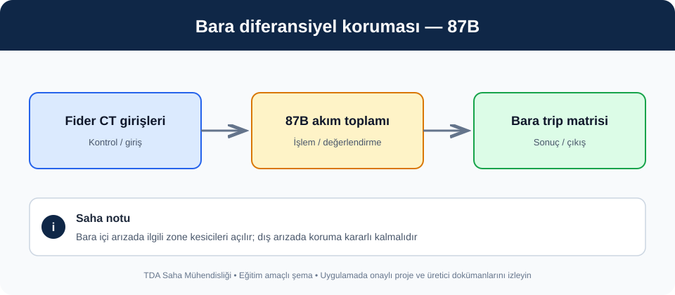

# 📖 Gün 17 — Bara Diferansiyeli: Şema Hesapları, CT Doyma ve Zone Mantığı (Teknik Detaylar)

Bu doküman, 17. Gün çalışması kapsamında incelenen **87B şema tipleri**, **yüksek impedans hesabı**, **Knee-point gereksinimleri** ve **zone/bay mantığı** konularını içerir.

---

## 1. Yüksek Impedanslı Bara Diferansiyeli

### 1.1. Devre Yapısı

```
CT1 ──┬── CT2 ──┬── CT3 ──┬── ...
      │         │         │
      ├─── Yüksek impedans V rölesi ───┤
      │                                │
     Nötr barası (ortak nokta)
```

Tüm CT'lerin aynı polariteli uçları bir bara noktasında, ters uçları diğer noktada birleştirilir. Aralarına **yüksek impedanslı voltaj rölesi** bağlanır.

### 1.2. Stabilite Reostası (Stabilizing Resistor)

Röleye seri bir $R_{stab}$ direnç eklenir. Dış arıza durumunda doyan CT'ın yaratığı fark akımı bu dirençte gerilim düşürür ve röle tripi engeller.

$$V_{set} = I_{arıza,max} \times (R_{CT} + R_{kablo} + R_{stab}) \times \frac{I_{f,doyma}}{I_{f,nominal}}$$

### 1.3. Knee-Point Gerilimi Gereksinimi

Yüksek impedans şemada **tüm CT'ler aynı knee-point** gerilimine sahip olmalıdır:

$$V_k \geq 2 \times V_{set} \quad \text{(tipik güvenlik faktörü)}$$

Pratikte aynı trafo tipi CT'ler kullanılır; karışık CT'ler (eski/yeni, farklı markalar) sorun yaratır.

---

## 2. Düşük Impedanslı Bara Diferansiyeli

### 2.1. Yapı

Modern IED'ler her fider CT'sini **ayrı analog giriş** olarak alır, yazılımsal olarak toplar.

$$\bar{I}_{differansiyel} = \left| \sum_{i=1}^{n} \bar{I}_i \right|$$

### 2.2. Avantajlar

-   Farklı CT oranları/özellikleri kullanılabilir (yazılımsal normalize).
-   Zone mantığı yazılımla esnek değiştirilebilir.
-   CT doyma dedektörü (saturation detector) ile stabilite artırılır.

### 2.3. Dezavantajlar

-   Her fider için ayrı analog giriş gerektirir — kablo maliyeti.
-   CT doyması doğrudan fark akımı yaratır — yazılımsal koruma gerekir.

---

## 3. CT Doyma Dedektörü (Saturation Detector)

Dış arıza durumunda:

1.  **İlk 3-5 ms:** CT doğrudur (fark akımı düşük).
2.  **5-10 ms:** CT doyar, fark akımı artar.

**Detektör mantığı:** Fark akımı **hızlı başlayıp** yavaş geliyorsa iç arıza; **gecikmeli** başlıyorsa CT doyması → inhibit.

---

## 4. Zone Mantığı ve Bus Coupler

### 4.1. Bölünmüş Bara (Split Bus)

İki bara segmenti, bus coupler ile bağlanır:

-   **Zone 1:** Bara A fiderleri
-   **Zone 2:** Bara B fiderleri
-   **Bus Coupler pozisyonuna göre:** BC kapalı → tek büyük zone; BC açık → iki ayrı zone.

### 4.2. Zone Seçim Mantığı

Modern röle, **bay kontrol ünitelerinden** (Bay Control Unit) gelen kesici/ayırıcı pozisyonlarına göre **zone'u dinamik değiştirir**. Bu, **check zone** ve **main zone** olarak iki seviyede yapılır.

### 4.3. Trip Mantığı

Bara iç arıza tespit edilirse:

1.  Arızalı zone'daki **tüm fider kesicileri** açılır.
2.  Bus coupler açık ise sadece arızalı zone açılır — sağlıklı zone devam eder.
3.  Bus coupler kapalı ise iki zone birlikte açılır (tam kayıp).

---

## 5. Saha Testleri — Detaylı

### 5.1. Stabilite Testi

-   Bir fiderden akım verilir, diğer fiderden **eşit ve zıt** yönde akım verilir (dış arıza simülasyonu).
-   Röle trip etmemeli.
-   Maksimum geçiş akımına kadar test edilmeli.

### 5.2. Hassasiyet Testi

-   Tek fiderden akım verilir (iç arıza simülasyonu).
-   Rölenin trip ettiği değer $I_{s0}$ ile karşılaştırılır.

### 5.3. Zone Testi

-   Bus coupler açık/kapalı senaryoları simüle edilir.
-   Her durumda doğru fiderlerin trip ettiği doğrulanır.

### 5.4. CT Testleri

-   Tüm fider CT'leri: oran, polarite, knee-point, sargı direnci.
-   Yüksek impedans şemada CT'lerin **birbirine benzerliği** kritik.

---

## 6. Tipik Hata Senaryoları

| Senaryo                          | Sonuç                                     | Çözüm                                  |
| :------------------------------- | :---------------------------------------- | :------------------------------------- |
| CT polarite ters (bir fider)     | Yükte bile sürekli trip                    | Polarite testi zorunlu                 |
| Farklı CT tipleri karışık        | Yüksek impedans şemada stabilite bozulur   | Benzer CT'ler veya düşük impedans şema |
| Zone mantığı hatalı              | Arıza dışı zone trip eder                  | Zone testleri zorunlu                  |
| Kablo kesiti yetersiz            | CT devre direnci artar, knee-point yetersiz | Kablo hesabı ile belirlenmeli         |

---



## 🔗 İlgili Kaynaklar

-   _IEC 60255 — Protection Relays_
-   _IEEE C37.234 — Guide for Protective Relay Applications to Power System Buses_
-   _Alstom NPAG — Chapter 15: Busbar Protection_
