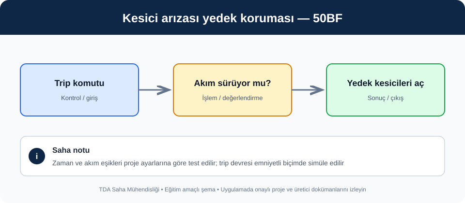

# 📍 Gün 18 — Kesici Yedek Koruma (50BF) ve Sistem Koordinasyonu

## 🎯 Günün Hedefleri

-   [x] 50BF (Breaker Failure) mantığını ve zamanlama zincirini kavramak.
-   [x] Trip arabulma (trip relay / lockout) yapılarını öğrenmek.
-   [x] Kesici açma sürelerinin koordinasyona etkisini analiz etmek.
-   [x] Test senaryoları ile 50BF davranışını doğrulamak.

---

## 📚 Özet Çalışma Notları

### 1. 50BF — Neden Gerekli?

Kesici arıza anında açmazsa, arıza akımı **sürekli beslenmeye** devam eder. Bu durumda:

-   Arızalı bölge **sürekli enerjili** kalır — ekipman hasarı büyür.
-   Üst kademe yedek koruma uzun gecikmeyle açar — geniş alan kesintiye uğrar.

**50BF:** Trip komutu verildi ama **akım devam ediyor** → komşu kesicileri aç.

### 2. 50BF Başlatma Şartları (VE mantığı)

1.  **Trip komutu var** (herhangi bir koruma fonksiyonu trip verdi).
2.  **Belirli süre sonra akım hâlâ mevcut** (CT üzerinden, $I > I_{BF,eqıv}$).

İkisi birlikte 200-300 ms sürerse → Breaker Fail kabul edilir.

### 3. Aksiyon Zinciri

```
50BF tespiti
  ├─ Komşu fider kesicileri aç (backup trip)
  ├─ Bara diferansiyeli tetikle (87B trip)
  ├─ Üst trafo kesicisi aç
  └─ Lockout rölesi (86) kilitlenir — manuel reset gerekir
```

### 4. Zamanlama

| Adım                       | Süre           |
| :------------------------- | :------------- |
| Trip komutu                | 0 ms           |
| Kesici açma (tipik VCB)    | 60-80 ms       |
| Arc süresi                 | 20-30 ms       |
| 50BF bekleme               | 150-200 ms     |
| Backup trip                | 200-250 ms     |

---



## 🔗 Detaylı Notlar

Lockout rölesi (86) mantığı, test senaryoları ve koordinasyon hesabı için:
👉 **[18. Gün Detaylı Teknik Notları (detail.md)](./detail.md)**
