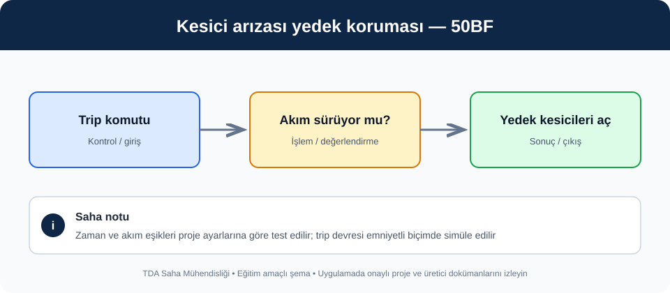

# 📖 Gün 18 — Kesici Yedek Koruma (50BF): Mantık, Lockout ve Testler (Teknik Detaylar)

Bu doküman, 18. Gün çalışması kapsamında incelenen **50BF mantığı**, **lockout rölesi (86)**, **koordinasyon** ve **test prosedürleri** konularını içerir.

---

## 1. 50BF Mantığı — Detay

### 1.1. Başlatma Şartları

50BF başlatmak için **iki koşulun VE'si** gerekir:

```
IF (trip_komutu_aktif) AND (akım > I_BF_set) THEN
    50BF_timer başlat
    IF timer > T_BF THEN
        Breaker Fail alarm → Backup trip
    ENDIF
ENDIF
```

-   $I_{BF,eqıv}$: Tipik olarak **%20 $I_{nom}$** — kesicinin açamadığını gösteren minimum akım.
-   $T_{BF}$: Tipik **150-250 ms** — kesici açma + arc süresi + tolerans.

### 1.2. Sıfır Akım ile Doğrulama

Bazı sistemlerde 50BF başlatmak için **akım kesilmesi** beklenir:

-   Trip komutu → akım **kaybolursa** kesici açtı → 50BF iptal.
-   Trip komutu → akım **sürerse** → 50BF tetiklenir.

Bu yaklaşım, **erken trip** (kesici henüz açmadan) riskini azaltır.

---

## 2. Lockout Rölesi (86 — Manuel Reset)

### 2.1. Rolü

Bir trip olduktan sonra **otomatik yeniden kapamayı engelleyen** kilitli röle:

-   Trip → 86 aktif → kesici kapama devresi bloke.
-   **Manuel reset** gerektirir (operatör onayı).

### 2.2. Neden Gerekli?

-   Arıza tekrarlayabilir; otomatik kapama ikinci hasarı tetikler.
-   Arıza nedeni belirlenmeden devreye alınmamalı.

### 2.3. Tipik Uygulama

| Koruma        | Lockout? | Neden                         |
| :------------ | :------- | :---------------------------- |
| 87T (trafo)   | ✓        | Ağır iç arıza — kontrol şart  |
| 87B (bara)    | ✓        | Bara arıza — kontrol şart     |
| 50BF          | ✓        | Kesici arızalı — kontrol şart |
| 51 (fider)    | ✗        | 79 AR ile tekrar kapama mümkün |

---

## 3. Trip Arabulma (Trip Relay / Trip Matrix)

### 3.1. Kavram

Hangi koruma fonksiyonunun **hangi kesiciyi** açacağı tablosu:

| Koruma            | Fider Kesici | Trafo YG Kesici | Bara Kesici |
| :---------------- | :----------- | :-------------- | :---------- |
| 51 Fider          | ✓            | ✗               | ✗           |
| 87T Trafo         | ✗            | ✓               | ✗           |
| 87B Bara          | ✓            | ✓               | ✓           |
| 50BF              | ✓ (backup)   | ✓               | ✓           |

### 3.2. Uygulama Yolları

-   **Bakır kablolama:** Trip kontakları fiziksel olarak kesici trip devrelerine bağlanır.
-   **GOOSE (IEC 61850):** Sanal trip mesajları — kablosuz, esnek.
-   **Yazılımsal trip matrix:** IED içindeki PLC mantığı.

---

## 4. Koordinasyon ve Zamanlama Hesabı

### 4.1. Toplam Kesme Süresi

$$t_{toplam} = t_{röle} + t_{kesici} + t_{arc}$$

| Bileşen          | Tipik Süre     |
| :--------------- | :------------- |
| Röle kararı      | 15-40 ms       |
| Kesici açma      | 50-80 ms (VCB), 30-50 ms (SF6 YG) |
| Arc söndürme     | 10-30 ms       |
| **Toplam**       | **80-150 ms**  |

### 4.2. 50BF Zaman Ayarı

$$T_{BF} > t_{kesici} + t_{tolerans}$$

Tipik: **200 ms** (kesici 80 ms + %50 güvenlik payı).

### 4.3. Üst Kademe Koordinasyonu

50BF backup trip süresi, üst kademeyi (örn. trafo 51) **geçmemeli**:

```
Fider 51:      0.9 s
50BF backup:   0.25 s  ← daha hızlı olmalı
Trafo 51:      1.4 s
```

---

## 5. Test Prosedürleri

### 5.1. Normal Trip Testi

1.  Sekonder enjeksiyon ile trip fonksiyonu tetiklenir.
2.  Kesici açılır — akım kesilir.
3.  50BF tetiklenmez (akım 200 ms içinde kesildi).

### 5.2. Breaker Fail Simülasyonu

1.  Kesici **açmayacak şekilde bloke edilir** (test modu veya fiziksel blok).
2.  Sekonder enjeksiyon ile trip tetiklenir.
3.  **Beklenen:**
    -   Akım devam eder.
    -   200 ms sonra 50BF alarm.
    -   Komşu fider trip kontakları kapanır.
    -   86 lockout aktif.
4.  Reset testi: 86 manuel reset edilir, sistem normale döner.

### 5.3. Zamanlama Ölçümü

-   Trip komutu → backup trip arası süre ölçülür.
-   **Kabul:** $T_{BF}$ ayar değeri ±20 ms.

---

## 6. Tipik Hata Senaryoları

| Senaryo                              | Sonuç                              |
| :----------------------------------- | :--------------------------------- |
| $I_{BF,eqıv}$ çok yüksek             | Gerçek fail algılanmaz             |
| $T_{BF}$ çok kısa                    | Yavaş açan kesicide sahte 50BF     |
| Backup trip hedefleri yanlış         | Yanlış fiderler açılır             |
| 86 reset unutulur                    | Kesici yeniden kapatılamaz         |
| Test modunda kesici bloke unutulur   | Sahada sahte backup trip           |

---



## 🔗 İlgili Kaynaklar

-   _IEEE C37.119 — Guide for Breaker Failure Protection_
-   _IEC 60255 — Protection Relays_
-   _Alstom NPAG — Chapter 16: Busbar and Backup Protection_
