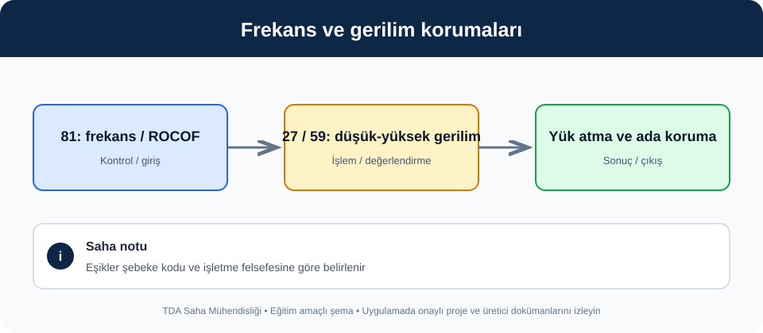

# 📍 Gün 19 — Frekans ve Gerilim Korumaları (81, 27/59), Ada Tespiti

## 🎯 Günün Hedefleri

-   [x] Frekans korumasının (81U/81O/ROCOF) şebeke çökme mantığını kavramak.
-   [x] Yük atma (load shedding) öncelik sistemini öğrenmek.
-   [x] Gerilim korumalarını (27/59/47) motor ve şebeke uygulamalarında ayırt etmek.
-   [x] Anti-islanding (ada tespiti) mantığını ve jeneratör korumasını analiz etmek.

---

## 📚 Özet Çalışma Notları

### 1. Frekans Korumaları

| Fonksiyon | ANSI | Tipik Ayar       | Amaç                    |
| :-------- | :--- | :--------------- | :---------------------- |
| Under-freq | 81U | 49 Hz (1. kademe)| Şebeke yük fazlalığı    |
| Over-freq  | 81O | 51 Hz            | Şebeke üretim fazlalığı |
| ROCOF      | 81R | 0.5-2 Hz/s       | Hızlı ada tespiti       |

**Mantık:** Frekans düşüşü → üretim < yük → **yük atılmalı** veya frekans yükselişi → üretim > yük → üretim azaltılmalı.

### 2. Yük Atma (Load Shedding) Kademeleri

| Kademe | Frekans Tetik | Atılan Yük |
| :----- | :------------ | :--------- |
| 1      | 49.0 Hz       | %10        |
| 2      | 48.75 Hz      | %10        |
| 3      | 48.5 Hz       | %15        |
| 4      | 48.25 Hz      | %15        |

> ⚡ **Kural:** Kademe 4 tetiklenirse sistem **çökmeye yakın** demektir — kritik yükler dışında her şey ayrılır.

### 3. Gerilim Korumaları

-   **27 (UV):** Motor koruması (düşük gerilimde yeniden kalkış tehlikeli), şebeke düşüşü.
-   **59 (OV):** Aşırı gerilim — izolasyon riski.
-   **47 (Unbalance):** Negatif sıra gerilim — motor asimetrisi.

### 4. Ada Tespiti (Anti-Islanding)

Şebeke bağlantısı koptuğunda, santral tek başına çalışmaya devam ederse **ada** oluşur. Tehlike:

-   Gerilim/frekans kontrolsüz dalgalanır.
-   Tekrar bağlanma anında **senkron dışı bağlanma** — ekipman hasarı.

**Tespit Yöntemleri:** ROCOF, vektör kayması (vector shift), aktif güç kayması, pasif/aktif tarama.

---

## 🔗 Detaylı Notlar

Yük atma tablosu tasarımı, ROCOF hesabı ve ada tespiti algoritmaları için:
👉 **[19. Gün Detaylı Teknik Notları (detail.md)](./detail.md)**
