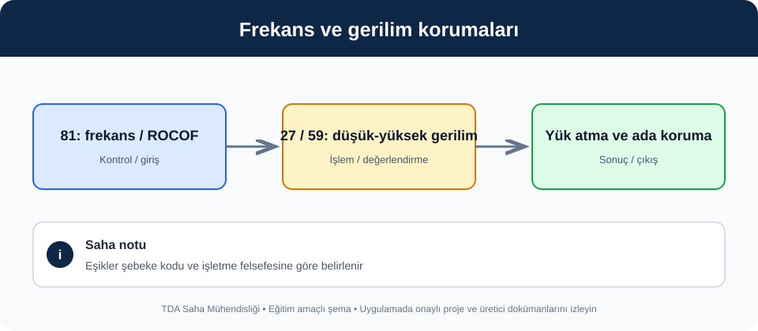

# 📖 Gün 19 — Frekans ve Gerilim Korumaları: Yük Atma ve Ada Tespiti (Teknik Detaylar)

Bu doküman, 19. Gün çalışması kapsamında incelenen **frekans koruma tasarımı**, **yük atma kademeleri**, **gerilim koruma uygulamaları** ve **anti-islanding algoritmaları** konularını içerir.

---

## 1. Şebeke Frekans Dinamiği

### 1.1. Frekans — Denge Göstergesi

$$P_{üretim} = P_{yük} \Rightarrow f = f_{nom}$$

-   **Üretim > yük:** Frekans yükselir.
-   **Üretim < yük:** Frekans düşer.
-   Büyük sistemlerde frekans salınımı yavaştır; küçük (ada) sistemlerde **çok hızlı** düşebilir.

### 1.2. Frekans Düşüş Hızı

$$\frac{df}{dt} = \frac{\Delta P}{2H} \times f_{nom}$$

-   $H$: Sistem atalet sabiti (s) — büyük sistemlerde 4-6 s, küçük adalarda 1-2 s.
-   **Örnek:** %10 yük fazlalığı, $H = 4$ s → $df/dt = 1.25$ Hz/s.

> ⚡ **Kritik:** Ada oluşumunda $df/dt$ **2-5 Hz/s** mertebesine çıkar — ROCOF koruması bunu yakalar.

---

## 2. Yük Atma (Load Shedding) Tasarımı

### 2.1. Kademe Tasarım Kuralları

1.  Toplam atılabilir yük, **en kötü üretim kaybını** karşılamalı (tipik %30-50).
2.  Kademeler **0.25 Hz arayla** dizilir.
3.  Her kademe gecikmesi **0.1-0.3 s** (rofile + kesici süresi).
4.  Yükler **öncelik sırasına** göre atanır: en önce atılacak → sosyal/üretim önemsiz.

### 2.2. Kritik Yükler (Asla Atılmaz)

-   Hastane, güvenlik sistemleri
-   Soğutma sistemleri (reaktör, trafo)
-   Haberleşme ve SCADA
-   Yangın pompaları

### 2.3. UFLS (Under Frequency Load Shedding) Tablosu Örneği

| Kademe | Frekans  | Gecikme | Atılan Yük | Amaç                    |
| :----- | :------- | :------ | :--------- | :---------------------- |
| 1      | 49.0 Hz  | 0.1 s   | %10        | Hafif dengesizlik       |
| 2      | 48.75 Hz | 0.1 s   | %10        | Orta dengesizlik        |
| 3      | 48.5 Hz  | 0.1 s   | %15        | Ciddi dengesizlik       |
| 4      | 48.0 Hz  | 0.1 s   | %15        | Acil durum              |
| Son    | 47.5 Hz  | —       | Jeneratör ayrıl | Sistem çökme koruma |

### 2.4. Over-Frequency Kontrol

-   Üretim fazlalığı → frekans yükselir → 51 Hz'de **üretim azaltılır**.
-   Yenilenebilir kaynaklarda 51.5 Hz üzerinde **bağlantı kesilir** (grid code).

---

## 3. Gerilim Korumaları — Uygulama

### 3.1. 27 UV — Motor Koruması

Motor çalışırken gerilim düşerse:
-   Tork $\propto V^2$ → tork düşer, motor durabilir.
-   Gerilim geri geldiğinde **yeniden kalkış akımı** — ağır ve ısındırıcı.

**Ayar:** Tipik **0.8 × $U_{nom}$**, 1-3 s. Motor ayrılır.

### 3.2. 59 OV — İzolasyon Koruması

-   Aşırı gerilim izolasyonu yorar, kısa ömür.
-   Ayar: **1.1-1.2 × $U_{nom}$**, IDMT veya DT.
-   Aydınlatma/trafo ekipmanlarına göre seçilir.

### 3.3. 47 — Negatif Sıra Gerilim

Motor uygulaması:
-   Faz kaybı (tek faz açılması) veya asimetri.
-   Negatif sıra gerilim **ters döner alan** yaratır — motor ısınır, tork düşer.
-   Ayar: Tipik **%2-5 $U_{nom}$** negatif sıra.

---

## 4. Ada Tespiti (Anti-Islanding) Algoritmaları

### 4.1. Pasif Yöntemler

| Yöntem           | İlke                                        | Dezavantaj                    |
| :--------------- | :------------------------------------------ | :---------------------------- |
| **ROCOF**        | $df/dt$ eşiği                                | Yükte sahte trip              |
| **Vector Shift** | Faz açısının hızlı kayması                  | Ayar hassas                   |
| **Frekans sapması** | Ada frekansı hızlı değişir               | Yavaş adalarda yetersiz       |

### 4.2. Aktif Yöntemler

-   **Aktif frekans kaydırma:** İnverter küçük frekans perturbasyonu gönderir; şebeke bağlıyken absorbe edilir, adada **büyür**.
-   **Impedans ölçümü:** İnverter periyodik küçük yük değişimi yapar; tepkiden şebeke impedansı hesaplanır.

### 4.3. Ada Olmadan Yapılan Yanlış Trip

ROCOF koruması, **şebeke bağlantılı** sistemde ani yük değişimlerinde sahte alarm verebilir. Bu yüzden:

-   ROCOF + **düşük gerilim onayı** (VE mantığı) kullanılır.
-   Ya da **kezdete (supervised)** ROCOF: Şebeke kesicisi açık bilgisine bağlı.

---

## 5. Jeneratör Korumaları ile İlişki

| Koruma            | Fonksiyon                                    |
| :---------------- | :------------------------------------------ |
| 81U/81O           | Jeneratör frekans limitleri                 |
| 27/59             | Jeneratör gerilim limitleri                 |
| 40 (Loss of Excitation) | Uyartım kaybı — jeneratör motor gibi çalışır |
| 32 (Reverse Power)| Jeneratör **motor gibi** çekiyor — primer mover korunmalı |
| 78 (Out-of-Step)  | Pole slipping                               |

---

## 6. Saha Testleri

### 6.1. Frekans Koruması Testi

1.  Test cihazı ile frekans kademeli düşürülür.
2.  Pick-up frekansı doğrulanır.
3.  Trip süresi ölçülür.
4.  ROCOF testi: frekans rampası uygulanır ($df/dt$ doğrulanır).

### 6.2. Ada Tespiti Testi

1.  Şebeke kesicisi açılır (simülasyon).
2.  ROCOF/vector shift tepkisi ölçülür.
3.  Jeneratör bağlantı kesici açılmalı.

---

## 🔗 İlgili Kaynaklar

-   _IEC 60255 — Protection Relays_
-   _IEEE C37.117 — Guide for IEEE Standard for Power System Protection_
-   _TEİAŞ Grid Code — Şebeke Bağlantı Teknik Kuralları_
-   _IEEE 1547 — Distributed Generation Interconnection_
