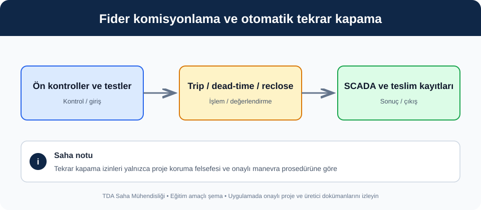

# 📍 Gün 20 — Auto Reclose (79) ve Havai Hat Şebekeleri

## 🎯 Günün Hedefleri

-   [x] Auto-reclose (79) mantığını ve havai hat şebekelerindeki rolünü kavramak.
-   [x] Tek/çok atışlı (single/multi-shot) senaryolarını ayırt etmek.
-   [x] Dead time ve reclaim time parametrelerini doğru ayarlamak.
-   [x] Kablo-havai hat karışık fiderlerde reclose kısıtlamalarını öğrenmek.

---

## 📚 Özet Çalışma Notları

### 1. Auto-Reclose Mantığı

Havai hat arızalarının **%80-90'ı geçicidir** (ağaç teması, kuş, rüzgar kaynaklı kısa süreli temas). Kesici açar, ark söner, izolasyon kendini onarır → **tekrar kapama ile enerji geri gelir.**

```
Arıza → Trip (0.1 s) → Dead Time (0.3-3 s) → Reclose
  ├─ Başarılı (%80) → İşletme devam
  └─ Başarısız (%20) → 2. trip → uzun dead time → 2. reclose → lockout (86)
```

### 2. Tipik Ayarlar

| Parametre     | Değer              | Amaç                              |
| :------------ | :----------------- | :-------------------------------- |
| Dead Time 1   | 0.3 - 1 s          | Ark sönmesi ve iyon temizliği     |
| Dead Time 2   | 5 - 15 s           | Daha kalıcı arıza için ikinci şans |
| Reclaim Time  | 10 - 30 s          | Başarılı kapamayı doğrulama       |
| Atış sayısı   | 1-3 (tipik 1 veya 2)| Kalıcı arızada sistem koruma      |

### 3. Kısıtlamalar

-   **Kablolu fiderlerde reclose YAPILMAZ** — kablo arızası kalıcıdır, ikinci enerjileme arızayı büyütür.
-   **Karma hat:** Sadece havai hat bölümünde arıza algılanırsa reclose izinli (yönülü/sektör seçimli reclose).
-   **Trafo/jeneratör yakınlığı:** Senkron kontrolü gerekli — senkron check (25) ile reclose.

### 4. Saha Testleri

| Test                    | Yöntem                                   |
| :---------------------- | :--------------------------------------- |
| Reclose sequence        | Sekonder enjeksiyon ile trip tetikle, zamanları ölç |
| Lockout (86) testi      | Tüm atışları tüket, kilitlendiğini doğrula |
| Senkron check (25)      | Faz/frekans farklıyken reclose engelleniyor mu? |
| Manual block            | Yerel manevra sırasında reclose devre dışı |

---



## 🔗 Detaylı Notlar

Reclose senaryoları, senkron check mantığı ve kablo-havai karışık hat ayarları için:
👉 **[20. Gün Detaylı Teknik Notları (detail.md)](./detail.md)**
