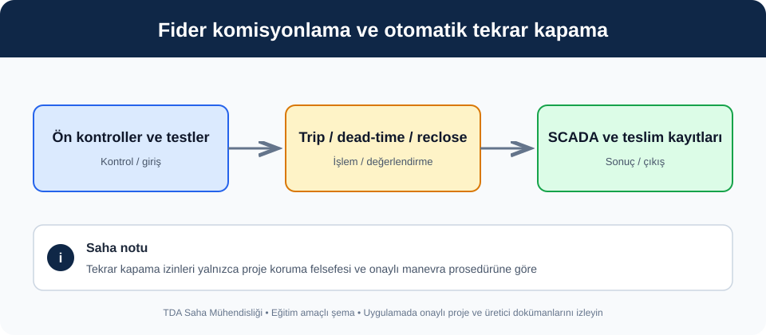

# 📖 Gün 20 — Auto Reclose (79): Senaryolar, Senkron Check ve Saha Testleri (Teknik Detaylar)

Bu doküman, 20. Gün çalışması kapsamında incelenen **auto-reclose tipleri**, **dead/reclaim time hesapları**, **senkron check** ve **reclose blocking** konularını içerir.

---

## 1. Reclose Tipleri

### 1.1. Three-Pole (Üç Kutuplu) Reclose

-   Tüm üç faz birlikte açılır ve kapanır.
-   Basit, klasik uygulama — OG dağıtımda standart.
-   Dezavantaj: Tek faz arızasında sağlıklı iki faz da kesilir.

### 1.2. Single-Pole (Tek Kutuplu) Reclose

-   Arızalı faz açılır, sağlıklı iki faz devam eder.
-   **%60-80 kesinti kaybını önler** — kalite artışı.
-   Yalnızca **havai hat, tek arıza** durumunda güvenli.
-   Şebeke bağlantılı sistemlerde zorunlu: iki faz açıkken ada oluşumu kontrol edilmeli.

### 1.3. Ters Reclose (Delayed / Deferred Reclose)

-   Uzaktan kumanda ile operatör onayı bekler.
-   Kontrollü senaryolar veya kritik yüklerde kullanılır.

---

## 2. Dead Time Hesabı

### 2.1. Ark Sönmesi Bekleme

Havai hat arızasında, kesici açıldıktan sonra ark yolu iyonize kalır. Yeniden kopma (restrike) olmaması için:

$$t_{dead} \geq 10 \times \frac{U_{nom}}{100\text{kV}} \text{ (ms)}$$

Örnek: 36 kV → minimum 360 ms. Tipik ayar: **0.5-1 s**.

### 2.2. Kablo-Havai Karışık Hat

-   Arıza mesafe koruması ile belirlenirse:
    -   **Havai hat bölgesi** → reclose izinli.
    -   **Kablo bölgesi** → reclose **bloklanır**.
-   Mesafe koruması Zone ayarları veya hata konumu bilgisi (fault locator) ile yapılır.

---

## 3. Senkron Check (25) ile Reclose

### 3.1. Ne Zaman Gerekli?

İki taraftan da enerjilenmiş hat uçlarında (ring main, paralel hat):

-   Reclose yapılmadan önce iki tarafın **senkron olması** gerekir.
-   Senkron dışı reclose = kısa devre ve mekanik hasar.

### 3.2. Senkron Şartları

| Parametre     | Tipik Kabul       |
| :------------ | :---------------- |
| Gerilim farkı | < %10-20          |
| Frekans farkı | < 0.1 - 0.2 Hz    |
| Faz açısı     | < 20° - 40°       |

### 3.3. Live-Line / Dead-Line Mantığı

| Hat Tarafı | Bara Tarafı | Reclose İzni                     |
| :--------- | :---------- | :------------------------------- |
| Dead       | Live        | İzin (syncless reclose)          |
| Live       | Dead        | Bloke — bara enerjisiz          |
| Live       | Live (sync) | Sync check şartına bağlı         |
| Dead       | Dead        | Bloke — sistem enerjisiz        |

---

## 4. Reclaim Time ve Lockout

### 4.1. Reclaim Time

Başarılı reclose sonrası **izleme süresi**:

-   Bu süre içinde yeni trip olursa → **lockout** (86) → daha fazla deneme yapılmaz.
-   Tipik: **10-30 s**.

### 4.2. Lockout (86)

Kalıcı arıza tespiti:

-   Tüm atışlar tüketildi → sistem kilitlenir.
-   Manuel reset olmadan reclose çalışmaz.
-   Arıza ekibi devreye girer, kalıcı onarım yapılır.

### 4.3. Reclose Sayısı

| Tip              | Atış     | Uygulama                    |
| :--------------- | :------- | :-------------------------- |
| Tek atış (1 shot)| 1        | OG dağıtım, hızlı temizleme |
| İki atış (2 shot)| 2        | Karma sistemler, ikinci şans |
| Üç+ atış         | 3-4      | Ağaç teması yoğun hatlar    |

---

## 5. Saha Testleri — Detaylı

### 5.1. Reclose Sequence Testi

Sekonder enjeksiyon cihazı ile:

1.  Koruma fonksiyonu trip ettirilir (akım uygulanır).
2.  Kesici açılır — akım kesilir.
3.  Test cihazı **akımı geri getirir** (hat tarafı hâlâ enerjili simülasyonu).
4.  **Dead time** sonrası kesici kapama komutunu kontrol et.
5.  Ölçümler: Dead time, reclaim time, trip sayısı.

### 5.2. Senkron Check Testi

-   İki ayrı gerilim kaynağı ile simülasyon yapılır.
-   Faz açısı, frekans, gerilim farkı kademeli değiştirilir.
-   Reclose sadece izin verilen kombinasyonda çalışmalı.

### 5.3. Blocking Testleri

| Test                          | Beklenen                       |
| :---------------------------- | :----------------------------- |
| Manuel trip (operatör)        | Reclose çalışmaz               |
| Trafo koruması trip           | Reclose çalışmaz               |
| Bara koruması trip            | Reclose çalışmaz               |
| Fider aşırı akım trip         | Reclose çalışır                |
| Low gas trip                  | Reclose çalışmaz               |

> ⚡ **Kritik Kural:** Sadece **hat arızası kaynaklı** trip'larda reclose çalışır. Trafo, bara, kesici koruma trip'ları kalıcıdır.

---

## 6. Tipik Hata Senaryoları

| Senaryo                                | Sonuç                              |
| :------------------------------------- | :--------------------------------- |
| Dead time çok kısa                     | Ark yeniden tutuşur — reclose fail |
| Kablolu hat üzerinde reclose aktif      | Kablo tekrar patlar                |
| Senkron check kapalı                    | Senkron dışı bağlanma — hasar      |
| Reclaim time çok kısa                   | İkinci trip'e yakalanır — lockout hemen |
| Manual block bypass                     | Manevra sırasında sahte reclose    |

---

## 🔗 İlgili Kaynaklar

-   _IEEE C37.104 — Guide for Automatic Reclosing_
-   _IEC 60255-149 — Functional Requirements for Auto-Reclosing_
-   _TEİAŞ Dağıtım Şebeke Yönetmeliği_
