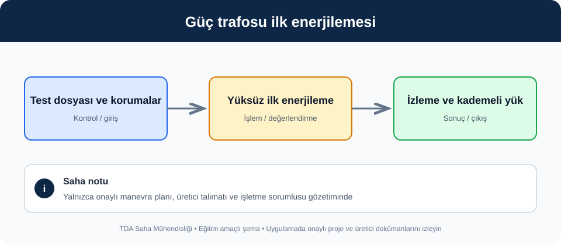

# 📍 Gün 21 — Güç Trafo Devreye Alma: Enerjileme ve Inrush İzleme

## 🎯 Günün Hedefleri

-   [x] Trafo devreye alma prosedürünü adım adım öğrenmek.
-   [x] Inrush (çekme) akımı fenomenini ve koruma etkisini analiz etmek.
-   [x] İlk enerjileme sonrası izleme listesini uygulamak.
-   [x] Kademeli yük alma ve termal izleme mantığını kavramak.

---

## 📚 Özet Çalışma Notları

### 1. Devreye Alma Ön Kontrolleri

-   [ ] Test dossier tamamlanmış (TTR, IR, PI, yağ analizi, SFRA).
-   [ ] Koruma röleleri aktif (87T, REF, Buchholz, sıcaklık).
-   [ ] Nötr topraklama yapılmış (YN tarafı).
-   [ ] Buchholz ve PRD valfleri açık konumda.
-   [ ] Soğutma sistemleri (fan/pompa) çalışıyor.
-   [ ] Tap changer doğru kademede, motor tahrik çalışıyor.

### 2. İlk Enerjileme (No-Load)

1.  Yük tarafı kesici **açık** konumda.
2.  Trafo kesicisi kapatılır — trafo **yüksüz** enerjilenir.
3.  **Inrush akımı izlenir:** Tipik 6-12 × $I_n$, 0.1-1 s sürebilir.
4.  **Dinleme:** Anormal ses (humming, tıslama) kontrol edilir.
5.  Gerilim üç fazda ölçülür, faz sırası kontrol edilir.
6.  **8-24 saat** izleme: sıcaklık, ses, yağ sızıntısı, gaz oluşumu.

### 3. Kademeli Yük Alma

-   Yük **%25 → %50 → %75 → %100** şeklinde kademeli artırılır.
-   Her kademe arası **1-2 saat** izleme.
-   Sıcaklık artışı, yağ sızıntısı, ses kontrolü.

---

## 🔗 Detaylı Notlar

Inrush hesabı, izleme kontrol listesi ve tipik sorunlar için:
👉 **[21. Gün Detaylı Teknik Notları (detail.md)](./detail.md)**
