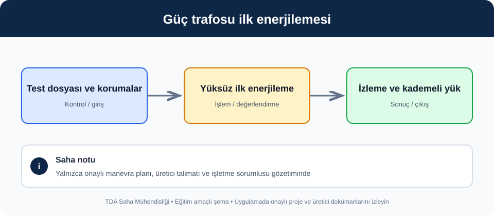

# 📖 Gün 21 — Trafo Devreye Alma: Inrush, İzleme ve Sorun Giderme (Teknik Detaylar)

Bu doküman, 21. Gün çalışması kapsamında incelenen **trafo enerjileme prosedürü**, **inrush analizi**, **izleme kontrol listesi** ve **tipik sorunlar** konularını içerir.

---

## 1. Inrush (Çekme Akımı) Fenomeni

### 1.1. Fiziksel Kaynak

Trafo çekirdeği **histerezis** özelliği nedeniyle **residual flux** ($\Phi_r$) taşır. Gerilim sıfır geçişinde enerjilenirse, istenen akı $\Phi_{nom} + \Phi_r$ olabilir — çekirdek **doyma** noktasına zorlanır:

$$i_{inrush} \approx 6-12 \times I_{nom} \text{ (ilk pik)}$$

### 1.2. Zamanla Azalma

Inrush akımı **RC zaman sabiti ile** azalır:
-   Büyük trafolar: 1-10 s (bazı durumlarda daha uzun)
-   Küçük trafolar: 0.1-1 s

### 1.3. Harmonik Karakteristik

Inrush akımının belirgin özelliği:
-   **Yüksek 2. harmonik** ($I_2/I_1 > 15\%$)
-   **Tek yönlü (DC bileşenli)** dalga şekli
-   **Asimetrik pikler**

Bu özellik, 87T rölesinin inrush'ı **iç arızadan ayırt etmesini** sağlar (Gün 16 detayı).

---

## 2. Devreye Alma Prosedürü — Detaylı

### 2.1. Ön Kontrol Listesi

| Kontrol                          | Kriter                       |
| :------------------------------- | :--------------------------- |
| Yağ seviyesi                     | Gösterge nominal             |
| Yağ sıcaklığı                    | > 0°C (soğukta ısıtma gerekebilir) |
| Silika jel                       | Mavi (nemli değil)           |
| Buchholz havası                  | Boşaltılmış                  |
| Nötr topraklama                  | Bağlı (YN tarafı)            |
| Tap changer pozisyonu            | Ana kademe (tipik 1 veya orta)|
| Soğutma                          | Çalışır durumda              |
| Yağ sızıntısı                    | Görsel kontrol               |
| İzolasyon testleri               | PI > 2, IR > 1 GΩ            |
| Yağ analizi                      | IEC 60422 kriterleri         |
| SFRA (varsa)                     | Fabrika eğrisi ile uyum      |

### 2.2. Enerjileme Adımları

1.  **Tüm yedek korumalar aktif** — 51/50 (YG/AG tarafı), 27/59, 81.
2.  **AG tarafı kesici açık** — yüksüz enerjileme.
3.  **YG kesici kapatılır.**
4.  **Inrush izleme:** Koruma rölesi event kaydı kontrol edilir.
5.  **AG tarafında gerilim ölçümü** — üç faz dengeli, doğru sıra.
6.  **15-30 dk bekleme** — anormal ses, sıcaklık, gaz.
7.  **AG tarafı yük yüklenir** — kademeli.

### 2.3. Paralel Çalışmaya Geçiş (İki Trafo)

İki trafo paralel çalışacaksa:

-   **Vektör grupları aynı** olmalı (Dyn11 + Dyn11 ✓, Dyn11 + YNd11 ✗).
-   **Çevrim oranları eşit** (±%0.5).
-   **Empedans oranları** yakın (%10 fark içinde).
-   **Faz kontrolü** paralel kesici üzerinde yapılır (faz-faz gerilim 0V).
-   Paralel kesici kapatılır — **dolaşım akımı (circulating current)** kontrol edilir (< %10 $I_{nom}$).

---

## 3. İlk 24 Saat İzleme Listesi

| Saat    | Kontrol                                       |
| :------ | :-------------------------------------------- |
| 0-1 s   | Inrush akımı geçti mi? 87T inhibit çalıştı mı? |
| 0-15 dk | Sıcaklık trendi, ses, yağ sızıntısı            |
| 0-1 s   | Buchholz gaz birikimi başladı mı?              |
| 1-8 saat| Yağ sıcaklığı stabilize olmalı (70-85°C max)   |
| 8-24 saat| Yağ ve sargı sıcaklığı, DGA örneklemesi (kritik trafolarda) |

### 3.1. Sıcaklık Beklentileri

-   **Yağ sıcaklığı:** Nominal yükte 60-85°C (toplam = ortam + 50-65°C rampa).
-   **Sargı sıcaklığı:** Yağ + 10-20°C (tipik 75-95°C).
-   Soğutma tipleri: ONAN, ONAF, OFAF, ODAF (IEC 60076-2).

---

## 4. Tipik Sorunlar ve Çözümler

| Sorun                            | Muhtemel Neden                          | Çözüm                              |
| :------------------------------- | :-------------------------------------- | :--------------------------------- |
| Anormal hum (gürültü)            | Gevşek çekirdek sıkma, rezonans         | Sıkma kontrol, frekans analizi     |
| Yağ sıcaklığı hızlı artış        | Soğutma arızalı, yük dengesiz           | Fan/pompa kontrol, yük kontrol     |
| Buchholz alarm (ilk saat)        | Hava kabarcıkları (normal), yağ dolumu hatalı | Hava boşaltma, tekrar izleme  |
| 87T trip enerjilemede            | Inrush inhibit ayarı düşük, vektör grubu parametresi hatalı | Ayar kontrol, 2. harmonik eşiği |
| Yağ sızıntısı                    | Conta, valf, radiator hattı             | Acil müdahale, yağ seviyesi izle   |
| Tap changer arızası              | Motor tahrik limit switch, zamanlama    | Manuel sıfırlama, servis           |

---

## 5. Yağ Analizi Kabul Kriterleri

İlk yağ analizi (IEC 60422):

| Parametre            | Kabul               |
| :------------------- | :------------------ |
| Dielektrik dayanım   | > 60 kV (2.5 mm gap)|
| Su içerik            | < 10 ppm (151 kV+)  |
| Asitlik              | < 0.05 mg KOH/g     |
| IFT (Interfacial Tension) | > 40 mN/m      |
| Çözünmüş gaz         | Düşük (yeni yağ)    |

---

## 🔗 İlgili Kaynaklar

-   _IEC 60076-1 — Power Transformers_
-   _IEC 60076-2 — Temperature Rise_
-   _IEC 60422 — Mineral Insulating Oils Supervision Guide_
-   _IEEE C57.106 — Acceptance of Insulating Oil_
