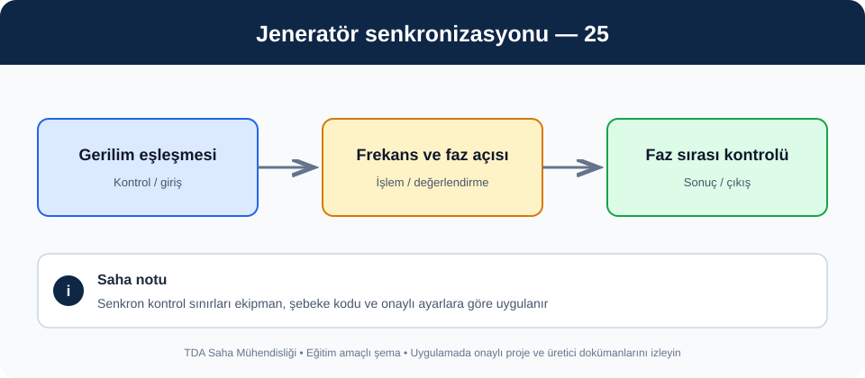

# 📍 Gün 22 — Jeneratör Senkronizasyonu ve Senkron Check (25)

## 🎯 Günün Hedefleri

-   [x] Senkronizasyon şartlarını (gerilim, frekans, faz açısı) kavramak.
-   [x] Senkron check rölesi (25) çalışma mantığını öğrenmek.
-   [x] Otomatik senkronizasyon ve manuel senkronizasyon farklarını analiz etmek.
-   [x] Senkron dışı bağlanma sonuçlarını ve koruma davranışını değerlendirmek.

---

## 📚 Özet Çalışma Notları

### 1. Senkronizasyon Şartları

Jeneratör şebekeye bağlanmadan önce dört şart sağlanmalıdır:

| Şart            | Tipik Kabul       | Neden                              |
| :-------------- | :---------------- | :--------------------------------- |
| Gerilim farkı   | < %5-10           | Aşırı akım ve mekanik stres        |
| Frekans farkı   | < 0.1 - 0.2 Hz    | Güç salınımı, tork darbeleri       |
| Faz açısı       | < 10° - 20°       | Mekanik tork darbesi               |
| Faz sırası      | Aynı (ABC)        | Yanlış sıra = kısa devre gibi      |

### 2. Senkron Check Rölesi (25)

-   Kesicinin **iki tarafındaki** gerilimleri karşılaştırır.
-   Şartlar sağlanırsa **kapama izni** verir; sağlanmazsa **bloklar**.
-   **Auto-sync modu:** Jeneratör hız/gerilim regülatörüne komut verir, şart sağlanınca otomatik kapar.

### 3. Senkron Dışı Bağlanma Sonuçları

| Şart İhlali       | Sonuç                                        |
| :---------------- | :------------------------------------------- |
| Faz açısı 180°    | Maksimum tork darbesi — şaft kırılabilir     |
| Frekans farkı     | Güç salınımı — mekanik yorulma               |
| Gerilim farkı     | Reaktif akım darbesi — sargı ısınması        |
| Faz sırası ters   | Kısa devre eşdeğeri — anında hasar           |

---

## 🔗 Detaylı Notlar

Senkron check ayarları, otomatik senkronizasyon algoritması ve saha testleri için:
👉 **[22. Gün Detaylı Teknik Notları (detail.md)](./detail.md)**
