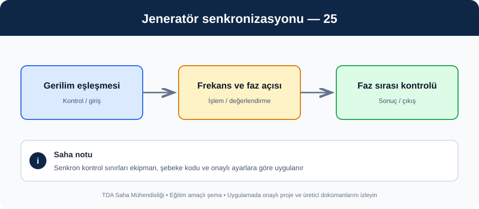

# 📖 Gün 22 — Jeneratör Senkronizasyonu: Şartlar, 25 Rölesi ve Testler (Teknik Detaylar)

Bu doküman, 22. Gün çalışması kapsamında incelenen **senkronizasyon matematiği**, **25 rölesi ayarları**, **otomatik senkron** ve **saha testleri** konularını içerir.

---

## 1. Senkronizasyon Matematiği

### 1.1. Faz Farkı ile Tork Darbesi

Senkron dışı bağlanmada oluşan maksimum güç darbesi:

$$P_{darbe} \approx \frac{E \times V}{X_d'} \times \sin(\delta)$$

-   $\delta = 180°$: Maksimum darbe — jeneratör şaftına **catastrofik tork** uygulanır.
-   $\delta = 30°$: Halihazırda **%50 nominal tork** darbesi.

### 1.2. Frekans Farkı ile Güç Salınımı

Frekans farkı $\Delta f$ varsa, bağlanma sonrası **power swing** olur:

$$f_{swing} \approx \sqrt{\frac{P_s}{2H}}$$

-   $P_s$: Senkron güç katsayısı
-   $H$: Atalet sabiti
-   Tipik salınım frekansı: 0.5-2 Hz.

---

## 2. Senkron Check Rölesi (25)

### 2.1. Çalışma Prensibi

Röle, kesicinin iki tarafındaki gerilimleri ölçer:

-   $V_{jeneratör}$ tarafı: Jeneratör gerilimi
-   $V_{şebeke}$ tarafı: Bara gerilimi

Karşılaştırma yapar ve şu durumlarda **kapama izni** verir:

| Durum                          | İzin                       |
| :----------------------------- | :------------------------- |
| Her iki taraf canlı ve senkron | ✓ (in-sync)                |
| Jeneratör canlı, bara ölü      | ✓ (dead bus syncless)      |
| Bara canlı, jeneratör ölü      | ✗ (hiçbir durumda)         |
| Her iki taraf ölü              | ✗                          |

### 2.2. Tipik Ayarlar

| Parametre              | Tipik Değer         |
| :--------------------- | :------------------ |
| Max. gerilim farkı     | %5-10               |
| Max. frekans farkı     | 0.05-0.2 Hz         |
| Max. faz açısı         | 10°-30°             |
| Min. canlı gerilim     | %80 $U_{nom}$       |
| Max. ölü bus gerilim   | %30 $U_{nom}$       |
| Bekleme (lead time)    | Kesici kapanma süresi ≈ 0.2 s |

### 2.3. Lead Time (Önden Tahmin)

Otomatik senkronizasyonda kapama komutu **kesici kapanma süresi kadar önceden** verilir, böylece kesici kontakları kapandığı anda faz farkı ~0° olur:

$$t_{komut} = t_{kesici.kapanma} \times \frac{\Delta f}{360°/s}$$

---

## 3. Otomatik Senkronizasyon (Auto-Sync)

### 3.1. Kontrol Döngüsü

```
Auto-Sync Controller
  ├─ Jeneratör hız regülatörüne komut → frekansı yaklaştırır
  ├─ Jeneratör gerilim regülatörüne komut → gerilimi yaklaştırır
  ├─ Sürekli izleme: Δf, ΔV, Δδ
  └─ Şartlar sağlanınca kesici kapatma komutu
```

### 3.2. Faz Yakalama (Phase Matching)

-   Δf pozitif → jeneratör şebekeden **ileride** → hız **azaltılır**.
-   Δf negatif → hız **artırılır**.
-   Küçük Δf (~0.1 Hz) → yavaş faz kayması → doğru anıda kapar.

### 3.3. Kritik Nokta

-   Faz farkı **0°'dan geçerken** kapama yapılır.
-   Kesici kapama süresi (60-100 ms) dikkate alınır.

---

## 4. Manuel Senkronizasyon

Bazı tesislerde hâlâ manuel senkron kullanılır (operatör):

1.  Jeneratör hız ve gerilim regülatörleri manuel ayarlanır.
2.  **Synchroscope** (senkroskop) ekranı izlenir — ibre döner.
3.  İbre yavaş dönüyor (Δf küçük) ve **12 noktasına** yaklaşırken kesici kapatılır.
4.  **Kural:** İbre saat yönünde dönüyorsa (jeneratör hızlı) kapama **12'den hemen önce** yapılır.

> ⚡ **Kritik:** Manuel senkronda insan hatası riski yüksektir; modern tesislerde **25 rölesi zorunlu kontrol** olarak kalır.

---

## 5. Saha Testleri

### 5.1. 25 Rölesi Doğrulama

1.  Test cihazı ile iki taraf gerilimi simüle edilir.
2.  Gerilim farkı, frekans farkı, faz açısı **kademeli** değiştirilir.
3.  Kapama izninin **sadece izinli kombinasyonlarda** verildiği kontrol edilir.

### 5.2. Jeneratör İlk Senkronizasyon

1.  Jeneratör **izole bara** üzerinde çalıştırılır.
2.  Gerilim/frekans nominal'e ayarlanır.
3.  Senkron check rölesi izni doğrulanır.
4.  Kesici kapatılır — akım/güç ölçümleri kontrol edilir.
5.  Yük kademeli alınır (%10 → %25 → %50 → ...).

### 5.3. Sync-Check Bypass Testi

-   Test modunda 25 rölesi bypass edilirse **jeneratör zarar görebilir**.
-   Test modu zorunlu **operatör uyarısı** ile işaretlenmelidir.

---

## 6. Jeneratör Koruma Entegrasyonu

| Koruma         | Fonksiyon                       |
| :------------- | :------------------------------ |
| 25             | Senkron check                   |
| 32 (Reverse Power) | Motor gibi çalışma koruması |
| 40 (Loss of Excitation) | Uyartım kaybı          |
| 46 (Unbalance) | Negatif sıra akım               |
| 87G            | Stator diferansiyeli            |
| 81U/81O        | Frekans limitleri               |

---



## 🔗 İlgili Kaynaklar

-   _IEEE C37.113 — Guide for Protective Relay Applications_
-   _IEC 60255 — Protection Relays_
-   _Prabha Kundur, "Power System Stability and Control"_
