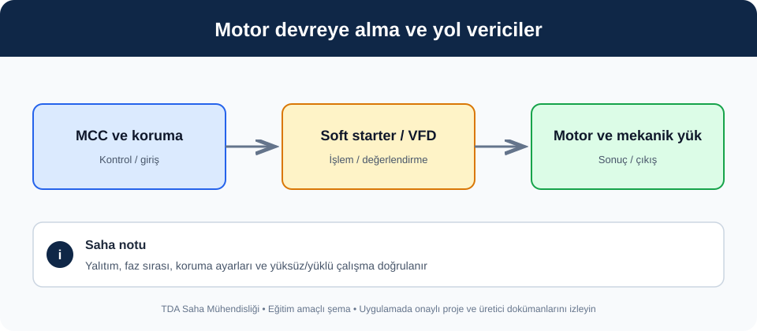

# 📍 Gün 23 — Motor Devreye Alma: MCC, VFD ve Motor Testleri

## 🎯 Günün Hedefleri

-   [x] Motor kalkış akımı (inrush) ve termal model mantığını kavramak.
-   [x] Yumuşak yol verici (soft starter) ve VFD temel işlevlerini ayırt etmek.
-   [x] Motor saha testlerini (IR, PI, Surge) uygulamak.
-   [x] Motor koruma ayarlarını (49, 46, 51) doğru hesaplamak.

---

## 📚 Özet Çalışma Notları

### 1. Motor Kalkış (Inrush) Akımı

-   Doğrudan yol verme (DOL): **6-8 × $I_{nom}$**, 1-5 s sürebilir.
-   Koruma ayarı bu akımı **atlatmalı** ama gerçek arızayı **yakalamalı**.
-   Ayar mantığı: 51 fonksiyonu uzun gecikmeli eğri + 50 fonksiyonu kısa devre koruma.

### 2. Yol Verici Tipleri

| Tip                | Kalkış Akımı   | Avantaj / Dezavantaj             |
| :----------------- | :------------- | :-------------------------------- |
| DOL (Doğrudan)     | 6-8 × In       | Basit, ucuz / mekanik stres       |
| Yıldız-Üçgen (Y/Δ) | 2-2.5 × In     | Ekonomik / tork düşer             |
| Soft Starter       | 3-4 × In       | Yumuşak / harmonik, ısı           |
| VFD (Frekans)      | 1-1.5 × In     | Tam kontrol / maliyet, harmonik   |

### 3. Motor Saha Testleri

| Test             | Cihaz               | Kriter                          |
| :--------------- | :------------------ | :------------------------------ |
| IR (Megger)      | 500V-5kV megger     | $(U+1)$ MΩ minimum, tipik >100 MΩ |
| PI               | Megger 10dk/1dk     | > 2.0                           |
| Sargı direnci    | Mikroohmmetre       | Fazlar arası ±%5                |
| Surge test       | Surge tester        | Turn-to-turn izolasyon          |
| Dönüş yönü       | Bağlama testi       | Doğru yön (kuru çalışma öncesi) |

### 4. Motor Koruma Ayarları

-   **49 (Termal):** Sargı termal modeli — kalkış ve işletme ısınması.
-   **46 (Negatif Sıra):** Faz kaybı ve asimetri → tipik %20-40 $I_2$.
-   **51 (Aşırı yük):** Kalkış akımı toleranslı IDMT.
-   **50 (Ani):** Kısa devre — kalkış akımının üzerine.
-   **RTD:** Sargı ve yatak sıcaklık sensörleri — direkt ölçüm.

---

## 🔗 Detaylı Notlar

Termal model hesabı, VFD uygulamaları ve tipik hata senaryoları için:
👉 **[23. Gün Detaylı Teknik Notları (detail.md)](./detail.md)**
