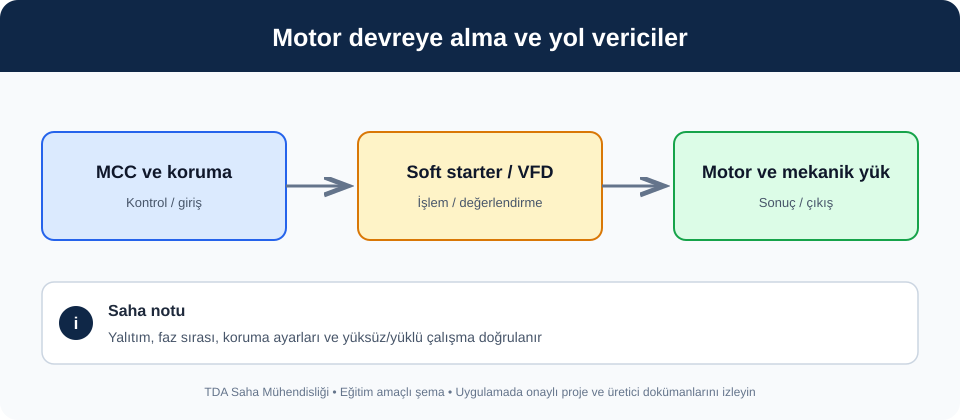

# 📖 Gün 23 — Motor Devreye Alma: Koruma Ayarları, VFD ve Saha Testleri (Teknik Detaylar)

Bu doküman, 23. Gün çalışması kapsamında incelenen **motor koruma matematiği**, **yol verici seçimi**, **VFD uygulaması** ve **test prosedürleri** konularını içerir.

---

## 1. Motor Termal Modeli (49)

### 1.1. İlk Termal Kapasite Kullanımı

Motor termal modeli, kalkış ve işletme ısınmasını ayrı hesaplar:

$$\theta = \theta_{∞} \times (1 - e^{-t/\tau})$$

-   $\tau$: Termal zaman sabiti (motor boyutuna göre 5-30 dk).
-   **Kalkış:** Stator+rotor hızlı ısınır (kısa zaman sabiti).
-   **İşletme:** Yavaş ısınma (uzun zaman sabiti).

### 1.2. Kalkış Sayısı Sınırı

-   Motor üretici limiti: Tipik **2-3 ardışık kalkış** (soğuk) veya **1 kalkış** (sıcak).
-   Koruma rölesi termal belleği ile bunu izler.

### 1.3. Ayar Örneği

**Motor:** 100 kW, $I_{nom} = 180$ A, kalkış 6 × In = 1080 A, kalkış süresi 4 s

| Fonksiyon | Ayar                          |
| :-------- | :---------------------------- |
| 51        | 1.15 × 180 = 207 A, IDMT      |
| 50        | 1.5 × 1080 = 1620 A (instant) |
| 49        | 100% termal kapasite          |
| 46        | %25 negatif sıra akımı        |

> ⚠️ **Kritik:** 50 ayarı **kalkış akımını atlatmalı** (1080 A) ama **sonuna kadar** kısa devre akımını yakalamalı.

---

## 2. Yol Verici Detayları

### 2.1. Yıldız-Üçgen (Y/Δ) Geçiş

-   Başlangıçta sargılar yıldız → gerilim/√3 → akım/3.
-   Nominal hızın %70-80'ine ulaşınca üçgene geçilir.
-   **Geçiş anı akım darbesi (open transition):** 1-2 × In ekstra darbe.
-   **Closed transition (Wye-Delta + rezistör):** Darbe azaltılır.

### 2.2. Soft Starter (Yumuşak Yol Verici)

-   **Thyristor faz kontrolü** ile gerilim kademeli artar.
-   Kalkış akımı **3-4 × In** ile sınırlı.
-   Kalkış tamamlanınca **by-pass kontağı** thyristor'ları atlar (ısı kaybını azaltır).

### 2.3. VFD (Variable Frequency Drive)

-   Frekans ve gerilim **V/f sabit** mantığı ile kademeli artar.
-   Kalkış akımı **1-1.5 × In** — minimum stres.
-   **Harmonik:** 6 darbeli VFD THDi %30+; **12 pulse veya aktif filtre** ile azaltılır.

**VFD Devreye Alma Kontrolleri:**
-   [ ] Motor parametreleri VFD'ye girildi (akım, frekans, hız).
-   [ ] Accel/decel rampaları ayarlandı (tipik 10-60 s).
-   [ ] V/f eğrisi doğru (DOL motor için sabit tork).
-   [ ] Kuru çalışma (dry run) — yük bağlanmadan.
-   [ ] Dönüş yönü kontrol edildi.
-   [ ] PID kontrol parametreleri (varsa) ayarlandı.
-   [ ] Harmonik filtre (varsa) çalışıyor.

---

## 3. Motor Saha Testleri — Detaylı

### 3.1. IR (İzolasyon Direnci) — Sıcaklık Düzeltmesi

Ölçülen değer **40°C'ye** düzeltilmelidir:

$$R_{40°C} = R_{ölçülen} \times K$$

-   $K = 2^{(40-T)/10}$ — her 10°C için yarılanma.
-   Örnek: 30°C'de 100 MΩ ölçüldü → 40°C'de 50 MΩ eşdeğeri.

**Kabul (IEEE 43):**
-   Eski motor: $R_{min} = \frac{U + 1}{1.5}$ MΩ
-   Yeni motor: $R_{min} = U + 1$ MΩ (örn. 400 V motor → 401 MΩ civarı)

### 3.2. PI (Polarizasyon İndeksi)

-   1 dk ve 10 dk değerleri: $PI = R_{10}/R_{1}$
-   **PI > 2.0** → iyi izolasyon.
-   **PI < 1.5** → nem/kir — kurutma veya temizlik gerekir.

### 3.3. Surge Test

-   Sargılar arası **yüksek gerilim darbesi** (2-3 × $U_{nom}$).
-   Turn-to-turn izolasyon testi — IR testinin göremediği kısa devreleri yakalar.
-   Osiloskopta sargı tepkisi karşılaştırılır — asimetri varsa turn-to-turn arıza.

### 3.4. RTD Testleri

-   PT100/PT1000 sensörleri: Direnç değeri sıcaklık tablosuna uyumlu mu?
-   Termokupl: Milivolt değeri doğru mu?
-   Bağlantı kablosu süreklilik kontrolü.

---

## 4. Kuru Çalışma ve İlk Yol Verme

### 4.1. Kuru Çalışma (Dry Run)

1.  Yük (pompa, kompresör) bağlanmadan motor çalıştırılır.
2.  Dönüş yönü kontrol edilir (yanlışsa iki faz değiştirilir).
3.  Kalkış akımı ve süresi ölçülür.
4.  Titreşim, ses kontrol edilir.
5.  Yatak sıcaklığı izlenir.

### 4.2. Yüklü Çalışma

1.  Yük yavaşça bağlanır (valf açılıp kapanarak).
2.  Nominal akım kontrol edilir — etiket ile karşılaştırılır.
3.  Üç faz dengeli mi (±%5)?
4.  Güç faktörü kontrol edilir.
5.  Titreşim seviyesi (ISO 10816 kriterleri).

---

## 5. Tipik Hata Senaryoları

| Senaryo                              | Sonuç                                  |
| :----------------------------------- | :------------------------------------- |
| Kalkış akımı ayarı düşük             | Motor her kalkışta trip                |
| 49 termal model yanlış parametre     | Yanlış ısınma algısı — sahte trip      |
| Dönüş yönü ters                      | Pompa/kompresör ters çalışır           |
| RTD sensörü hatalı                   | Sahte yüksek sıcaklık trip             |
| VFD accel rampa çok kısa             | Aşırı akım, mekanik stres              |
| Yıldız-üçgen geçiş yanlış zaman      | Aşırı akım darbesi, motor ısınır       |

---

## 🔗 İlgili Kaynaklar

-   _IEC 60034 — Rotating Electrical Machines_
-   _IEEE 43 — Insulation Resistance Testing_
-   _IEEE 841 — Standard for Petroleum Industry Motors_
-   _NEMA MG-1 — Motors and Generators_
