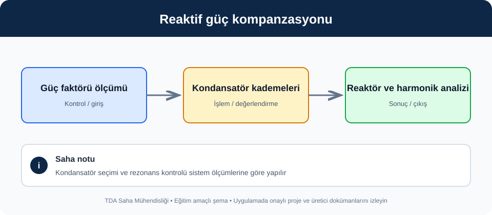

# 📍 Gün 24 — Reaktif Güç Kompanzasyonu ve Harmonikler

## 🎯 Günün Hedefleri

-   [x] Reaktif güç ve güç faktörü kavramlarını hesaplamalarıyla öğrenmek.
-   [x] Kondansatör grubu boyutlandırma ve kademe kontrol mantığını kavramak.
-   [x] Harmonik filtre (seri reaktör) mantığını anlamak.
-   [x] Rezonaans riskini ve THD analizini değerlendirmek.

---

## 📚 Özet Çalışma Notları

### 1. Güç Faktörü Kavramı

$$\cos \varphi = \frac{P}{S}, \quad Q = P \times \tan(\arccos(\cos \varphi))$$

-   $P$: Aktif güç (kW), $Q$: Reaktif güç (kVAr), $S$: Görünür güç (kVA).
-   **Hedef:** $\cos \varphi > 0.95$ (elektrik dağıtım şirketi ceza limiti).

### 2. Kondansatör Grubu Boyutlandırma

$$Q_c = P \times (\tan \varphi_1 - \tan \varphi_2)$$

**Örnek:** 1000 kW yük, $\cos \varphi_1 = 0.80$ → hedef $\cos \varphi_2 = 0.98$:
-   $\tan \varphi_1 = 0.75$, $\tan \varphi_2 = 0.203$
-   $Q_c = 1000 \times (0.75 - 0.203) = 547$ kVAr

### 3. Harmonik Sorunu

-   VFD, UPS, LED aydınlatma gibi **non-linear yükler** harmonik üretir.
-   Kondansatör + şebeke empedansı **paralel rezonans** yaratabilir → harmonik büyütme.
-   Çözüm: **Seri reaktör (detuned filter)** ile kondansatör devresinin rezonans frekansı **4.7-5.4 harmonik** seviyesine çekilir (5. harmoniğe altı).

### 4. THD (Total Harmonic Distortion)

$$THD = \frac{\sqrt{\sum_{h=2}^{50} V_h^2}}{V_1} \times 100\%$$

-   **IEC 61000-2-4 sınıf 2:** $THD_V < \%5$ (endüstriyel tesis).

---

## 🔗 Detaylı Notlar

Kademe kontrol, rezonans hesabı ve filtre tasarımı için:
👉 **[24. Gün Detaylı Teknik Notları (detail.md)](./detail.md)**
