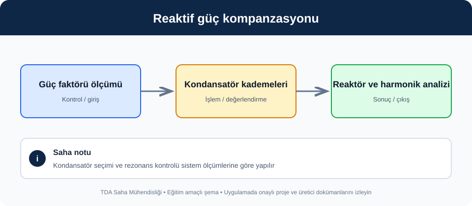

# 📖 Gün 24 — Reaktif Güç Kompanzasyonu: Kondansatör, Reaktör ve THD Analizi (Teknik Detaylar)

Bu doküman, 24. Gün çalışması kapsamında incelenen **kondansatör grubu tasarımı**, **rezonans analizi**, **harmonik filtre tasarımı** ve **kontrol mantığı** konularını içerir.

---

## 1. Reaktif Güç ve Güç Faktörü Detay

### 1.1. Ceza Hesapları

Türkiye'de dağıtım şirketleri:
-   **Endüktif:** $\cos \varphi < 0.95$ → ceza
-   **Kapasitif:** $\cos \varphi > 0.99$ → ceza (gece düşük yükte aşırı kompanzasyon)

### 1.2. Trafo Kapasitesi Etkisi

Kompanzasyon ile trafo kapasitesinden **daha fazla aktif güç** çekilir:

$$S_{kullanım} = \frac{P}{\cos \varphi}$$

**Örnek:** 1000 kVA trafo:
-   $\cos \varphi = 0.8$ → 800 kW aktif güç
-   $\cos \varphi = 0.98$ → 980 kW aktif güç (**%22.5 artış!**)

---

## 2. Kondansatör Grubu Tasarımı

### 2.1. Kademe Yapısı

Yük değişimine göre kademeli bağlama:

-   **Kademe sayısı:** Tipik 4-8 kademe.
-   **Kademe boyutları:** Eşit (örn. 5 × 50 kVAr) veya oranlı (25/50/100 kVAr).
-   **Kontrol:** Gerilim, akım, güç faktörü veya zaman bazlı.

### 2.2. Kademe Kontrol Mantığı (PF Regülatör)

Regülatör $\cos \varphi$'yı izler ve karar verir:

-   $\cos \varphi < 0.95$ → bir kademe **kapatılır** (bağlanır).
-   $\cos \varphi > 0.99$ (kapasitif) → bir kademe **açılır** (ayrılır).
-   **Histerisiz:** Kademe değişim sıklığını sınırlar (min. 1-3 dk aralık).

### 2.3. Kontak Yükü — Kritik Detay

Kondansatör **bağlanırken yüksek inrush akımı** üretir (ilgili kondansatör şarj boş ise 100× $I_{nom}$'a kadar). Bu nedenle:

-   **Kondansatör kontakları** özel tip (hard-service, örn. güvenilir bir kondansatör kontaktörü).
-   **İnrush choke (reaktör):** İnrush sınırlama.

---

## 3. Rezonans Analizi

### 3.1. Paralel Rezonans Riski

Şebeke empedansı + kondansatör paralel kombinasyonu belirli bir frekansta **rezonansa girer**:

$$h_{rez} = \sqrt{\frac{S_{sc}}{Q_c}}$$

-   $S_{sc}$: Kısa devre gücü (MVA)
-   $Q_c$: Kondansatör gücü (MVAr)

**Örnek:** $S_{sc} = 100$ MVA, $Q_c = 2$ MVAr → $h_{rez} = \sqrt{50} \approx 7.07$ → **7. harmonikte rezonans!** VFD'lerde 5/7 harmonik yoğun — tehlike.

### 3.2. Çözüm: Detuned (Seri Reaktörlü) Kondansatör

Seri reaktör, kondansatör devresinin **kendi rezonans frekansını düşürür**:

$$f_{rez,devre} = \frac{1}{2\pi\sqrt{L \times C}} \approx 4.7 \times f_{nom}$$

Yani rezonans **4.7 harmoniğe** (235 Hz) çekilir — **5. harmoniğin altında** ve güvenli bölgede.

**Tipik Reaktör Değerleri:**

| p % (Reaktans Oranı) | Rez. Frekans | Kullanım                    |
| :------------------- | :----------- | :-------------------------- |
| 5.67%                | 4.7 × f      | 5. harmonik baskın          |
| 7%                   | 3.8 × f      | 3. harmonik baskın (nötr)   |
| 14%                  | 2.7 × f      | 3. harmonik baskın ciddi    |

### 3.3. Gerilim Yükselme (Voltage Rise)

Seri reaktörlü kondansatör, terminallerde **gerilim yükselmesi** yapar:

$$U_c = \frac{U_{şebeke}}{1 - p}$$

Örnek: 400 V, p = 5.67% → $U_c = 424$ V → kondansatör **440 V tipi** seçilmelidir.

---

## 4. Harmonik Filtre Tasarımı (Aktif/Pasif)

### 4.1. Pasif Filtre

-   **Tek ayarlı (tuned):** Belirli harmonikte (5., 7., 11.) rezonansa ayarlı LC devresi.
-   Harmonik akımı absorbe eder.
-   Ayarlama hassasiyeti kritiktir (şebeke frekansı, sıcaklık etkisi).

### 4.2. Aktif Filtre (APF)

-   **Harmonikleri ölçer, ters fazda üretir** → iptal eder.
-   Tipik 5., 7., 11., 13. harmonikleri hedefler.
-   Ölçüm: 20-50 kHz sampling, DSP işlemci.
-   Kapasite: Amper cinsinden harmonik akım (örn. 100 A APF).

### 4.3. Seçim Kriteri

| Durum                            | Çözüm                       |
| :------------------------------- | :-------------------------- |
| Hafif harmonik (THDi < %20)      | Detuned kondansatör         |
| Orta harmonik (THDi %20-40)      | Detuned + aktif filtre      |
| Ağır harmonik (THDi > %40)       | Tam aktif filtre            |

---

## 5. Saha Testleri ve Ölçümler

### 5.1. Güç Kalitesi Analizi

-   **Power quality analyzer** ile 1 haftalık ölçüm:
    -   $V$, $I$, $P$, $Q$, $\cos \varphi$ trendleri
    -   Harmonik spektrum (2-50. harmonik)
    -   THD V ve THD I
    -   Flicker, dip, swell olayları

### 5.2. Kompanzasyon Doğrulama

1.  Kondansatör grupları bağlanır, her kademe akımı ölçülür.
2.  $\cos \varphi$ ölçümü regülatör ile karşılaştırılır.
3.  Harmonik ölçümü — kondansatör devresinde harmonik büyüme yok.
4.  Reaktör ısınması kontrol edilir.

### 5.3. Kabul Kriterleri

| Parametre        | Kriter                          |
| :--------------- | :------------------------------ |
| $\cos \varphi$   | 0.95 - 0.99 arası               |
| $THD_V$          | < %5 (IEC 61000-2-4 sınıf 2)    |
| Kondansatör akım | < 1.3 × $I_{nom}$               |
| Reaktör sıcaklık | < 80°C                          |

---

## 6. Tipik Hata Senaryoları

| Senaryo                                | Sonuç                                    |
| :------------------------------------- | :--------------------------------------- |
| Reaktörsüz kondansatör + VFD           | Harmonik büyütme, kondansatör patlaması  |
| Aşırı kompanzasyon (gece)              | Kapasitif cos φ ceza, gerilim yükselmesi |
| Kondansatör kontakları standart tip    | İnrush ile kontak yanması                |
| Kademe kontrol histerisisi yok         | Kademe sürekli açıp kapatır — kontak aşınması |

---

## 🔗 İlgili Kaynaklar

-   _IEC 60831 — Shunt Power Capacitors_
-   _IEC 61000-2-4 — Compatibility Levels (Harmonics)_
-   _IEEE 519 — Harmonic Control_
