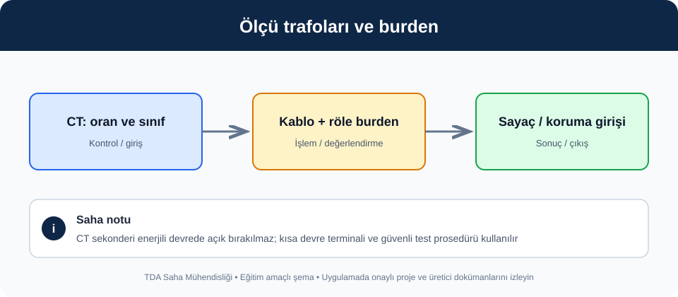

# 📍 Gün 25 — Ölçü Trafoları: CT/VT Hassasiyet Sınıfları ve Burden Hesabı

## 🎯 Günün Hedefleri

-   [x] CT ve VT hassasiyet sınıflarını (0.2s, 5P20, ...) yorumlamak.
-   [x] CT burden hesabı yapmak ve doğru sınıf seçimi yapmak.
-   [x] CT açık devre tehlikesini ve önlemlerini öğrenmek.
-   [x] Ölçü vs koruma CT farklarını ayırt etmek.

---

## 📚 Özet Çalışma Notları

### 1. CT Sınıf Yorumlaması

**Örnek: 400/1 A, 5P20, 15 VA**

| Kısım    | Anlam                                     |
| :------- | :---------------------------------------- |
| 400/1 A  | Oran — 400 A birincil, 1 A sekonder       |
| 5P       | %5 hata, Protection (koruma sınıfı)       |
| 20       | 20 × nominal akımda hata %5'i geçmez (ALF)|
| 15 VA    | Burden kapasitesi                         |

**Ölçü sınıfları:** 0.2s, 0.5s, 1, 3 — sayac ve gösterge için.
**Koruma sınıfları:** 5P20, 10P20, PR, PX — koruma röleleri için.

### 2. Burden Hesabı

Toplam burden = röle burden + kablo burden + terminal:

$$S_{toplam} = S_{röle} + I^2 \times (R_{kablo} \times 2 + R_{terminal})$$

**Örnek:** Röle 0.1 VA, kablo 25 m × 2.5 mm² (R = 0.017 Ω·mm²/m / 2.5 = 0.0068 Ω/m → 0.17 Ω), 1 A CT:
-   $S_{kablo} = 1^2 \times 0.17 = 0.17$ VA
-   $S_{toplam} = 0.1 + 0.17 = 0.27$ VA → CT burden **5 VA** veya üstü seçilir.

### 3. CT Açık Devre Tehlikesi

-   CT birincilinde akım geçerken sekonder **açılırsa**, CT sekonderinde **kilovolt mertebesinde** gerilim oluşur.
-   İzolasyon delinir, personel ölebilir, CT yanar.
-   **Kural:** Test yapılırken CT her zaman **kısa devre** veya röleye bağlı olmalı.

### 4. Ölçü vs Koruma CT

| Özellik          | Ölçü CT (0.2s)            | Koruma CT (5P20)         |
| :--------------- | :------------------------ | :----------------------- |
| Nominalde hata   | Çok düşük (%0.2)          | %5                       |
| Yüksek akımda    | **Bilerek doyar** (sayacı korur) | **Doymamalı**      |
| Knee-point       | Düşük                     | Yüksek                   |
| Kullanım         | Sayaç, gösterge           | Koruma röleleri          |

---

## 🔗 Detaylı Notlar

Knee-point hesabı, PS class CT ve PX sınıf detayları için:
👉 **[25. Gün Detaylı Teknik Notları (detail.md)](./detail.md)**
