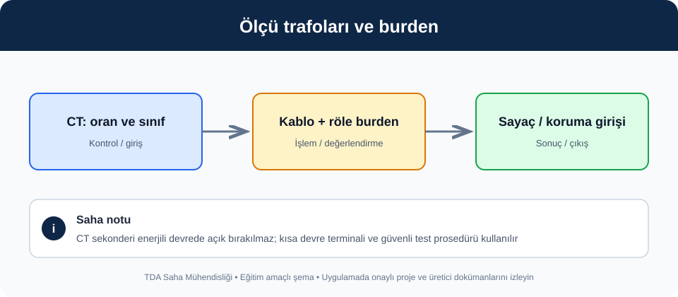

# 📖 Gün 25 — Ölçü Trafoları: CT Sınıfları, Burden ve Knee-Point Analizi (Teknik Detaylar)

Bu doküman, 25. Gün çalışması kapsamında incelenen **CT/VT sınıf yorumlaması**, **burden hesapları**, **knee-point gereksinimleri** ve **saha testleri** konularını içerir.

---

## 1. CT Sınıf Kodlamanın Tam Yorumu

### 1.1. IEC 61869-2 Sınıfları

| Kod     | Anlam                                             |
| :------ | :------------------------------------------------ |
| 0.2, 0.5, 1 | Ölçü sınıfı — nominal akımda hata %0.2/%0.5/%1 |
| 0.2s, 0.5s | Genişletilmiş ölçü sınıfı (%1-120 aralıkta)     |
| 5P20    | Koruma — %5 hata, 20× ALF                         |
| 10P20   | Koruma — %10 hata, 20× ALF                        |
| PX / PS | Spesifik — yüksek hassasiyetli diferansiyel       |

### 1.2. ALF (Accuracy Limit Factor)

CT'nin **hata sınıfını koruyabildiği maksimum akım katlaması**. 5P20 → 20× $I_{nom}$'da bile %5 hata içinde.

**Kritik:** Sistem kısa devre akımı $I_{sc}$ ise:

$$ALF_{gerçek} = \frac{I_{sc}}{I_{nom}}$$

CT ALF'si $ALF_{gerçek}$'ten **büyük olmalı**. Değilse koruma akımı doğru göremez.

### 1.3. Efektif ALF (Gerçek Burden ile)

CT etiketindeki ALF, **nominal burden'da** geçerlidir. Gerçek burden düşükse efektif ALF **artar**:

$$ALF_{efektif} = ALF_{nominal} \times \sqrt{\frac{S_{nominal} + R_{CT} \cdot I_n^2}{S_{gerçek} + R_{CT} \cdot I_n^2}}$$

---

## 2. Burden Hesabı — Detaylı

### 2.1. Bileşenler

| Bileşen        | Tipik Değer               |
| :------------- | :------------------------ |
| Röle akım girişi | 0.02 - 0.5 VA (numerik) |
| Analog ölçü    | 0.5 - 5 VA                |
| Kablo (bakır 2.5 mm²) | 0.0176 Ω·mm²/m / 2.5 = 0.00704 Ω/m |
| Terminal blokları | ~0.01 Ω her bağlantı   |

### 2.2. Kablo Boyutlandırma Örneği

**Durum:** TR sahasında CT → koruma rölesi 100 m, 5 A CT sekonderi.

-   Kablo direnci: 100 m × 0.00704 Ω/m = 0.704 Ω (tek yön) → 1.408 Ω (çift yön)
-   $S_{kablo} = 5^2 \times 1.408 = 35.2$ VA — **çok yüksek!**

**Çözüm:**
-   **1 A CT** kullan → $S_{kablo} = 1^2 \times 1.408 = 1.4$ VA (25× azalır)
-   veya kablo kesiti 4 mm²'ye çıkar.

> ⚡ **Kural:** Uzun mesafelerde **1 A CT** kullanılır. 5 A CT kısa mesafelerde veya yüksek burden ihtiyacında.

---

## 3. Knee-Point (Diz Noktası) Detaylı

### 3.1. Tanım

Excitation eğrisinde gerilimdeki **%50 artışın akımda %10 artışa** neden olduğu nokta:

$$V_k \text{ where } \frac{V_{k+10\%}}{V_k} = 1.5 \Rightarrow I_e \text{ doubles}$$

Pratikte $V_k = $ akımın 2× arttığı gerilim.

### 3.2. Koruma İçin Gereksinim

Diferansiyel ve mesafe koruması için CT, maksimum arıza akımında **doymamalı**:

$$V_k \geq K \times I_{sc} \times (R_{CT} + R_{burden})$$

-   $K$: Güvenlik faktörü (2-4)
-   $I_{sc}$: Maksimum arıza akımı (birincil, CT oranına bölünmüş)
-   $R_{CT}$: CT sargı direnci
-   $R_{burden}$: Kablo + röle direnci

### 3.3. PX / PS Sınıfı

Diferansiyel koruma için spesifik gereksinimler:

-   $V_k$ minimum değeri
-   $I_e$ (excitation akımı) maksimum değeri
-   $R_{CT}$ maksimum değeri

**Örnek PX Tanımı:** $V_k \geq 600$ V, $I_e \leq 1$ mA @ $V_k/2$, $R_{CT} \leq 15$ Ω.

---

## 4. VT (Gerilim Trafoları) Detay

### 4.1. Sınıflar

| Sınıf  | Kullanım                          |
| :----- | :-------------------------------- |
| 0.2, 0.5 | Sayaç ve gösterge               |
| 3P, 6P | Koruma röleleri                   |
| 0.2/3P | Çift çekirdek (ölçü + koruma)     |

### 4.2. VT Bağlantı Tipleri

-   **Yıldız (3 fazlı):** Faz-gerilim ölçümü, $V_{faz} = U/\sqrt{3}$
-   **Açık üçgen (residual):** $V_0$ ölçümü — toprak koruma için.
-   **VT/2 veya split:** İki faz arası ölçüm.

### 4.3. Ferro-Rezonans Riski

VT primer yıldız noktası topraklanmış sistemde, kesici açma-kapama ile **ferro-rezonans** oluşabilir. Çözüm: **Damping rezistörü** açık üçgen sargıda.

---

## 5. Saha Testleri

### 5.1. CT Testleri (CT Analyzer)

| Test              | Yöntem                              |
| :---------------- | :---------------------------------- |
| Oran              | Primer akım verilir, sekonder ölçülür |
| Polarite          | Ani akım darbesi yönü               |
| Excitation eğrisi | Kademeli gerilim, akım ölçümü       |
| Sargı direnci     | DC mikroohm                         |
| Burden            | Nominal akımda yük gerilimi         |

### 5.2. Excitation Eğrisi Yorumu

```
Akım (mA, log)
  │                ╱
  │               ╱  ← Doyma bölgesi
  │              ╱
  │         ____╱
  │        ╱    ← Knee-point (Vk)
  │       ╱
  │  ____╱       ← Lineer bölge (µA)
  │ ╱
  └────────────────→ Gerilim (V)
```

-   **Knee-point:** Eğrinin dikleştiği yer.
-   **Koruma CT:** Yüksek $V_k$, düşük $I_e$.
-   **Ölçü CT:** Düşük $V_k$ (bilerek erken doyar).

### 5.3. Primer Enjeksiyon

-   CT primerine yüksek akım verilir (primer injection set, 1000-5000 A).
-   Sekonder akım, oranın ve polaritenin saha şartlarında doğrulanması.
-   **Kabul:** Oran ±%1, polarite doğru.

---

## 6. Tipik Hata Senaryoları

| Senaryo                                | Sonuç                                     |
| :------------------------------------- | :---------------------------------------- |
| Ölçü CT koruma rölesine bağlanmış       | Yüksek akımda doyar — koruma çalışmaz     |
| 5 A CT uzun kablo ile                   | Burden yüksek — CT doyar, hata artar      |
| Knee-point yetersiz                     | Diferansiyel koruma stabilite sorunu      |
| Test sonrası CT açık bırakılır          | Kilovolt gerilim — tehlike                |
| VT açık üçgen damping rezistörü yok     | Ferro-rezonans — VT yanar                 |

---



## 🔗 İlgili Kaynaklar

-   _IEC 61869-1/2 — Instrument Transformers (CT)_
-   _IEC 61869-3 — Instrument Transformers (VT)_
-   _IEEE C57.13 — Instrument Transformers_
