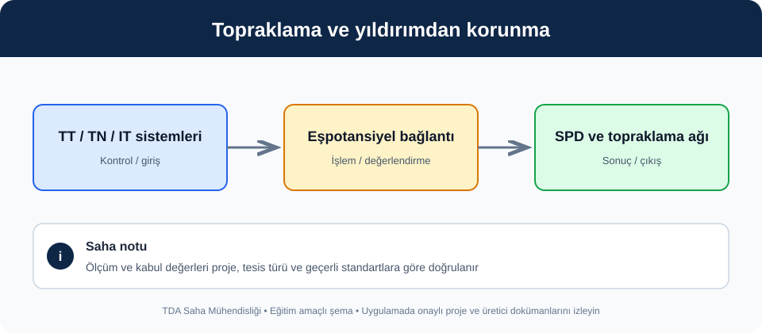

# 📍 Gün 26 — Topraklama Sistemleri (TT/TN/IT) ve Yıldırım Koruma

## 🎯 Günün Hedefleri

-   [x] IEC 60364 topraklama sistemlerini (TT, TN-S, TN-C, IT) ayırt etmek.
-   [x] Topraklama direnci ölçümü ve kabul kriterleri uygulamak.
-   [x] Yıldırım koruma sınıflarını (LPS I-IV) ve kademelendirmeyi kavramak.
-   [x] SPD (Surge Protective Device) tip seçimi ve koordinasyonu öğrenmek.

---

## 📚 Özet Çalışma Notları

### 1. Topraklama Sistemleri

| Sistem  | Yapı                                          | Kullanım                     |
| :------ | :-------------------------------------------- | :--------------------------- |
| **TT**  | Nötr kaynağa topraklı, yük toprağı ayrı       | Genel dağıtım, kırsal        |
| **TN-S**| Nötr ve PE ayrı iletken (kaynaktan itibaren)  | Modern binalar, endüstri     |
| **TN-C**| Nötr + PE birleşik (PEN)                      | Eski tesisler, riskli        |
| **TN-C-S**| Üstte PEN, altta ayrı                       | Kısmi dönüşüm                |
| **IT**  | Nötr izole veya yüksek impedanslı             | Hastane, süreç endüstrisi    |

> ⚡ **TN-C riski:** PEN kesilirse gövde **faz gerilimine** maruz kalır. Modern tesislerde TN-S tercih edilir.

### 2. Topraklama Direnci Ölçümü

| Yöntem            | Uygulama                                   |
| :---------------- | :----------------------------------------- |
| 3 telli (fall-of-potential) | Ana topraklama ölçümü           |
| Clamp-on          | Paralel toprak elektrodlarını ölçme        |
| 62% kuralı        | Ölçüm elektrodu mesafe ayarı               |

**Kabul:**
-   Şalt sahası: $R_a < 1\ \Omega$ (YG)
-   Dağıtım: $R_a < 2\ \Omega$
-   Bina: $R_a < 10\ \Omega$ (tipik)

### 3. Yıldırım Koruma Sınıfları (IEC 62305)

| Sınıf  | Koruma Seviyesi | Verimlilik | Tipik Uygulama        |
| :----- | :-------------- | :--------- | :-------------------- |
| LPS I  | Yüksek          | %98        | Patlayıcı ortam, kritik |
| LPS II | Orta            | %95        | Endüstriyel           |
| LPS III/IV | Standart    | %84-90     | Genel binalar         |

### 4. SPD Kademeleri

```
Bina Girişi → T1 (10/350 µs) → Tabela/alt dağıtım → T2 (8/20 µs) → Cihaz → T3
```

Her kademe, bir önceki kalan gerilimi daha da düşürür; aralarında **decoupling mesafesi** (min. 10 m kablo) gerekir.

---



## 🔗 Detaylı Notlar

Topraklama hesapları, dokunma gerilimi ve LPS tasarımı için:
👉 **[26. Gün Detaylı Teknik Notları (detail.md)](./detail.md)**
