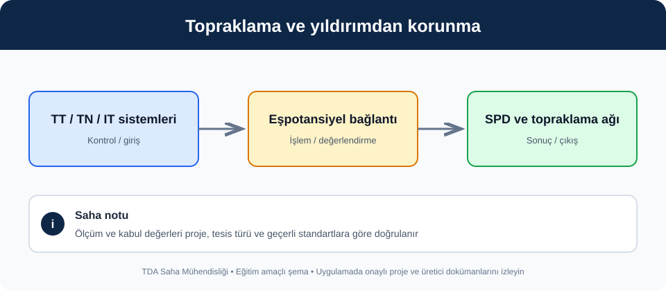

# 📖 Gün 26 — Topraklama Sistemleri ve Yıldırım Koruma: Hesaplar ve Testler (Teknik Detaylar)

Bu doküman, 26. Gün çalışması kapsamında incelenen **topraklama sistem seçimi**, **topraklama direnci hesapları**, **dokunma gerilimi** ve **LPS/SPD tasarımı** konularını içerir.

---

## 1. Topraklama Sistem Seçimi

### 1.1. TT Sistemi

-   Kaynak nötrü topraklı, yük toprağı **ayrı** elektrodlar.
-   Arıza akımı **sınırlı** (toprak direnci üzerinden) → RCD (30 mA) zorunlu.
-   **Avantaj:** Tek toprak hatası yüksek akım yaratmaz.
-   **Dezavantaj:** RCD olmadan koruma zayıf.

### 1.2. TN-S Sistemi

-   Nötr ve PE **ayrı** iletkenler.
-   Arıza akımı **yüksek** (metalik dönüş) → sigorta/kesici temizler.
-   **Avantaj:** Yüksek arıza akımı ile hızlı temizleme.
-   **Dezavantaj:** PE iletkeni üzerindeki gerilim düşümü.

### 1.3. IT Sistemi

-   Nötr **izole** veya yüksek rezistansla topraklı.
-   İlk toprak hatası **alarm verir**, sistem çalışmaya devam eder.
-   İkinci toprak hatası kısa devre → temizlenmeli.
-   **Kullanım:** Hastane ameliyathane, süreç endüstrisi (kesinti maliyeti yüksek).

### 1.4. Seleksiyon Tablosu

| Uygulama              | Önerilen Sistem    |
| :-------------------- | :----------------- |
| Genel bina            | TN-S               |
| Kırsal dağıtım        | TT                 |
| Hastane ameliyathane  | IT (izole)         |
| Şalt sahası (DC)      | IT (DC IT — izole) |
| Endüstriyel süreç     | IT veya TN-S       |

---

## 2. Topraklama Direnci Hesabı

### 2.1. Tek Elektrod

Basit kabul (homojen toprak):

$$R_a = \frac{\rho}{2\pi L} \left(\ln\frac{4L}{d}\right)$$

-   $\rho$: Toprak özdirenci (Ω·m) — tipik 50-500 Ω·m
-   $L$: Elektrod uzunluğu (m)
-   $d$: Elektrod çapı (m)

**Örnek:** 3 m çubuk, $\rho = 100$ Ω·m, $d = 0.016$ m:
-   $R_a = \frac{100}{2\pi \times 3} \ln\frac{12}{0.016} \approx 27$ Ω — tek çubuk yeterli değil!

### 2.2. Paralel Elektrodlar

$n$ elektrod paralel bağlanırsa:

$$R_{toplam} = \frac{R_a}{n \times \eta}$$

-   $\eta$ (verimlilik): Elektrod aralığına bağlı; tipik 0.6-0.8.
-   Aralık **elektrod uzunluğunun 2 katından az** ise verim düşer.

### 2.3. Topraklama Bariyeri (Ring)

Bina etrafında halka topraklama:

$$R_a \approx \frac{\rho}{4L} + \frac{\rho}{\pi S}$$

-   $L$: Halka uzunluğu, $S$: Sığdırma derinliği etkisi.

---

## 3. Dokunma ve Adım Gerilimi

### 3.1. Dokunma Gerilimi (Touch Voltage)

Arıza durumunda kişinin **el-ayak** arasında hissedeceği gerilim:

$$U_t = I_f \times R_a \times \frac{R_{kişi}}{R_{kişi} + R_{ayak}}$$

**Kabul (IEC 61936):**
-   Normal koşul: $U_t < 50$ V (AC)
-   Özel yerler (ıslak): $U_t < 25$ V

### 3.2. Adım Gerilimi (Step Voltage)

İki ayak arasında (1 m mesafe) gerilim:

$$U_s = I_f \times R_a \times \frac{\rho}{2\pi} \left(\frac{1}{r} - \frac{1}{r+1}\right)$$

Toprak yüzeyi **equi-potential bonding** (izole çakıl, asfalt) ile azaltılır.

---

## 4. Yıldırım Koruma Sistemi (LPS) Tasarımı

### 4.1. Risk Değerlendirmesi (IEC 62305-2)

Risk bileşenleri:
-   $R_A$: Canlılara temas
-   $R_B$: Fiziksel hasar (yangın/patlama)
-   $R_C$: İç sistemlerin arızası (EMP)
-   $R_M, R_U, R_V, R_W, R_Z$: Diğer bileşenler

Toplam risk kabul eşiği ($10^{-5}$/yıl) ile karşılaştırılır.

### 4.2. Faraday Kafesi (Mesh Method)

Bina çatısı ve duvarlarında iletken ağ:

| Sınıf  | Mesh Boyutu | Ø 8mm iletken aralığı |
| :----- | :---------- | :-------------------- |
| LPS I  | 5 × 5 m     | —                     |
| LPS II | 10 × 10 m   | —                     |
| LPS III| 15 × 15 m   | —                     |
| LPS IV | 20 × 20 m   | —                     |

### 4.3. Roll Sphere Method (Top Yöntemi)

Bina, yarıçapı sınıfa göre değişen bir **top** ile taranır:

| Sınıf  | Top Yarıçapı |
| :----- | :----------- |
| LPS I  | 20 m         |
| LPS II | 30 m         |
| LPS III| 45 m         |
| LPS IV | 60 m         |

Top temas edemediği noktalar **korunan bölge** kabul edilir.

---

## 5. SPD (Surge Protective Device) Seçimi

### 5.1. Tip Seçimi

| Tip     | Konum              | Dalga     | Tipik Inrush |
| :------ | :----------------- | :-------- | :----------- |
| **T1**  | Bina girişi        | 10/350 µs | 12.5-25 kA   |
| **T2**  | Alt dağıtım        | 8/20 µs   | 20-40 kA     |
| **T3**  | Cihaz seviyesi     | Kombinasyon | 1-3 kA     |

### 5.2. Koordinasyon

-   **T1-T2 arası min. 10 m** kablo (decoupling) veya dekolör kullan.
-   **Up** (koruma seviyesi) **kademe kademeye azalır**.
-   Son SPD $U_p$ cihaz dayanımından (tipik 1.5 kV AG) **düşük** olmalı.

### 5.3. Kablo Yolu Uzunluğu

SPD bağlantı kablosu **mümkün olduğunca kısa** (max. 50 cm):

$$U_{toplam} = U_p + \Delta U_{kablo}$$

Uzun kablo, SPD'nin koruma seviyesini bozar.

---

## 6. Saha Testleri

| Test                    | Cihaz            | Kriter                         |
| :---------------------- | :--------------- | :----------------------------- |
| Toprak direnci          | Earth tester     | Proje değeri (tipik < 1-2 Ω)   |
| Süreklilik (PE)         | Low-ohm meter    | < 0.2 Ω                        |
| SPD durumu              | Görsel (pencere) | Yeşil = OK, Kırmızı = değiştir |
| SPD leak current        | Megger/analyzer  | Üretici değeri                 |
| Ekvipotansiyel bağlantı | Low-ohm          | < 0.2 Ω (ana baraya)          |

---

## 🔗 İlgili Kaynaklar

-   _IEC 60364 — Low-Voltage Electrical Installations_
-   _IEC 62305 — Protection Against Lightning_
-   _IEC 61936 — Power Installations Exceeding 1 kV_
-   _IEEE 80 — Substation Grounding_
