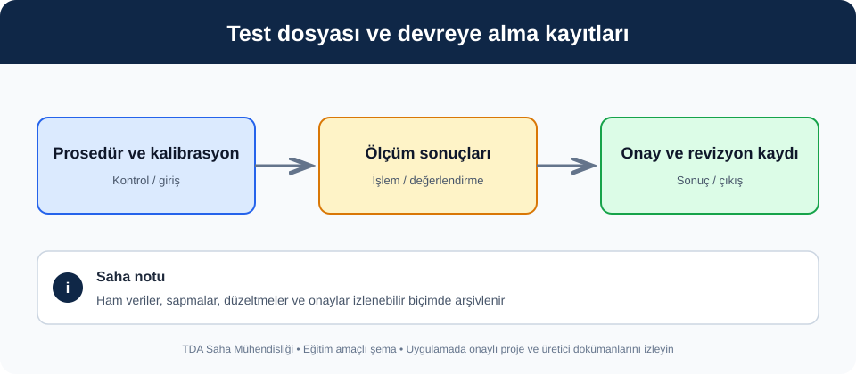

# 📍 Gün 27 — Test Dokümantasyonu: Dossier Yapısı ve İmza Akışı

## 🎯 Günün Hedefleri

-   [x] Test dossier yapısını ve içerik sırasını hazırlamak.
-   [x] Test prosedürü yazım mantığını öğrenmek.
-   [x] İmza ve onay akışını (TDA → Müşteri → Kuruluş) kavramak.
-   [x] Non-conformity (NC) kayıt ve kapatma sürecini uygulamak.
-   [x] Kabul kanıtlarını, şartlı kabul sınırlarını ve nihai imza yetkisini ayırt etmek.

---

## 📚 Özet Çalışma Notları

### 1. Test Dossier — Neden Hayati?

Dossier, işin **hukuki ve teknik ispatıdır**:
-   Saha anlaşmazlıklarında referans.
-   Garanti ve sigorta taleplerinde belge.
-   Gelecekteki bakım için temel veri.
-   Denetim ve akreditasyonlarda kanıt.

### 2. Standart Dossier Yapısı

| Bölüm | İçerik                                        |
| :---- | :-------------------------------------------- |
| 01    | Proje dokümanları (schematic, ayar listesi)   |
| 02    | Ekipman sertifikaları ve FAT raporları        |
| 03    | Test cihazı kalibrasyon sertifikaları         |
| 04    | Test prosedürleri ve kabul kriterleri         |
| 05    | Ölçüm sonuçları (ham veri + grafik)           |
| 06    | Interlock ve kumanda test raporları           |
| 07    | SCADA point test raporu                       |
| 08    | Enerjileme kayıtları (manevra fişi)           |
| 09    | NC (Non-Conformity) kayıtları                 |
| 10    | İmza ve onay sayfası                          |

### 3. Test Prosedürü Yazımı

Her prosedür şunları içerir:
-   **Amaç** — neden test ediliyor?
-   **Referanslar** — IEC/IEEE standardı, proje şartnamesi.
-   **Cihazlar** — test ekipmanı + kalibrasyon bilgisi.
-   **Adımlar** — numaralı, tek tek uygulanabilir.
-   **Kabul kriteri** — ölçülebilir, net değerler.
-   **Kayıt tablosu** — ölçüm değerlerinin yazılacağı alanlar.

### 4. Kabul kanıtı ve imza netliği
- Kabul, yalnızca “test yapıldı” beyanı değildir: onaylı kriter, ham ölçüm/veri, PASS/FAIL sonucu, test cihazı kalibrasyonu ve imzalı rapor birlikte saklanır.
- Testi uygulayan, tanık olan, teknik uygunluğu değerlendiren ve sözleşmeye göre nihai kabulü imzalayan roller ayrı belirtilir.
- Şartlı kabul varsa açık iş, sorumlu, hedef tarih, işletme/emniyet etkisi ve tekrar test/onay şartı yazılı kayda alınır. Kritik emniyet veya koruma eksikliği kabul edilmiş sayılmaz.

### 5. NC (Non-Conformity) Yönetimi

1.  NC **bulunur** → form doldurulur (tarih, konum, fotoğraf).
2.  **Sınıflandırılır:** Kritik / Major / Minor.
3.  **Aksiyon planı** hazırlanır (düzeltme + önleyici).
4.  **Kapatılır** → tekrar test + imza.
-   Kritik NC kapatılmadan **enerjileme yapılmaz**.

---

## 🔗 Detaylı Notlar

Örnek test raporu formatı, imza yetki matrisi ve revizyon yönetimi için:
👉 **[27. Gün Detaylı Teknik Notları (detail.md)](./detail.md)**
