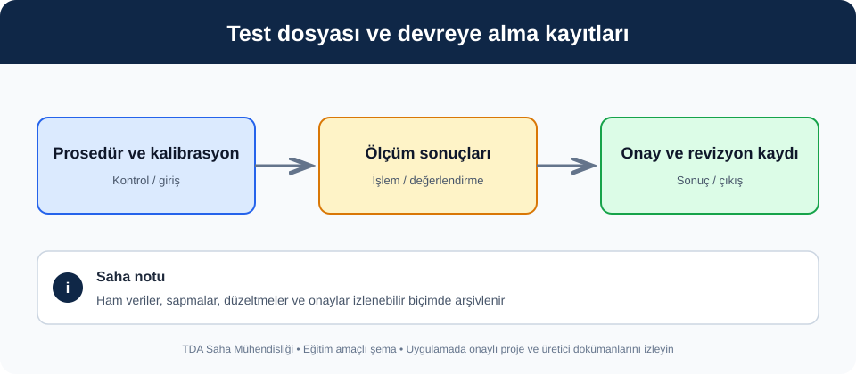

# 📖 Gün 27 — Test Dokümantasyonu: Prosedür Yazımı, İmza Akışı ve NC Yönetimi (Teknik Detaylar)

Bu doküman, 27. Gün çalışması kapsamında incelenen **test prosedürü yazım mantığı**, **dossier revizyon yönetimi**, **imza yetki matrisi** ve **NC süreci** konularını içerir.

---

## 1. Test Prosedürü Yazım Şablonu

### 1.1. Başlık Bloğu

```
Doküman No: TDA-TP-001
Revizyon: 02
Tarih: 2024-XX-XX
Proje: XXX Trafo Merkezi
Ekipman: Fider F1 — Koruma Rölesi
Hazırlayan: ______ (TDA Mühendisi)
Kontrol Eden: ______ (Kıdemli Mühendis)
Onaylayan: ______ (Proje Müdürü)
```

### 1.2. Test Tablosu Örneği

| No | Test Adı        | Cihaz     | Beklenen     | Ölçülen | Sonuç |
| :-- | :------------- | :-------- | :----------- | :------ | :---- |
| 1  | 51 Pick-up     | Omicron   | 480 A ±5%    | 478 A   | PASS  |
| 2  | 51 Trip @5×Is  | Omicron   | 1.42 s ±5%   | 1.39 s  | PASS  |
| 3  | 50 Instant     | Omicron   | 2400 A       | 2395 A  | PASS  |
| 4  | Trip kontak    | Multimetre| NO kapanır   | Kapanır | PASS  |

-   **PASS/FAIL/N/A** sütunu zorunlu.
-   Her satır **imzalı** olmalı.

---

## 2. İmza ve Onay Akışı

### 2.1. Yetki Matrisi

| Aksiyon                    | Hazırlayan       | Kontrol          | Onay             |
| :------------------------- | :--------------- | :--------------- | :--------------- |
| Test prosedürü             | TDA Mühendisi    | Kıdemli Mühendis | Proje Müdürü     |
| Test raporu (ölçüm)        | TDA Teknisyeni   | TDA Mühendisi    | Müşteri Temsilcisi |
| Ayar dosyası               | Ayar Mühendisi   | Kıdemli Mühendis | Müşteri (4-göz)  |
| Enerjileme izni            | TDA Şef          | Proje Müdürü     | Müşteri + Kuruluş|

### 2.2. 4-Göz Prensibi

Kritik işlemler (ayar yükleme, enerjileme) **iki ayrı kişi** ile doğrulanır:
-   Hesaplayan ≠ Kontrol eden.
-   İkisi ayrı firmalardan olabilir (TDA + Müşteri).

### 2.3. Elektronik İmza

Modern projelerde:
-   PDF + dijital imza (509/KamuSM).
-   Zaman damgalı (timestamp) imza.
-   Dossier imza sayfasında her katılımcının imza yeri ayrı.

---

## 3. Revizyon Yönetimi

### 3.1. Revizyon Numaralandırma

-   **Rev 00:** İlk yayım.
-   **Rev 01, 02...:** Değişiklikler.
-   Her revizyon **değişiklik özeti** içermeli (hangi sayfa, ne değişti).

### 3.2. Versiyon Kontrol Kuralı

-   Sahada **sadece en güncel revizyon** kullanılmalı.
-   Eski revizyonlar **tarihi klasörde** saklanır, silinmez.
-   Test cihazına yüklenen ayar dosyası **hash'i** raporlanır.

---

## 4. NC (Non-Conformity) Yönetimi — Detaylı

### 4.1. NC Formu İçeriği

```
NC No: NC-2024-015
Tarih: 2024-XX-XX
Konum: Fider F1 — Panosu
Tanım: CT polarite testi başarısız (B fazı ters)
Sınıf: Major
Aksiyon: CT bağlantısı kontrol edilecek, düzeltme sonrası yeniden test
Sorumlu: TDA Mühendisi
Hedef Tarih: 2024-XX-XX
Kapatma: ______ (imza + tarih)
```

### 4.2. NC Sınıfları

| Sınıf    | Etki                                       | Aksiyon                  |
| :------- | :----------------------------------------- | :----------------------- |
| **Kritik** | Emniyet riski, enerjilemeyi bloke eder   | Anında düzeltme, şef onayı |
| **Major**  | Fonksiyon bozuk, enerjileme ertelenir    | Düzeltme planı, tekrar test |
| **Minor**  | Kozmetik veya düşük risk                 | Not edilir, sonradan kapatılır |

### 4.3. Kök Neden Analizi (RCA)

Kritik NC'larda **5 Neden** veya **Ishikawa** yöntemi:

```
Problem: CT polarite hatası
├─ Neden 1: Kablo montajında hat
│   └─ Neden 2: Şematik okuma hatası
│       └─ Neden 3: Şematik revizyon güncel değil
│           └─ Neden 4: Proje revizyon yönetimi zayıf
│               └─ Neden 5: Revizyon kontrol prosedürü eksik
└─ Önleyici: Revizyon kontrol prosedürü revize edilir
```

---

## 5. Dossier Arşivleme ve Teslim

### 5.1. Dijital Arşiv

-   PDF formatı (A4, basılabilir).
-   Tarama kalitesi: 300 dpi minimum.
-   Dosya ismi standart: `PROJE_EKIPMAN_TEST_TIPI_REV.pdf`
-   Backup: Bulut + yerel sunucu (min. 2 kopya).

### 5.2. Teslim Çıktıları (Deliverables)

-   [ ] Test dossier (tam)
-   [ ] Ayar dosyası + hash
-   [ ] SCADA point listesi (son revizyon)
-   [ ] As-built schematic (gerçek saha durumu)
-   [ ] NC kayıtları (tümü kapatılmış)
-   [ ] Eğitim kaydı (operatörlere)
-   [ ] Bakım önerileri ve periyot tablosu

---

## 6. Tipik Hata Senaryoları

| Senaryo                                  | Sonuç                                     |
| :--------------------------------------- | :---------------------------------------- |
| Test raporu elle doldurulmamış           | Dossier eksik — hukuki risk               |
| Kritik NC kapatılmadan enerjileme        | Kaza riski, sigorta geçersiz              |
| Eski revizyon ayar sahada yüklü          | Koruma yanlış çalışır                     |
| Kalibrasyon sertifikası süresi dolmuş    | Ölçümler geçersiz sayılır                 |
| İmza eksik onay sayfasında               | Dossier geçersiz                          |

---



## 🔗 İlgili Kaynaklar

-   _ISO 9001 — Kalite Yönetimi_
-   _IEC 60364-6 — Doğrulama (Verification)_
-   _IEEAHA — TDA Prosedür Şablonları (Sektörel)_
