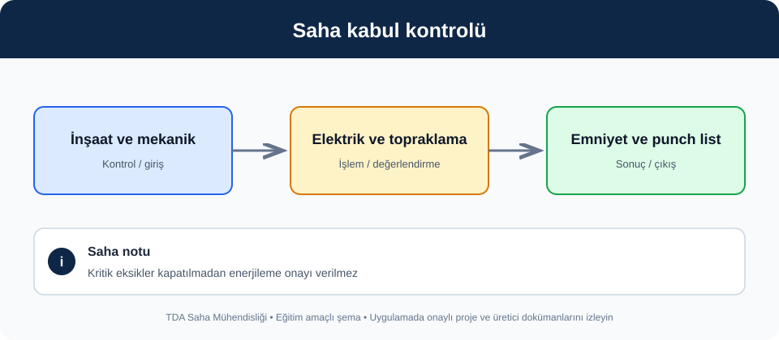

# 📍 Gün 28 — Saha Kabul: İnşaat, Mekanik ve Elektrik Hazırlık Kontrolü

## 🎯 Günün Hedefleri

-   [x] Şalt sahası kabul kontrol listesini hazırlamak.
-   [x] İnşaat, mekanik ve elektrik hazırlık kontrol noktalarını öğrenmek.
-   [x] Tesisat devreye alma öncesi emniyet hazırlığını değerlendirmek.
-   [x] Enerjileme öncesi kalan eksikleri (punch list) yönetmek.

---

## 📚 Özet Çalışma Notları

### 1. Kabul Kontrol Grupları

| Grup      | Kontrol Noktaları                             |
| :-------- | :-------------------------------------------- |
| **İnşaat**| Temel, duvar, çatı, drenaj, kapı-boyut       |
| **Mekanik**| Havalandırma, yangın, kapı kilitleri, tabela |
| **Elektrik**| Aydınlatma, priz, topraklama, güvenlik     |
| **Emniyet**| Yangın söndürme, ilk yardım, çıkış yolları  |

### 2. Topraklama Kabul

-   [ ] Ana toprak barası bağlı, etiketli.
-   [ ] Toprak elektrodları (çubuk/ring) montajlı.
-   [ ] $R_a$ ölçümü yapılmış, proje değeri içinde.
-   [ ] Ekvipotansiyel bağlantılar tamam.
-   [ ] Kapakları metal parçalar topraklı.

### 3. Elektrik Hazırlık Kontrolleri

-   [ ] Aydınlatma 2 katlı (normal + acil) çalışıyor.
-   [ ] Prizler topraklı, sigortalı.
-   [ ] AC/DC dağıtım panosu enerjilendirilebilir.
-   [ ] Akü/redktör kurulu ve çalışıyor.
-   [ ] Tabela ve uyarı levhaları takılı.

### 4. Punch List (Eksik Listesi)

Enerjileme öncesi tespit edilen eksikler:

| No | Tanım                          | Sorumlu | Hedef Tarih | Durum |
| :-- | :----------------------------- | :------ | :---------- | :---- |
| 1  | Kapı kilit mekanizması         | Mekanik | XX/XX       | Açık  |
| 2  | Fider F3 tabela eksik          | Elektrik| XX/XX       | Kapalı|

> ⚡ **Kural:** Kritik punch item kapatılmadan enerjileme yapılmaz.

---

## 🔗 Detaylı Notlar

Kontrol listeleri, tipik sorunlar ve kabul protokol örneği için:
👉 **[28. Gün Detaylı Teknik Notları (detail.md)](./detail.md)**
