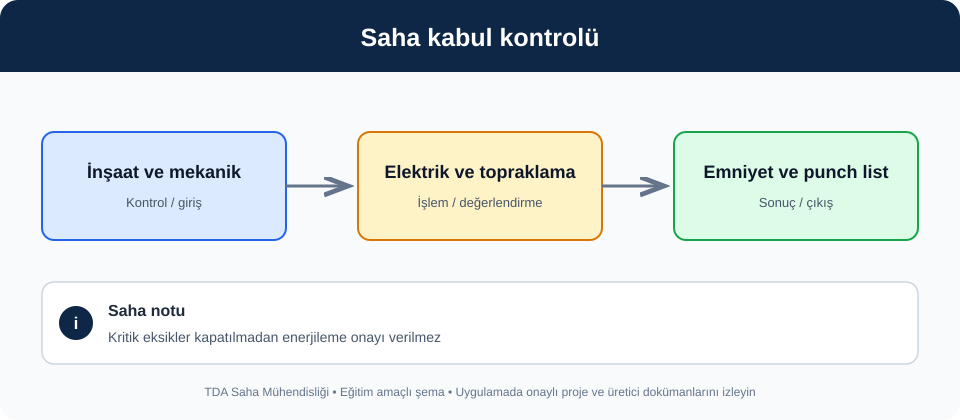

# 📖 Gün 28 — Saha Kabul: Kontrol Listeleri, Punch List ve Kabul Protokolü (Teknik Detaylar)

Bu doküman, 28. Gün çalışması kapsamında incelenen **şalt sahası kabul kontrol listeleri**, **tipik sorunlar** ve **kabul protokolü** konularını içerir.

---

## 1. İnşaat Kontrol Listesi

### 1.1. Temel ve Yapı

-   [ ] Temel düz (±5 mm/m), ankraj cıvataları doğru konumda.
-   [ ] Kablo kanalları (döşeme altı) temiz, kapakları takılı.
-   [ ] Drenaj çalışıyor — su birikmesi yok.
-   [ ] Duvar ve çatı sızdırmaz — rutubet izi yok.
-   [ ] Kapı boyutları ekipman giriş ölçülerine uygun.
-   [ ] Zemin yük kapasitesi (trafo yerleştirme için yeterli).

### 1.2. Kablolama Kanalları

-   [ ] Primer kablo kanalları: Eğim, su girişi engellenmiş.
-   [ ] Sekonder kablo kanalları: Ayrı, demetleme yapılmış.
-   [ ] Yangın bölme noktaları (fire stop) uygulanmış.
-   [ ] Kablo demirleri ve kanca montajlı.

---

## 2. Mekanik Kontrol Listesi

### 2.1. Havalandırma

-   [ ] Fan çalışıyor, termostat kontrolü aktif.
-   [ ] Filtreler temiz (hava emişi).
-   [ ] Yangın damperi (fire damper) çalışıyor.
-   [ ] Havalandırma kapasitesi trafo ısı kaybına uygun.

### 2.2. Yangın Koruması

-   [ ] Söndürme sistemi (CO₂, FM-200, sisleme) kuruldu.
-   [ ] Dedektörler (duman, sıcaklık) konumlandırıldı.
-   [ ] Alarm panosu çalışıyor, SCADA'ya bağlı.
-   [ ] Yangın söndürücü (manüel) yerinde, etiketli.

### 2.3. Kapı ve Kilitler

-   [ ] Kapılar ekipman montajına izin veriyor.
-   [ ] Kilit sistemi (anahtar kartı veya kilitli) çalışıyor.
-   [ ] Kapak kapama sınırlayıcıları doğru.
-   [ ] Yönlendirme işaretleri (çıkış, acil) takılı.

---

## 3. Elektrik Hazırlık Kontrol Listesi

### 3.1. Aydınlatma ve Priz

-   [ ] Normal aydınlatma ≥ 200 lux (çalışma seviyesi).
-   [ ] Acil aydınlatma 1 saat sürer.
-   [ ] Prizler: topraklı, RCD korumalı (30 mA).
-   [ ] Aydınlatma anahtarları kapı yanında.

### 3.2. DC Dağıtım Sistemi

-   [ ] Akü/redktör kuruldu, çalışıyor.
-   [ ] DC bara gerilimi nominal (110 V ±%5).
-   [ ] İzolasyon izleme rölesi çalışıyor.
-   [ ] Sigortalar doğru değerlerde, etiketli.

### 3.3. Topraklama

-   [ ] Ana toprak barası bağlı, etiketli.
-   [ ] Toprak elektrodları (çubuk/ring) montajlı.
-   [ ] $R_a$ ölçümü yapılmış, proje değeri içinde.
-   [ ] Ekvipotansiyel bağlantılar tamam.
-   [ ] Panolar, kapaklar, kablolar topraklı.

### 3.4. İşaretleme

-   [ ] "Yüksek Gerilim — Ölüm Tehlikesi" levhaları.
-   [ ] Fider etiketleri (her panoda).
-   [ ] Topraklama noktası işaretleri.
-   [ ] Acil çıkış işaretleri.

---

## 4. Emniyet Hazırlığı

### 4.1. İlk Yardım

-   [ ] İlk yardım kiti (tam dolu, son kullanma tarihi geçerli).
-   [ ] Otonom defibrilatör (AED) — varsa.
-   [ ] İlk yardım eğitim kayıtları personelde.

### 4.2. Acil Durum Planı

-   [ ] Tahliye planı duvarlarda.
-   [ ] Toplanma alanı işaretli.
-   [ ] Acil telefon numaraları panosunda.
-   [ ] Yangın tatbikatı yapılmış (personel bilgili).

---

## 5. Punch List Yönetimi

### 5.1. Klasifikasyon

| Tip      | Tanım                                     | Enerjileme etkisi |
| :------- | :---------------------------------------- | :---------------- |
| **Kritik** | Emniyet/fonksiyon riski (topraklama eksik)| **Bloke eder**    |
| **Major**  | İşletmeyi etkiler ama bloke etmez        | Ertelenebilir     |
| **Minor**  | Kozmetik (boya, tabela rengi)            | Ertelenebilir     |

### 5.2. Punch List Tablosu

| No | Tanım                    | Sınıf   | Sorumlu  | Hedef Tarih | Durum | Kapatma İmzası |
| :-- | :---------------------- | :------ | :------- | :---------- | :---- | :------------- |
| 1  | F3 topraklama eksik     | Kritik  | Elektrik | XX/XX       | Açık  | —              |
| 2  | F3 tabela eksik         | Minor   | Elektrik | XX/XX       | Kapalı| ✓              |

### 5.3. Kapatma Süreci

1.  Düzeltme yapılır.
2.  TDA mühendisi kontrol eder.
3.  Müşteri temsilcisi onaylar (imza).
4.  Punch list güncellenir, revizyon artırılır.

---

## 6. Kabul Protokolü Örneği

```
KABUL PROTOKOLÜ — XXX Trafo Merkezi

Tarih: 2024-XX-XX
Konum: XXX, Türkiye

Taraflar:
- TDA Mühendisi: ______
- Müşteri Temsilcisi: ______
- Elektrik Kuruluşu: ______

Kontrol Edilen:
☑ İnşaat yapısı tam
☑ Mekanik sistemler çalışıyor
☑ Elektrik hazırlık tamam
☑ Topraklama ölçümü uygun (Ra = 0.8 Ω)
☑ Emniyet ekipmanları yerinde

Sonuç:
☐ Kabul edildi — enerjileme izni verildi
☐ Koşullu kabul — punch list ile (ek: ___)
☐ Red — eksikler giderilip tekrar kontrol

İmzalar:
TDA: ______   Müşteri: ______   Kuruluş: ______
```

---

## 7. Tipik Sorunlar ve Dersler

| Sorun                                  | Çözüm                                  |
| :------------------------------------- | :------------------------------------- |
| Kablolama kanalları su dolu            | Drenaj düzenlemesi, kablo yenileme     |
| Topraklama direnci yüksek              | Ek elektrod veya kimyasal toprak       |
| Havalandırma yetersiz (trafo ısınıyor) | Fan kapasitesi artırımı                |
| Tabela eksik                           | Punch list, enerjileme öncesi tamamlama|
| Acil aydınlatma çalışmıyor             | Batarya kontrol, devre kontrolü        |

---



## 🔗 İlgili Kaynaklar

-   _IEC 61936 — Power Installations Exceeding 1 kV_
-   _EN 50110 — Elektrik Tesisatlarında İşletme_
-   _TEİAŞ Şalt Sahası Tasarım Rehberi_
