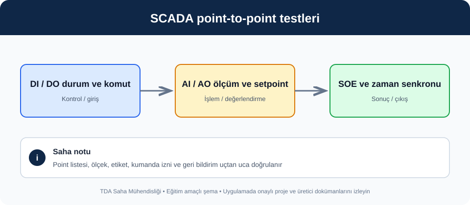

# 📍 Gün 29 — SCADA Point Testleri ve Uzaktan Kumanda Doğrulama

## 🎯 Günün Hedefleri

-   [x] SCADA point listesini okumak ve doğrulamak.
-   [x] DI/DO/AI/AO sinyal testlerini tek tek uygulamak.
-   [x] Komut mantığını (select-before-operate) doğrulamak.
-   [x] Zaman senkronizasyonu ve SOE kayıtlarını kontrol etmek.

---

## 📚 Özet Çalışma Notları

### 1. Point Tipleri

| Tip | Anlam               | Örnek                          |
| :-- | :------------------ | :----------------------------- |
| DI  | Digital Input       | Kesici açık/kapalı, alarm      |
| DO  | Digital Output      | Trip/Close komutları           |
| AI  | Analog Input        | Akım, gerilim, güç ölçümü      |
| AO  | Analog Output       | Setpoint, tap changer komutu   |
| SOE | Sequence of Events  | Zaman damgalı olay kaydı       |

### 2. Point-to-Point Test Mantığı

Her point için:
1.  Sahada sinyal **tetiklenir** (fiziksel olarak).
2.  RTU/Gateway'de sinyal **doğru algılanır**.
3.  Master Station'da sinyal **doğru görüntülenir**.
4.  Zaman damgası doğru.
5.  Etiket ve açıklama doğru.

### 3. Komut Testleri

-   **Select-Before-Operate (SBO):** İki aşamalı komut — önce select, sonra execute.
-   **Timeout:** Select sonrası 60 s içinde execute yapılmazsa komut iptal.
-   **Interlock SCADA tarafı:** Komut verilmeden önce saha interlock kontrolü.

### 4. Zaman Senkronizasyonu

-   **NTP/PTP/GPS:** Tüm IED'ler aynı saati kullanmalı.
-   **Kabul:** Sapma < ±1 ms.
-   **SOE hassasiyeti:** Olay sırası doğru — en yakın olay milisaniye seviyesinde.

---

## 🔗 Detaylı Notlar

Point tablosu örneği, protokol detayları ve tipik hatalar için:
👉 **[29. Gün Detaylı Teknik Notları (detail.md)](./detail.md)**
